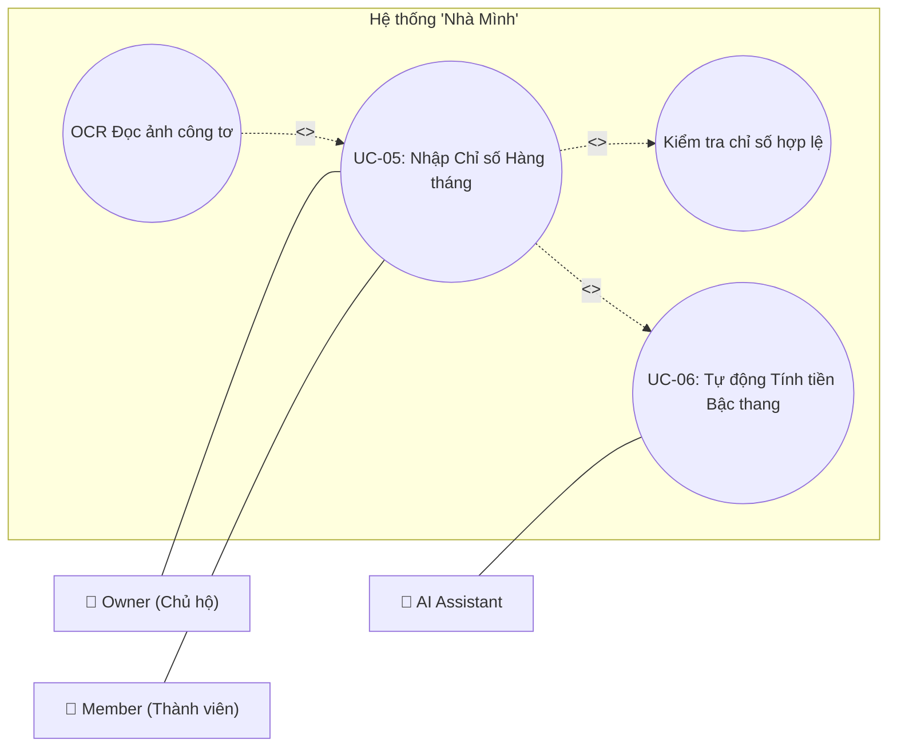

# Master Skill: UML Use Case Diagram Generator – Hệ Thống "Nhà Mình"

Skill này định nghĩa các quy tắc chuẩn UML 2.x, cấu trúc Actor, 12 Use Case chính, và cú pháp sinh sơ đồ (Mermaid & PlantUML) cho báo cáo đồ án của hệ thống **"Nhà Mình"** (Hệ thống Quản lý Hóa đơn Điện Nước Hộ Gia Đình tích hợp AI).

---

## 1. VAI TRÒ VÀ NGUYÊN TẮC BẮT BUỘC

Khi thực hiện yêu cầu sinh sơ đồ Use Case cho hệ thống "Nhà Mình":
- **Không tự ý thêm/bớt chức năng** ngoài tài liệu dự án.
- **Không tự ý đổi tên Actor, Use Case, mã UC/FR**.
- **Không tự ý thêm quan hệ UML** (`<<include>>`, `<<extend>>`, `Generalization`) trừ khi tài liệu hoặc logic đặc tả nghiệp vụ thực sự quy định.
- **Tính nhất quán**: Mọi sơ đồ Mermaid/PlantUML sinh ra phải dùng chung danh xưng, mã số và chuẩn vẽ UML 2.x.

---

## 2. CHUẨN ACTOR HỆ THỐNG (4 ACTORS)

| Actor Name | Tên Hiển Thị | Mô Tả & Quyền Hạn Nghiệp Vụ |
|---|---|---|
| **Owner** | Chủ hộ | Tạo hộ gia đình, mời/xóa thành viên, quản lý công tơ, nhập chỉ số, thanh toán hóa đơn, tương tác với AI Assistant. |
| **Member** | Thành viên | Xem thông tin hộ gia đình, nhập chỉ số hàng tháng, xem hóa đơn, đánh dấu thanh toán thủ công. |
| **Admin** | Quản trị viên | Quản lý người dùng, khóa/mở khóa tài khoản, cấu hình biểu giá điện nước bậc thang, xem Audit Log hệ thống. |
| **AI Assistant** | Trợ lý AI Agent | Tác nhân AI hỗ trợ dự báo sản lượng tiêu thụ, phát hiện bất thường chỉ số, trả lời truy vấn RAG theo kiến thức hộ. |

> **Lưu ý**: Các hệ thống tự động nội bộ (như Cron Job tính tiền bậc thang) không tạo thành Actor nếu không có tác nhân bên ngoài kích hoạt trực tiếp.

---

## 3. DANH SÁCH 12 USE CASE CHÍNH

| Mã UC | Tên Use Case Standard | Actor Chính | Tóm Tắt Nghiệp Vụ |
|---|---|---|---|
| **UC-01** | Đăng ký & Đăng nhập | User (Guest/Owner/Member), Admin | Xác thực người dùng, OTP/Email, JWT, OAuth2, Phân quyền RBAC. |
| **UC-02** | Wizard Onboarding Hộ | Owner | Khởi tạo hộ mới, thiết lập thông tin ban đầu, cấu hình loại công tơ. |
| **UC-03** | Quản lý Thành viên | Owner | Mời thành viên qua Email/Code, phân quyền, duyệt/xóa thành viên khỏi hộ. |
| **UC-04** | Quản lý Công tơ | Owner, Member | Thêm/sửa/xóa công tơ điện/nước, gán mã công tơ, xem trạng thái hoạt động. |
| **UC-05** | Nhập Chỉ số Hàng tháng | Owner, Member | Ghi nhận chỉ số mới (bằng tay hoặc OCR hình ảnh công tơ), validate chỉ số âm/bất thường. |
| **UC-06** | Tự động Tính tiền Bậc thang | System (Nội bộ) | Tính toán tiền điện/nước theo lũy tiến bậc thang quy định bởi Nhà nước / Cấu hình Admin. |
| **UC-07** | Truy vấn & Chi tiết Hóa đơn | Owner, Member | Xem danh sách hóa đơn theo tháng, chi tiết sản lượng & số tiền theo từng bậc. |
| **UC-08** | Ghi nhận Thanh toán | Owner, Member | Thanh toán qua cổng VNPay/Momo/Banking hoặc đánh dấu thanh toán tiền mặt thủ công. |
| **UC-09** | Thống kê & Cảnh báo | Owner, Member | Biểu đồ tiêu thụ điện/nước, cảnh báo vượt ngưỡng hạn mức đặt trước. |
| **UC-10** | Hỏi đáp Trợ lý AI Agent | Owner, Member | Tra cứu hóa đơn, hỏi mẹo tiết kiệm điện/nước qua giao diện Chatbot RAG. |
| **UC-11** | AI Dự báo & Bất thường | AI Assistant | AI phân tích chuỗi thời gian tiêu thụ, phát hiện chỉ số nhảy vọt/rò rỉ, dự báo hóa đơn cuối tháng. |
| **UC-12** | Quản trị Hệ thống | Admin | Quản lý danh sách User, khóa tài khoản, cập nhật biểu giá điện/nước, xem nhật ký Audit Log. |

---

## 4. QUY TẮC PHÂN TÍCH QUAN HỆ UML 2.X

### 4.1 Association (Quan hệ Tác nhân - Use Case)
- Biểu diễn mối liên kết giữa Actor và Use Case mà Actor tham gia.
- **Đường nét liền không mũi tên**: `Actor --- UseCase` (PlantUML: `Actor -- UC`, Mermaid: `Actor --- UC`).
- Không dùng đường nét đứt, không thêm arrowhead trừ trường hợp giao tiếp 1 chiều đặc thù.

### 4.2 System Boundary (Ranh giới Hệ thống)
- Tất cả Use Case **bắt buộc** nằm trong một khung hình chữ nhật System Boundary.
- Tên Boundary tổng thể: **`Hệ thống "Nhà Mình"`**
- Tên Boundary cho sơ đồ phân hệ: **`Hệ thống Quản lý Hóa đơn Điện Nước – [Mã UC]`**
- Actor **bắt buộc** nằm **bên ngoài** System Boundary.

### 4.3 Quan hệ `<<include>>` (Bắt buộc bao hàm)
- Sử dụng khi Use Case A **bắt buộc luôn thực hiện** Use Case B trong luồng chính.
- Mũi tên đường nét đứt hướng từ **Use Case A đến Use Case B**: `UC_A .> UC_B : <<include>>`.
- Ví dụ: `UC-05 Nhập Chỉ số` **`<<include>>`** `Kiểm tra hợp lệ chỉ số`.

### 4.4 Quan hệ `<<extend>>` (Mở rộng có điều kiện)
- Sử dụng khi Use Case A là hành vi **mở rộng tùy chọn/có điều kiện** của Use Case B (Extension Point).
- Mũi tên đường nét đứt hướng từ **Use Case Mở rộng (A) về Use Case Cơ sở (B)**: `UC_Ext .> UC_Base : <<extend>>`.
- Ví dụ: `Nhận biết chỉ số qua OCR` **`<<extend>>`** `UC-05 Nhập Chỉ số`.

### 4.5 Generalization (Kế thừa)
- Chỉ dùng khi có quan hệ cha-con rõ ràng giữa các Actor hoặc giữa các Use Case (ví dụ: `Thanh toán VNPay` kế thừa `Thanh toán`).

---

## 5. CÚ PHÁP CHUẨN PLANTUML & MERMAID

### 5.1 Template PlantUML Chuẩn
```plantuml
@startuml
left to right direction
skinparam packageStyle rectangle
skinparam shadowing false
skinparam actor {
    BackgroundColor White
    BorderColor #1E293B
}
skinparam usecase {
    BackgroundColor #F8FAFC
    BorderColor #0EA5E9
}

actor "Owner\n(Chủ hộ)" as Owner
actor "Member\n(Thành viên)" as Member
actor "AI Assistant\n(Trợ lý AI)" as AI

rectangle "Hệ thống \"Nhà Mình\"" {
    usecase "UC-05: Nhập Chỉ số Hàng tháng" as UC05
    usecase "UC-06: Tự động Tính tiền Bậc thang" as UC06
    usecase "Kiểm tra chỉ số hợp lệ" as SubVal
    usecase "OCR Đọc ảnh công tơ" as SubOCR

    UC05 .> SubVal : <<include>>
    SubOCR .> UC05 : <<extend>>
    UC05 .> UC06 : <<include>>
}

Owner -- UC05
Member -- UC05
AI -- UC06
@enduml
```

### 5.2 Template Mermaid Chuẩn


---

## 6. THƯ MỤC TÀI LIỆU THAM KHẢO & ĐẶC TẢ

Để xem đặc tả chi tiết 12 Use Case và các đoạn mã sơ đồ mẫu, đọc thêm tại:
- Specialization Specs & Diagrams: `references/use-case-specifications.md`
- UML Rules & Syntax Reference: `references/uml-rules-and-syntax.md`

---

## 7. CHECKLIST KIỂM TRA SƠ ĐỒ TRƯỚC KHI BÁO CÁO

- [ ] Actor nằm bên ngoài System Boundary?
- [ ] Tên System Boundary chính xác: `Hệ thống "Nhà Mình"`?
- [ ] Tên Use Case trong oval ngắn gọn, mang ý nghĩa hành động (Động từ + Danh từ)?
- [ ] Đường nối Actor - Use Case là đường thẳng không mũi tên?
- [ ] Mũi tên `<<include>>` chĩa từ Use Case chính đến Use Case con được gọi?
- [ ] Mũi tên `<<extend>>` chĩa từ Use Case mở rộng về Use Case gốc?
- [ ] Không có Actor thừa ngoài 4 Actor chuẩn (Owner, Member, Admin, AI Assistant)?
- [ ] Mã Use Case đồng bộ với tài liệu (UC-01 đến UC-12)?
