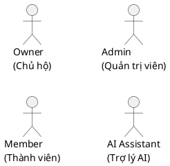
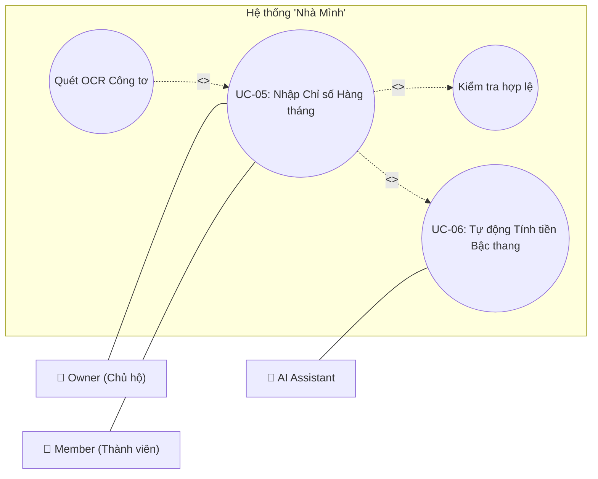

# Hướng dẫn Quy tắc UML 2.x & Cú pháp Vẽ Sơ đồ (PlantUML & Mermaid)

Tài liệu hướng dẫn chi tiết các quy tắc vẽ sơ đồ Use Case chuẩn ISO/IEC 19505 (UML 2.x) áp dụng cho đồ án đại học và báo cáo kiến trúc hệ thống **"Nhà Mình"**.

---

## 1. QUY TẮC PHÂN TÍCH ACTOR VÀ SYSTEM BOUNDARY

### 1.1 Vị trí và Biểu diễn Actor
- **Hình người que (Stick figure)**: Trong UML, Actor phải luôn biểu diễn bằng hình người que (hoặc icon đặc tả tác nhân) kèm tên Actor nằm dưới.
- **Nằm bên ngoài System Boundary**: Actor **tuyệt đối không được vẽ bên trong khung System Boundary**. Actor đại diện cho các đối tượng hoặc hệ thống bên ngoài tương tác với hệ thống.
- **Phân biệt Actor và User**:
  - `Owner` (Chủ hộ): Người sở hữu hộ gia đình trên ứng dụng.
  - `Member` (Thành viên): Người thuộc hộ gia đình, có quyền xem/nhập số.
  - `Admin` (Quản trị): Người vận hành nền tảng.
  - `AI Assistant` (Trợ lý AI): Tác nhân thông minh thực hiện dự báo và trả lời RAG.

### 1.2 System Boundary
- Là khung hình chữ nhật bao quanh tất cả các Use Case.
- Tên hệ thống bắt buộc ghi rõ trên đầu khung: **`Hệ thống "Nhà Mình"`** hoặc **`Hệ thống Quản lý Hóa đơn Điện Nước – [Mã phân hệ]`**.

---

## 2. QUY TẮC ASSOCIATION (MÁC NỐI TÁC NHÂN - USE CASE)

- Đường nối Association là **đường thẳng nét liền (Solid line)** kết nối giữa Actor và Use Case.
- **KHÔNG DÙNG MŨI TÊN**: Trong UML 2.x chuẩn, Association thông thường thể hiện sự tương tác 2 chiều giữa Actor và Use Case, do đó **không có mũi tên** ở hai đầu.
- **KHÔNG DÙNG NÉT ĐỨT**: Nét đứt chỉ dành cho quan hệ phụ thuộc như `<<include>>` và `<<extend>>`.

---

## 3. PHÂN BIỆT RÕ RÀNG `<<include>>` VÀ `<<extend>>`

### 3.1 Quan hệ `<<include>>`
- **Ý nghĩa**: Use Case A **bắt buộc phải kích hoạt/thực hiện** Use Case B trong mọi trường hợp khi A được gọi.
- **Chiều mũi tên**: Mũi tên nét đứt chĩa từ **Use Case A (Chính)** $\rightarrow$ **Use Case B (Được bao hàm)**.
- **Ký hiệu Stereotype**: `<<include>>`
- **Ví dụ**:
  - `UC-05 Nhập Chỉ số` $\rightarrow$ `<<include>>` $\rightarrow$ `Kiểm tra tính hợp lệ chỉ số`
  - `UC-05 Nhập Chỉ số` $\rightarrow$ `<<include>>` $\rightarrow$ `UC-06 Tự động tính tiền bậc thang`

### 3.2 Quan hệ `<<extend>>`
- **Ý nghĩa**: Use Case A (Mở rộng) là hành vi **tùy chọn hoặc chỉ xảy ra khi thỏa mãn điều kiện nhất định** của Use Case B (Cơ sở).
- **Chiều mũi tên**: Mũi tên nét đứt chĩa từ **Use Case A (Mở rộng)** $\rightarrow$ **Use Case B (Cơ sở)** (Chú ý: Ngược lại với include!).
- **Ký hiệu Stereotype**: `<<extend>>`
- **Ví dụ**:
  - `Quét ảnh OCR bằng AI` $\rightarrow$ `<<extend>>` $\rightarrow$ `UC-05 Nhập Chỉ số`
  - `Cảnh báo chỉ số bất thường` $\rightarrow$ `<<extend>>` $\rightarrow$ `UC-09 Thống kê & Cảnh báo`

---

## 4. CÚ PHÁP PLANTUML CHI TIẾT

### 4.1 Khai báo Actor & Skinparam


### 4.2 Khai báo System Boundary & Use Case
```plantuml
rectangle "Hệ thống \"Nhà Mình\"" {
    usecase "UC-05: Nhập Chỉ số Hàng tháng" as UC05
    usecase "UC-06: Tự động Tính tiền Bậc thang" as UC06
    usecase "Quét OCR Công tơ" as SubOCR
    usecase "Kiểm tra hợp lệ" as SubVal

    ' Quan hệ include (Mũi tên chĩa sang bên phải/được include)
    UC05 .> SubVal : <<include>>
    UC05 .> UC06 : <<include>>

    ' Quan hệ extend (Mũi tên chĩa về UC cơ sở)
    SubOCR .> UC05 : <<extend>>
}
```

### 4.3 Khai báo Association
```plantuml
' Nối Actor với Use Case bằng 2 dấu gạch ngang (không mũi tên)
Owner -- UC05
Member -- UC05
AI -- UC06
@enduml
```

---

## 5. CÚ PHÁP MERMAID CHI TIẾT

### 5.1 Khai báo subgraph & Node


---

## 6. NHỮNG LỖI THƯỜNG GẶP CẦN TRÁNH TRONG BÁO CÁO ĐỒ ÁN

| Lỗi sai thường gặp | Hậu quả / Vi phạm | Cách sửa đúng |
|---|---|---|
| Vẽ Actor nằm bên trong hình chữ nhật System Boundary | Vi phạm quy tắc UML 2.x cơ bản | Di chuyển tất cả Actor ra phía ngoài khung System Boundary |
| Đặt mũi tên ở đường nối giữa Actor và Use Case | Sai ý nghĩa Association 2 chiều | Sử dụng đường thẳng liền nét không mũi tên (`--` / `---`) |
| Vẽ mũi tên `<<extend>>` hướng từ Use Case cơ sở sang Use Case mở rộng | Đảo ngược chiều quan hệ extend | Xoay mũi tên `<<extend>>` chĩa từ Use Case mở rộng **về lại** Use Case cơ sở |
| Đưa các câu văn quá dài vào ellipse Use Case | Làm rối sơ đồ | Dùng tên ngắn gọn (Động từ + Danh từ) ví dụ `Nhập chỉ số`, `Xem hóa đơn` |
| Tự bịa tên Actor mới không có trong thiết kế | Làm mất tính thống nhất báo cáo | Chỉ dùng 4 Actor chuẩn: `Owner`, `Member`, `Admin`, `AI Assistant` |
