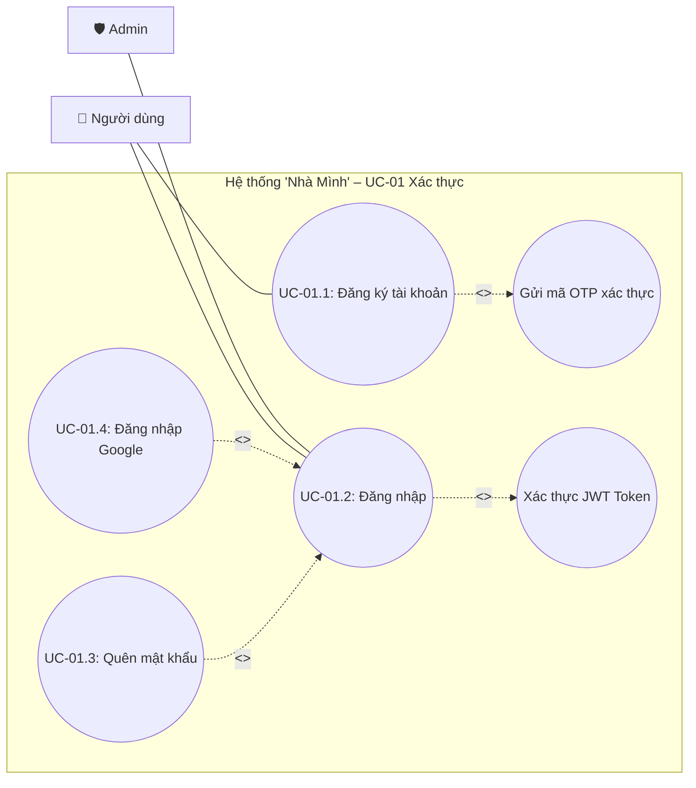
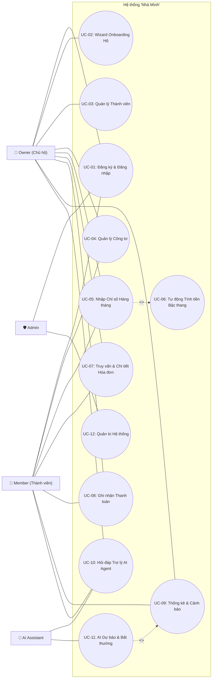

# Đặc tả Chi tiết 12 Use Case & Sơ đồ Mẫu - Hệ Thống "Nhà Mình"

Tài liệu này chứa thông tin đặc tả chi tiết của 12 Use Case chính trong hệ thống **"Nhà Mình"** (Hệ thống Quản lý Hóa đơn Điện Nước Hộ Gia Đình tích hợp AI), cùng mã nguồn sơ đồ mẫu dưới hai dạng **PlantUML** và **Mermaid**.

---

## UC-01: Đăng ký & Đăng nhập

- **Mã UC**: UC-01
- **Tên Use Case**: Đăng ký & Đăng nhập
- **Actor chính**: User (Khách / Owner / Member), Admin
- **Tóm tắt**: Người dùng đăng ký tài khoản mới bằng Email/Số điện thoại, nhận OTP xác thực hoặc đăng nhập qua OAuth2 (Google), nhận Token JWT. Admin đăng nhập vào trang quản trị hệ thống.
- **Yêu cầu chức năng (FR)**: FR-AUTH-01 (Đăng ký), FR-AUTH-02 (Đăng nhập), FR-AUTH-03 (Quên mật khẩu / OTP), FR-AUTH-04 (Google OAuth2).
- **Quan hệ UML**:
  - `Đăng nhập` `<<include>>` `Xác thực JWT Token`
  - `Đăng ký` `<<include>>` `Gửi mã OTP qua Email`
  - `Đăng nhập Google` `<<extend>>` `Đăng nhập`
  - `Quên mật khẩu` `<<extend>>` `Đăng nhập`

### Sơ đồ PlantUML (UC-01)
```plantuml
@startuml
left to right direction
skinparam packageStyle rectangle

actor "Người dùng" as User
actor "Quản trị viên" as Admin

rectangle "Hệ thống \"Nhà Mình\" – UC-01 Xác thực" {
    usecase "UC-01.1: Đăng ký tài khoản" as UC_Reg
    usecase "UC-01.2: Đăng nhập" as UC_Login
    usecase "UC-01.3: Quên mật khẩu" as UC_Forgot
    usecase "UC-01.4: Đăng nhập Google OAuth2" as UC_Google
    usecase "Gửi mã OTP xác thực" as Sub_OTP
    usecase "Xác thực JWT & Phân quyền" as Sub_JWT

    UC_Reg .> Sub_OTP : <<include>>
    UC_Login .> Sub_JWT : <<include>>
    UC_Forgot .> UC_Login : <<extend>>
    UC_Google .> UC_Login : <<extend>>
}

User -- UC_Reg
User -- UC_Login
Admin -- UC_Login
@enduml
```

### Sơ đồ Mermaid (UC-01)


---

## UC-02: Wizard Onboarding Hộ

- **Mã UC**: UC-02
- **Tên Use Case**: Wizard Onboarding Hộ
- **Actor chính**: Owner (Chủ hộ)
- **Tóm tắt**: Hướng dẫn Chủ hộ mới tạo thông tin hộ gia đình đầu tiên, thiết lập thông số công tơ ban đầu (điện 6 bậc, nước sạch), cài đặt mốc ngày ghi chỉ số hàng tháng.
- **Yêu cầu chức năng (FR)**: FR-ONB-01 (Tạo Hộ mới), FR-ONB-02 (Cấu hình Công tơ ban đầu), FR-ONB-03 (Đặt Ngày chốt sổ hàng tháng).
- **Quan hệ UML**:
  - `Wizard Onboarding Hộ` `<<include>>` `Khởi tạo Công tơ mặc định`

---

## UC-03: Quản lý Thành viên

- **Mã UC**: UC-03
- **Tên Use Case**: Quản lý Thành viên
- **Actor chính**: Owner (Chủ hộ)
- **Tóm tắt**: Owner gửi lời mời tham gia hộ cho thành viên khác qua Email hoặc Mã mời (Invite Code), duyệt thành viên vào hộ, phân quyền thao tác hoặc xóa thành viên khỏi hộ.
- **Yêu cầu chức năng (FR)**: FR-MEM-01 (Tạo mã mời), FR-MEM-02 (Duyệt thành viên), FR-MEM-03 (Xóa/Chặn thành viên).
- **Quan hệ UML**:
  - `Tạo mã/link mời` `<<extend>>` `Quản lý Thành viên`
  - `Gửi Mail mời` `<<include>>` `Tạo mã/link mời`

---

## UC-04: Quản lý Công tơ

- **Mã UC**: UC-04
- **Tên Use Case**: Quản lý Công tơ
- **Actor chính**: Owner, Member
- **Tóm tắt**: Quản lý danh sách các công tơ điện và nước trong hộ gia đình (ví dụ: Công tơ tầng 1, công tơ phòng trọ, công tơ nước chính). Thêm công tơ mới, cập nhật thông tin vị trí, mã công tơ, hoặc tạm ngừng theo dõi.
- **Yêu cầu chức năng (FR)**: FR-MTR-01 (Thêm công tơ), FR-MTR-02 (Cập nhật công tơ), FR-MTR-03 (Danh sách công tơ).

---

## UC-05: Nhập Chỉ số Hàng tháng

- **Mã UC**: UC-05
- **Tên Use Case**: Nhập Chỉ số Hàng tháng
- **Actor chính**: Owner, Member
- **Tóm tắt**: Nhập số điện/nước chốt của tháng. Hệ thống hỗ trợ nhập tay hoặc quét ảnh hóa đơn/ảnh công tơ qua AI OCR để tự động điền số. Kiểm tra logic chỉ số mới phải lớn hơn hoặc bằng chỉ số tháng trước.
- **Yêu cầu chức năng (FR)**: FR-RDG-01 (Nhập chỉ số thủ công), FR-RDG-02 (Quét AI OCR ảnh công tơ), FR-RDG-03 (Validation chỉ số hợp lệ).
- **Quan hệ UML**:
  - `Nhập Chỉ số Hàng tháng` `<<include>>` `Kiểm tra logic chỉ số`
  - `Quét OCR từ ảnh công tơ` `<<extend>>` `Nhập Chỉ số Hàng tháng`
  - `Nhập Chỉ số Hàng tháng` `<<include>>` `UC-06 Tự động Tính tiền Bậc thang`

---

## UC-06: Tự động Tính tiền Bậc thang

- **Mã UC**: UC-06
- **Tên Use Case**: Tự động Tính tiền Bậc thang
- **Actor chính**: System (Nội bộ) / Trực tiếp kích hoạt bởi UC-05
- **Tóm tắt**: Sau khi nhận chỉ số tháng mới, hệ thống tự động tính sản lượng tiêu thụ ($kWh$ điện hoặc $m^3$ nước) và áp dụng biểu giá bậc thang lũy tiến (ví dụ 6 bậc điện EVN, bậc nước sinh hoạt) kèm thuế VAT và phí môi trường để ra tổng tiền hóa đơn.
- **Yêu cầu chức năng (FR)**: FR-CALC-01 (Tính sản lượng), FR-CALC-02 (Áp biểu giá bậc thang EVN/Nước), FR-CALC-03 (Tính Thuế VAT & Phí BVMT).

---

## UC-07: Truy vấn & Chi tiết Hóa đơn

- **Mã UC**: UC-07
- **Tên Use Case**: Truy vấn & Chi tiết Hóa đơn
- **Actor chính**: Owner, Member
- **Tóm tắt**: Xem danh sách hóa đơn theo từng tháng, lọc theo trạng thái (Đã thanh toán / Chưa thanh toán), xem chi tiết số tiền từng bậc tiêu thụ, tải file hóa đơn dạng PDF hoặc chia sẻ cho thành viên hộ.
- **Yêu cầu chức năng (FR)**: FR-INV-01 (Tra cứu hóa đơn), FR-INV-02 (Chi tiết phân rã bậc thang), FR-INV-03 (Xuất File PDF Hóa đơn).

---

## UC-08: Ghi nhận Thanh toán

- **Mã UC**: UC-08
- **Tên Use Case**: Ghi nhận Thanh toán
- **Actor chính**: Owner, Member
- **Tóm tắt**: Thực hiện thanh toán hóa đơn trực tuyến qua cổng thanh toán VNPay/Momo/QR Banking, hoặc cho phép Owner/Member tự đánh dấu "Đã thanh toán thủ công" khi trả tiền mặt.
- **Yêu cầu chức năng (FR)**: FR-PAY-01 (Thanh toán VNPay/Momo), FR-PAY-02 (Đánh dấu thanh toán tiền mặt), FR-PAY-03 (Xác nhận trạng thái hóa đơn).

---

## UC-09: Thống kê & Cảnh báo

- **Mã UC**: UC-09
- **Tên Use Case**: Thống kê & Cảnh báo
- **Actor chính**: Owner, Member
- **Tóm tắt**: Cung cấp biểu đồ trực quan hóa lượng điện nước tiêu thụ qua các tháng, so sánh cùng kỳ năm trước. Phát cảnh báo qua App/Email/Telegram khi lượng điện/nước tiêu thụ trong tháng vượt quá hạn mức cài đặt.
- **Yêu cầu chức năng (FR)**: FR-STAT-01 (Biểu đồ so sánh sản lượng), FR-STAT-02 (Cài đặt hạn mức cảnh báo), FR-STAT-03 (Gửi thông báo Push Notification/Email).

---

## UC-10: Hỏi đáp Trợ lý AI Agent

- **Mã UC**: UC-10
- **Tên Use Case**: Hỏi đáp Trợ lý AI Agent
- **Actor chính**: Owner, Member
- **Tóm tắt**: Tương tác với Chatbot AI tích hợp công nghệ RAG (Retrieval-Augmented Generation). Người dùng có thể hỏi các câu như: "Tháng này nhà mình dùng hết bao nhiêu tiền điện?", "Tại sao tiền nước tháng này tăng gấp đôi?", "Gợi ý cách tiết kiệm điện mùa hè".
- **Yêu cầu chức năng (FR)**: FR-AI-01 (Giao diện Chatbot AI), FR-AI-02 (Truy vấn dữ liệu hóa đơn qua RAG), FR-AI-03 (Gợi ý tiết kiệm năng lượng).

---

## UC-11: AI Dự báo & Bất thường

- **Mã UC**: UC-11
- **Tên Use Case**: AI Dự báo & Bất thường
- **Actor chính**: AI Assistant
- **Tóm tắt**: AI Agent tự động phân tích dữ liệu lịch sử chốt chỉ số, chạy mô hình dự báo hóa đơn cuối tháng và phát hiện các điểm bất thường (như rò rỉ nước, thiết bị điện bị chập/tiêu thụ điện tăng vọt đột biến).
- **Yêu cầu chức năng (FR)**: FR-AI-04 (Phân tích chuỗi thời gian & Dự báo), FR-AI-05 (Phát hiện chỉ số bất thường / Rò rỉ).

---

## UC-12: Quản trị Hệ thống

- **Mã UC**: UC-12
- **Tên Use Case**: Quản trị Hệ thống
- **Actor chính**: Admin
- **Tóm tắt**: Quản trị viên quản lý danh sách người dùng trong hệ thống (khóa/mở khóa tài khoản), thay đổi cấu hình biểu giá điện nước bậc thang khi nhà nước cập nhật giá mới, và xem Audit Log giám sát an ninh hệ thống.
- **Yêu cầu chức năng (FR)**: FR-ADM-01 (Quản lý User & Khóa tài khoản), FR-ADM-02 (Cấu hình Biểu giá Bậc thang), FR-ADM-03 (Xem Nhật ký Audit Log).

---

## SƠ ĐỒ USE CASE TỔNG THỂ HỆ THỐNG "NHÀ MÌNH" (PLANTUML & MERMAID)

### PlantUML Tổng Thể System
```plantuml
@startuml
left to right direction
skinparam packageStyle rectangle
skinparam shadowing false

actor "Owner\n(Chủ hộ)" as Owner
actor "Member\n(Thành viên)" as Member
actor "Admin\n(Quản trị)" as Admin
actor "AI Assistant\n(Trợ lý AI)" as AI

rectangle "Hệ thống \"Nhà Mình\"" {
    usecase "UC-01: Đăng ký & Đăng nhập" as UC01
    usecase "UC-02: Wizard Onboarding Hộ" as UC02
    usecase "UC-03: Quản lý Thành viên" as UC03
    usecase "UC-04: Quản lý Công tơ" as UC04
    usecase "UC-05: Nhập Chỉ số Hàng tháng" as UC05
    usecase "UC-06: Tự động Tính tiền Bậc thang" as UC06
    usecase "UC-07: Truy vấn & Chi tiết Hóa đơn" as UC07
    usecase "UC-08: Ghi nhận Thanh toán" as UC08
    usecase "UC-09: Thống kê & Cảnh báo" as UC09
    usecase "UC-10: Hỏi đáp Trợ lý AI Agent" as UC10
    usecase "UC-11: AI Dự báo & Bất thường" as UC11
    usecase "UC-12: Quản trị Hệ thống" as UC12

    UC05 .> UC06 : <<include>>
    UC11 .> UC09 : <<extend>>
}

Owner -- UC01
Owner -- UC02
Owner -- UC03
Owner -- UC04
Owner -- UC05
Owner -- UC07
Owner -- UC08
Owner -- UC09
Owner -- UC10

Member -- UC01
Member -- UC04
Member -- UC05
Member -- UC07
Member -- UC08
Member -- UC09
Member -- UC10

Admin -- UC01
Admin -- UC12

AI -- UC10
AI -- UC11
@enduml
```

### Mermaid Tổng Thể System

