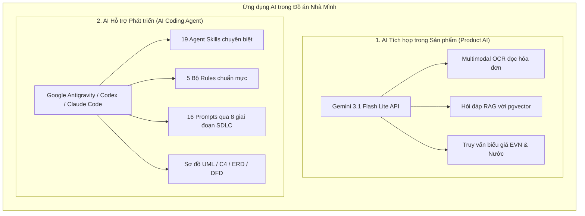

# Minh chứng Ứng dụng AI Hỗ trợ Phát triển Hệ thống — Nhà Mình

> **Đồ án môn học:** Ứng dụng Trí tuệ nhân tạo  
> **Đề tài:** Hệ thống Quản lý Hóa đơn Điện Nước Hộ gia đình tích hợp AI (Nhà Mình)  
> **Mã nguồn GitHub:** [https://github.com/nvmanh206/AI-House](https://github.com/nvmanh206/AI-House)  
> **Ngày tổng hợp & chuẩn hóa:** 29/10/2026  
> **Mốc mã nguồn cơ sở (Baseline Git):** Commit `dc19327` & `ab8fc26`  

---

## 1. Giới thiệu Tổng quan về Việc Ứng dụng AI

Trong đồ án này, Trí tuệ Nhân tạo được ứng dụng sâu rộng trên **hai phương diện độc lập và bổ trợ lẫn nhau**:



1. **AI tích hợp trong sản phẩm (Product AI):**
   - Đóng vai trò là tính năng cốt lõi phục vụ người dùng cuối.
   - Sử dụng mô hình **Google Gemini 3.1 Flash Lite** qua API có cấu trúc (`backend/app/ai/gemini_structured.py`).
   - Xử lý **Multimodal OCR**: Tiếp nhận ảnh chụp công tơ, hóa đơn điện EVN, hóa đơn nước để trích xuất số liệu và đối chiếu công nợ hộ gia đình (`backend/app/ai/multimodal.py`).
   - Hệ thống **RAG (Retrieval-Augmented Generation)**: Lưu trữ vector biểu giá điện nước công khai trên PostgreSQL với extension `pgvector` (`backend/app/knowledge/`).
2. **AI hỗ trợ phát triển phần mềm (AI Coding Agent):**
   - Đóng vai trò là trợ lý kỹ sư phần mềm (Pair Programmer / Coding Agent) đồng hành cùng sinh viên qua toàn bộ 8 giai đoạn SDLC.
   - Được định hướng bằng hệ thống **Agent Skills** chuẩn hóa theo định dạng `SKILL.md` và các **Rules** nghiêm ngặt về phân tầng kiến trúc, an toàn dữ liệu và kiểm thử 5 tầng.

---

## 2. Bản đồ Minh chứng AI qua 8 Giai đoạn SDLC

Toàn bộ các yêu cầu gửi cho AI Coding Agent, sản phẩm sinh ra và căn cứ kiểm tra được lưu trữ trong thư mục [`prompts/`](prompts/README.md) và liên kết chéo trong [Ma trận Truy vết (TRACEABILITY.md)](prompts/TRACEABILITY.md):

| Giai đoạn SDLC | Mã Prompt | Tiêu đề Nhiệm vụ | Công cụ AI | Trạng thái Minh chứng | Sản phẩm Mã nguồn / Tài liệu Đầu ra | Căn cứ Kiểm tra / Test suite |
|---|---|---|---|---|---|---|
| **01. Requirements** | [REQ-001](prompts/01-requirements/req-001-project-review.md) | Phân tích & Quy hoạch lại hệ thống | Codex / Agent | `EXACT_EXCERPT` | [`docs/replanning/2026-10-27-phan-tich-va-quy-hoach-v2.md`](docs/replanning/2026-10-27-phan-tich-va-quy-hoach-v2.md) | Kế hoạch V2 đã duyệt |
| | [REQ-002](prompts/01-requirements/req-002-real-data.md) | Chuyển đổi dữ liệu mẫu sang dữ liệu thực | Codex / Agent | `EXACT_EXCERPT` | [`docker-compose.yml`](docker-compose.yml), [`backend/app/db.py`](backend/app/db.py) | [`test_docker_bootstrap.py`](backend/tests/test_docker_bootstrap.py) |
| **02. Planning** | [PLAN-001](prompts/02-planning/plan-001-sdlc.md) | Kế hoạch tổng thể SDLC & Yêu cầu | Codex / Agent | `EXACT_EXCERPT` | [`docs/sdlc/SDLC-MASTER-PLAN.md`](docs/sdlc/SDLC-MASTER-PLAN.md), [`docs/replanning/2026-10-27-backlog-v2.md`](docs/replanning/2026-10-27-backlog-v2.md) | Backlog và SDLC Plan |
| | [PLAN-002](prompts/02-planning/plan-002-checkpoint.md) | Nhật ký Checkpoint & Tiến độ kỹ thuật | Codex / Agent | `EXACT_EXCERPT` | [`IMPLEMENTATION_PROGRESS.md`](IMPLEMENTATION_PROGRESS.md) | Nhật ký tiến độ commit |
| **03. Design** | [DES-001](prompts/03-design/des-001-usecase-preserved.md) | Chuẩn hóa 12 Ca sử dụng cốt lõi | Codex / Agent | `VERBATIM_FILE` | [`docs/uml/specs/use-case-specifications.md`](docs/uml/specs/use-case-specifications.md), [`docs/design/diagram-manifest.json`](docs/design/diagram-manifest.json) | 12 Use Case Specs |
| | [DES-002](prompts/03-design/des-002-impeccable-init.md) | Khởi tạo hệ thống Design & UI/UX | Impeccable / UI Agent | `EXACT_EXCERPT` | [`docs/replanning/V2-UX-REDESIGN.md`](docs/replanning/V2-UX-REDESIGN.md), Design tokens | Kế hoạch UI/UX V2 |
| **04. Implementation** | [IMP-001](prompts/04-implementation/imp-001-gemini-images.md) | Xây dựng pipeline Gemini Multimodal | Codex / Agent | `EXACT_EXCERPT` | [`backend/app/ai/multimodal.py`](backend/app/ai/multimodal.py), [`frontend/components/invoice-result-details.tsx`](frontend/components/invoice-result-details.tsx) | [`test_multimodal.py`](backend/tests/test_multimodal.py), UI tests |
| | [IMP-002](prompts/04-implementation/imp-002-public-rag.md) | Xây dựng RAG Tri thức Biểu giá | Codex / Agent | `EXACT_EXCERPT` | [`backend/app/knowledge/service.py`](backend/app/knowledge/service.py), [`backend/app/knowledge/crawler.py`](backend/app/knowledge/crawler.py) | [`test_knowledge.py`](backend/tests/test_knowledge.py), [`test_water_knowledge.py`](backend/tests/test_water_knowledge.py) |
| **05. Testing** | [TEST-001](prompts/05-testing/test-001-five-layers.md) | Chiến lược Kiểm thử Toàn diện 5 Tầng | Codex / Agent | `EXACT_EXCERPT` | [`docs/sdlc/SDLC-TEST-STRATEGY.md`](docs/sdlc/SDLC-TEST-STRATEGY.md), [`docs/sdlc/VERIFICATION-GEMINI-MULTIMODAL-2026-10-28.md`](docs/sdlc/VERIFICATION-GEMINI-MULTIMODAL-2026-10-28.md) | 123 backend tests pass |
| **06. Deployment** | [DEP-001](prompts/06-deployment/dep-001-clone-docker.md) | Docker hóa toàn bộ môi trường (1 lệnh) | Codex / Agent | `EXACT_EXCERPT` | [`docker-compose.yml`](docker-compose.yml), [`DOCKER_GUIDE.md`](DOCKER_GUIDE.md), [`deploy/pgadmin.servers.json`](deploy/pgadmin.servers.json) | [`test_docker_bootstrap.py`](backend/tests/test_docker_bootstrap.py) |
| | [DEP-002](prompts/06-deployment/dep-002-clean-push.md) | Dọn dẹp sạch mã nguồn trước Git push | Codex / Agent | `EXACT_EXCERPT` | [`.gitignore`](.gitignore), [`scripts/repo_audit.py`](scripts/repo_audit.py) | Commit [`ab8fc26`](https://github.com/nvmanh206/AI-House/commit/ab8fc26) |
| **07. Optimization** | [OPT-001](prompts/07-optimization/opt-001-free-key.md) | Quản lý Quota Free Tier & Cooldown | Codex / Agent | `EXACT_EXCERPT` | [`backend/app/ai/quota.py`](backend/app/ai/quota.py), [`backend/app/ai/gemini_structured.py`](backend/app/ai/gemini_structured.py) | [`test_knowledge_postgres.py`](backend/tests/test_knowledge_postgres.py) |
| | [OPT-002](prompts/07-optimization/opt-002-no-fake-fallback.md) | Chống ảo giác (No-fake-fallback) | Codex / Agent | `EXACT_EXCERPT` | [`backend/app/ai/agent.py`](backend/app/ai/agent.py), Trả mã lỗi tự nhiên | [`test_chat_degraded.test.cjs`](frontend/tests/chat-degraded.test.cjs) |
| | [OPT-003](prompts/07-optimization/opt-003-security-review-proposed.md) | Rà soát Bảo mật & Phân quyền Hộ | Codex / Agent | `PROPOSED` | Quy tắc cô lập tenant tại [`backend/app/ai/multimodal.py`](backend/app/ai/multimodal.py) | Đề xuất rà soát định kỳ |
| **08. Documentation** | [DOC-001](prompts/08-documentation/doc-001-readme-data.md) | Tài liệu hóa Triển khai & CSDL | Codex / Agent | `EXACT_EXCERPT` | [`README.md`](README.md), [`DOCKER_GUIDE.md`](DOCKER_GUIDE.md) | Kiểm tra trực quan README |
| | [DOC-002](prompts/08-documentation/doc-002-ai-evidence.md) | Chuẩn hóa Toàn bộ Minh chứng AI | Antigravity / Codex | `EXACT_EXCERPT` | [`AI_DEVELOPMENT.md`](AI_DEVELOPMENT.md), [`.agents/`](.agents/README.md), [`prompts/`](prompts/README.md) | [`check_ai_evidence.py`](scripts/check_ai_evidence.py) |

---

## 3. Hệ sinh thái Agent Skills & Rules (`.agents/`)

Hệ thống Agent Skills được thiết kế theo cấu trúc thư mục mở, độc lập và tương thích đa nền tảng:
- **19 Agent Skills:** Chi tiết tại [`.agents/README.md`](.agents/README.md) và [Danh mục Upstream License (.agents/CATALOG.md)](.agents/CATALOG.md).
- **5 Agent Rules:** Định hình phong cách lập trình và ràng buộc kỹ thuật tại [`.agents/rules/README.md`](.agents/rules/README.md).
- **Tài nguyên Sơ đồ Đa dạng:** Sơ đồ Use Case, Sequence, Class, Activity, ERD, DFD, C4 Architecture tại [`.agents/diagrams/README.md`](.agents/diagrams/README.md).

---

## 4. Phân loại Trạng thái Minh chứng (Evidence Provenance)

Để đảm bảo tính trung thực học thuật cao nhất trong đồ án nghiên cứu/bảo vệ, dự án phân định rành mạch 4 cấp độ minh chứng:

1. **`VERBATIM_FILE`:** Giữ nguyên vẹn 100% nội dung file gốc đã được lưu trữ (ví dụ: prompt đặc tả 12 use case tại [`prompts/03-design/des-001-usecase-preserved.md`](prompts/03-design/des-001-usecase-preserved.md)).
2. **`EXACT_EXCERPT`:** Trích đoạn nguyên văn yêu cầu của người dùng từ lịch sử hội thoại đã được xác nhận qua commit Git và sản phẩm đầu ra tương ứng.
3. **`RECONSTRUCTED`:** Bản tái dựng có căn cứ kỹ thuật rõ ràng từ mã nguồn hoặc nhật ký phát triển; không tự nhận là bản xuất hội thoại thô nguyên văn.
4. **`PROPOSED`:** Tài nguyên chuẩn hóa mới được thiết kế để mở rộng và nâng cấp hệ thống trong tương lai, chưa qua thực thi trong lịch sử.

---

## 5. Quy trình Tự động Kiểm tra Minh chứng & Bảo mật

Hệ thống cung cấp hai công cụ dòng lệnh bằng Python để phục vụ giảng viên và hội đồng kiểm tra:

```bash
# 1. Kiểm tra toàn diện tính toàn vẹn của thư mục .agents/, prompts/, ma trận truy vết và secrets:
python scripts/check_ai_evidence.py

# 2. Kiểm toán bảo mật mã nguồn (đảm bảo 100% không lộ secret, key hoặc file rác):
python scripts/repo_audit.py
```

### Tiêu chuẩn Bảo mật được Thực thi:
- **Zero Secrets on Git:** Không bao giờ commit file `.env`, API key Gemini, JWT secret hay Private Key lên Git repository.
- **Zero PII:** Không lưu trữ dữ liệu cá nhân thật, hóa đơn sinh hoạt thật hay thông tin nhạy cảm của hộ gia đình trong tài liệu minh chứng.
- **Mã nguồn sạch:** Đảm bảo toàn bộ tài nguyên được phân loại, định danh ổn định (stable IDs) và có thể tái lập (reproducible).

---

*Tài liệu này được biên soạn nhằm phục vụ công tác đánh giá, chấm điểm và bảo vệ đồ án môn Ứng dụng Trí tuệ nhân tạo. Mọi chi tiết về mã nguồn xin tra cứu trực tiếp tại kho lưu trữ [nvmanh206/AI-House](https://github.com/nvmanh206/AI-House).*
