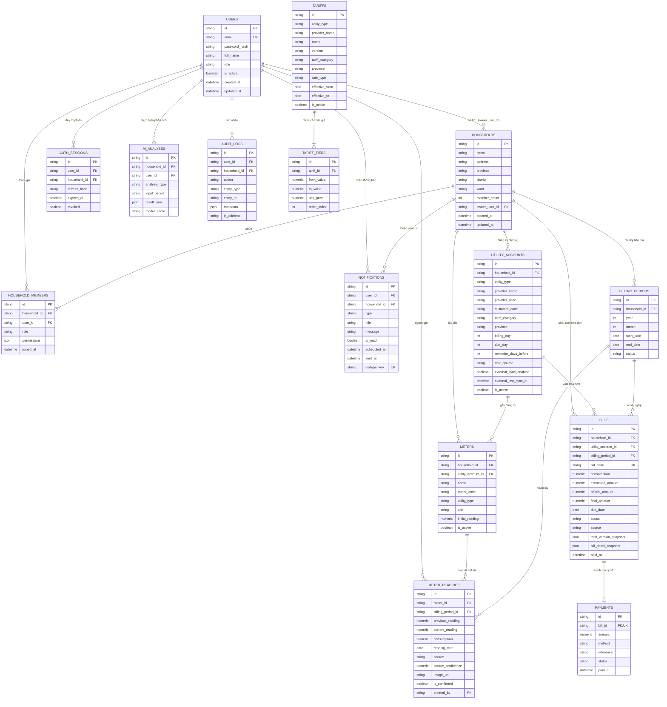
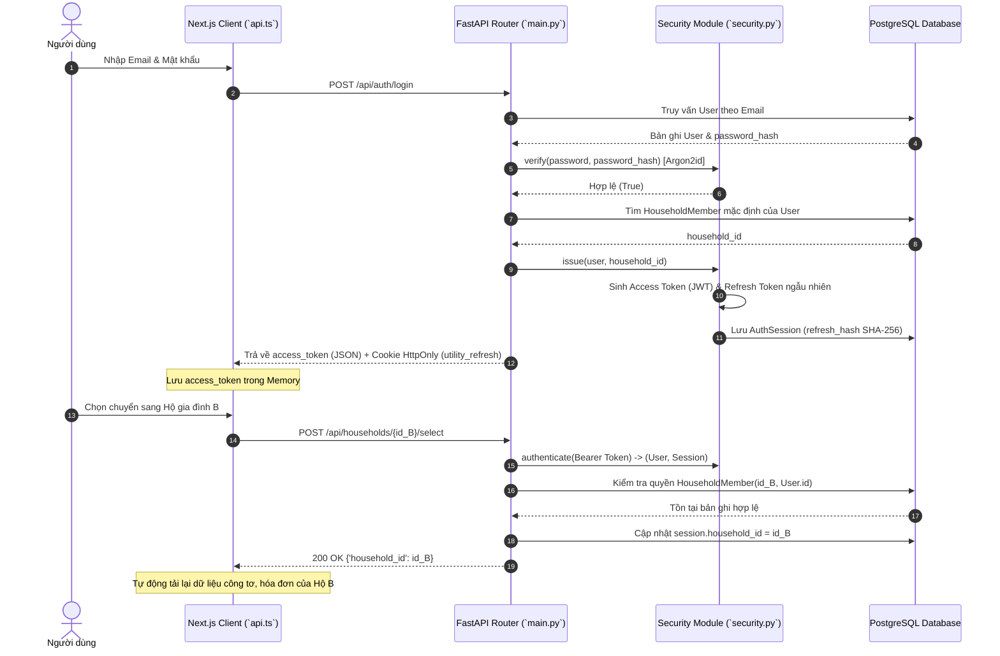
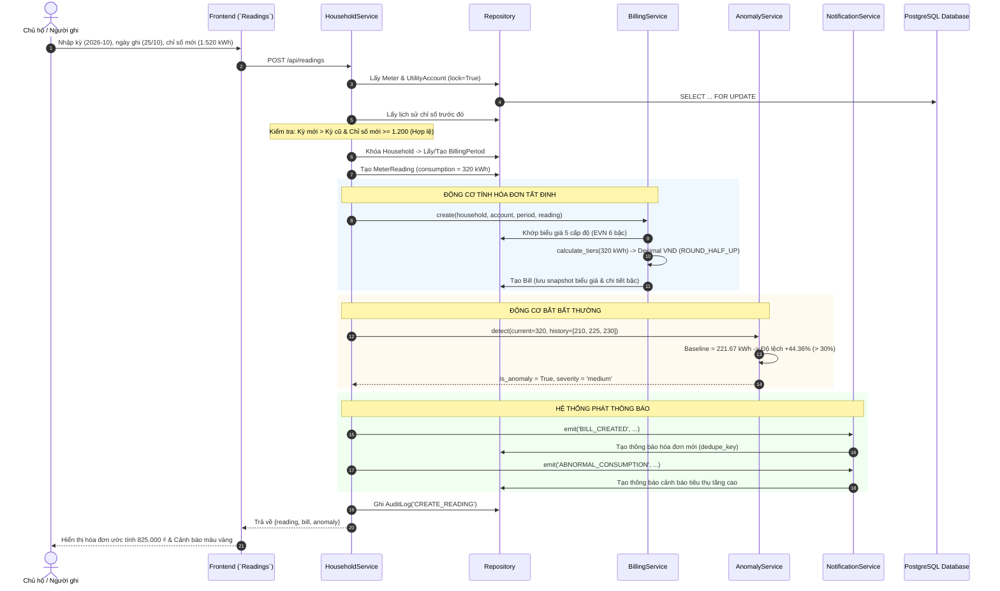
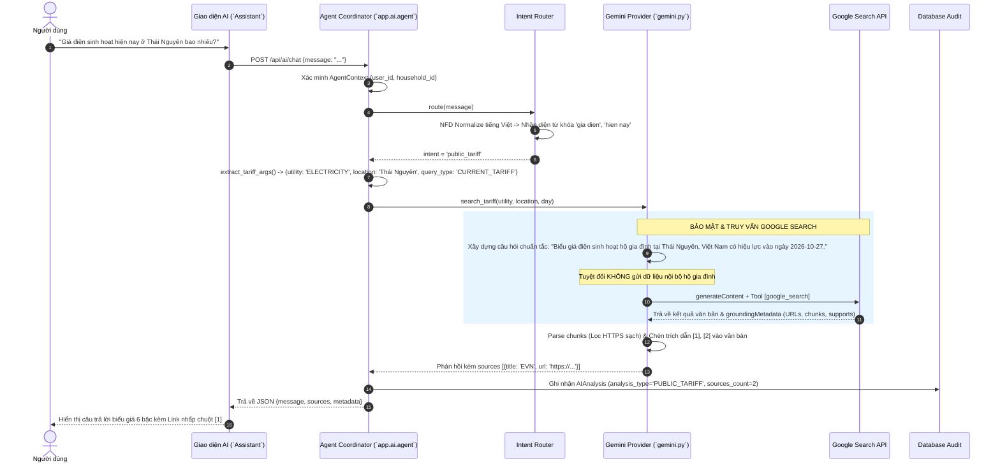
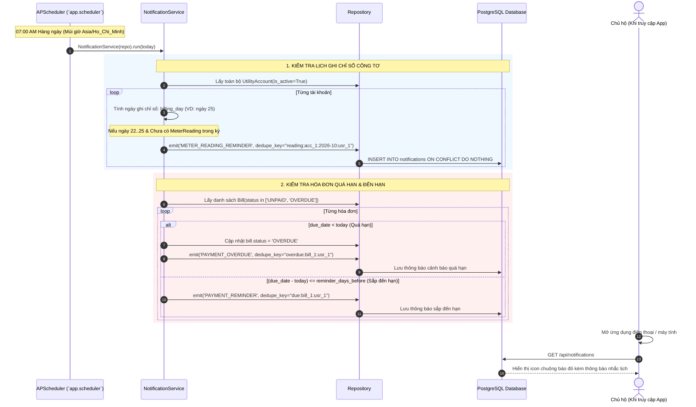
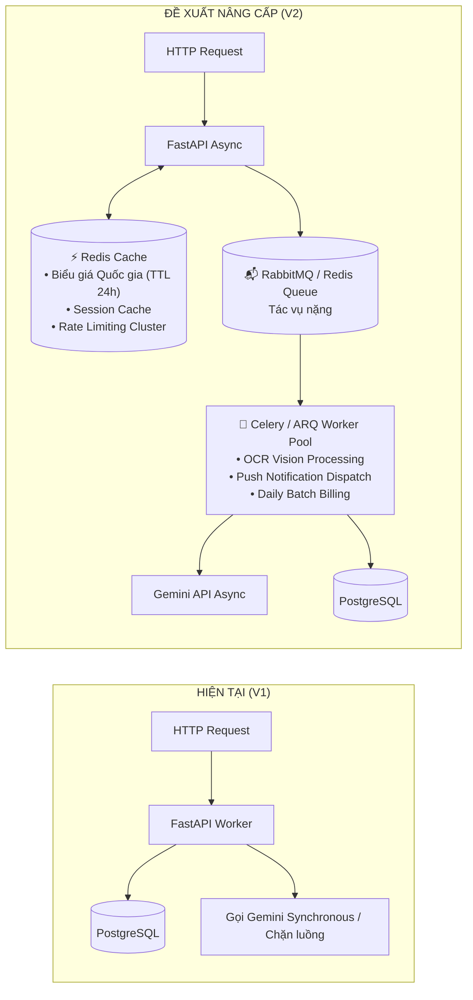
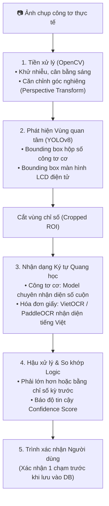
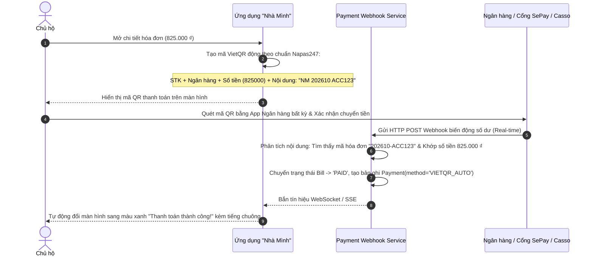
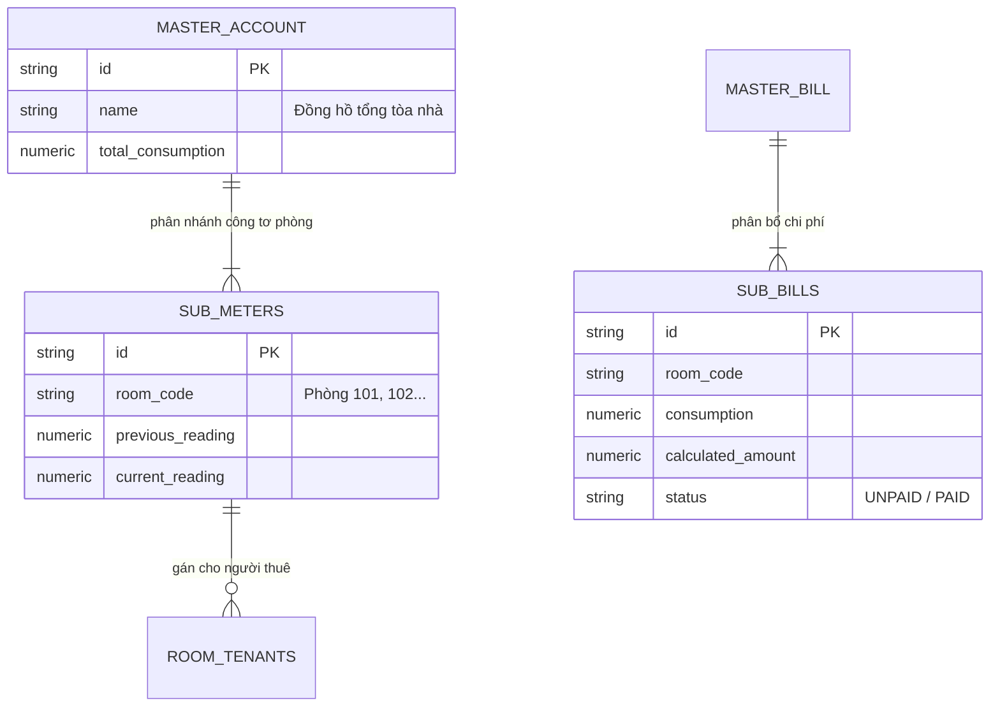

# TỔNG QUAN DỰ ÁN VÀ PHÂN TÍCH KIẾN TRÚC CHI TIẾT
## HỆ THỐNG QUẢN LÝ HÓA ĐƠN ĐIỆN NƯỚC HỘ GIA ĐÌNH TÍCH HỢP AI — "NHÀ MÌNH"

> **Tài liệu Kỹ thuật & Kiến trúc Toàn diện (System Architecture & Technical Specification)**  
> **Phiên bản:** 1.2.0 (Cập nhật tích hợp Gemini 2.5 Flash, Grounded Google Search & Multimodal OCR Verification)  
> **Mã nguồn:** `website/` (`nvmanh206/AI-House`)  
> **Ngôn ngữ & Nền tảng:** Python 3.12+ (FastAPI), TypeScript / Next.js 16 (React 19), PostgreSQL 16  

---

## MỤC LỤC TỔNG QUAN

1. [Tổng Quan Hệ Thống & Tầm Nhìn Sản Phẩm](#1-tổng-quan-hệ-thống--tầm-nhìn-sản-phẩm)
   - 1.1. Bối cảnh & Bài toán Thực tế
   - 1.2. Mục tiêu Cốt lõi & Triết lý Thiết kế
   - 1.3. Bảng Tổng hợp Công nghệ (Tech Stack Matrix)
2. [Kiến Trúc Hệ Thống & Mô Hình Luồng Hoạt Động (Architecture & C4 Diagrams)](#2-kiến-trúc-hệ-thống--mô-hình-luồng-hoạt-động)
   - 2.1. Kiến trúc Tổng thể: Modular Monolith với Domain-Driven Design
   - 2.2. Sơ đồ Kiến trúc Thành phần (C4 Component Diagram)
   - 2.3. Mô hình Xử lý Concurrency & Cơ chế Transaction Lifecycle
3. [Mô Hình Dữ Liệu & Cơ Sở Dữ Liệu (Database Schema & Entity Specifications)](#3-mô-hình-dữ-liệu--cơ-sở-dữ-liệu)
   - 3.1. Sơ đồ Thực thể Quan hệ (Mermaid ERD)
   - 3.2. Đặc tả Chi tiết 15 Bảng Cơ sở Dữ liệu
   - 3.3. Ràng buộc Toàn vẹn (Constraints, Check Rules & Data Types)
4. [Phân Tích Chi Tiết Tác Nhân (Actors) & Ma Trận Phân Quyền (RBAC Matrix)](#4-phân-tích-chi-tiết-tác-nhân-actors--ma-trận-phân-quyền)
   - 4.1. Hệ thống Phân quyền Đa tầng (Multi-tenancy & Roles)
   - 4.2. Bảng Ma trận Quyền hạn (API & UI Access Matrix)
5. [Phân Tích Dữ Liệu & Luồng Xử Lý Chi Tiết Theo Từng File (Code Walkthrough)](#5-phân-tích-dữ-liệu--luồng-xử-lý-chi-tiết-theo-từng-file)
   - 5.1. Phân hệ Cấu hình & Hạ tầng Cơ sở (`config.py`, `db.py`, `enums.py`)
   - 5.2. Phân hệ Bảo mật, Mã hóa & Phiên (`security.py`, `schemas.py`)
   - 5.3. Tầng Truy vấn Dữ liệu & Lưu trữ (`repository.py`)
   - 5.4. Tầng Dịch vụ Nghiệp vụ Lõi (`services.py`, `admin_service.py`)
   - 5.5. Động cơ Tính toán Tiền tệ & Thuật toán Chuyên dụng (`billing_service.py`, `forecast_service.py`, `anomaly_service.py`)
   - 5.6. Phân hệ Thông báo & Lập lịch Chạy ngầm (`notification_service.py`, `scheduler.py`)
   - 5.7. Phân hệ Trí tuệ Nhân tạo Đa phương thức (`ai/` & `providers/`)
     - `ai/context.py` — Bất biến ngữ cảnh (Immutable Context)
     - `ai/router.py` — Chuẩn hóa tiếng Việt & Phân luồng ý định (Intent Routing)
     - `ai/registry.py` & `ai/agent.py` — Điều phối Agent & Thực thi Tools
     - `ai/gemini.py` — Tích hợp Gemini 2.5 Flash, Grounded Google Search & Vision OCR
     - `ai/tools/ocr_analysis.py` & `ocr_parser.py` — Quy trình Đối soát Công tơ (Meter Verification)
     - `ai/tools/knowledge.py` — Căn cứ Biểu giá & Tri thức Năng lượng
   - 5.8. Bộ Điều Khiển Trung Tâm API (`main.py`)
   - 5.9. Phân hệ Giao Diện Người Dùng Frontend (`frontend/components/`)
     - `api.ts` — Quản trị Phiên & Tự Động Làm Mới Token
     - `application.tsx` — Ứng Dụng Đơn Trang (SPA) & Điều Hướng
     - `bill-analysis-card.tsx` — Trực Quan Hóa Đối Soát Hóa Đơn
     - `chat-answer.tsx` — Trình Kết Xuất Markdown & Nguồn Trích Dẫn
     - `charts.tsx` — Trực Quan Hóa Tiêu Thụ & Xu Hướng Chi Phí
6. [Sơ Đồ Luồng Hoạt Động Điển Hình (Sequence & Activity Diagrams)](#6-sơ-đồ-luồng-hoạt-động-điển-hình)
   - 6.1. Luồng Xác thực, Cấp quyền & Đổi Phiên Hộ Gia Đình
   - 6.2. Luồng Nhập Chỉ Số -> Lập Hóa Đơn -> Phát Hiện Bất Thường -> Phát Thông Báo
   - 6.3. Luồng Hỏi Đáp Trợ Lý AI Tra Cứu Biểu Giá Trực Tuyến (Grounded Search)
   - 6.4. Luồng Tải Ảnh Hóa Đơn / OCR -> Đối Soát Chỉ Số Công Tơ Hệ Thống
   - 6.5. Luồng Quét Lịch Nhắc Nhập Chỉ Số & Hạn Thanh Toán Tự Động
7. [Đề Xuất Phân Tích & Định Hướng Nâng Cấp Hệ Thống (Architecture Roadmap)](#7-đề-xuất-phân-tích--định-hướng-nâng-cấp-hệ-thống)
   - 7.1. Kiến trúc Caching Phân tán (Redis) & Hàng đợi Xử lý Bất đồng bộ (Celery / RabbitMQ)
   - 7.2. Pipeline OCR Chuyên dụng Kết hợp Computer Vision (YOLOv8 + PaddleOCR / VietOCR)
   - 7.3. Cổng Thanh Toán Tự Động & Đối Soát Biến Động Số Dư (VietQR / Webhook SePay)
   - 7.4. Mở rộng Hệ thống IoT Đo đếm Thời gian thực (Smart Metering qua MQTT & Time-series DB)
   - 7.5. Hỗ trợ Đa hộ & Phân bổ Hóa đơn Cho Nhà trọ / Căn hộ Dịch vụ (Sub-metering Multi-tenancy)
   - 7.6. Gia cố Bảo mật & Tuân thủ Dữ liệu Cá nhân (OWASP & Field-level Encryption)

---

## 1. TỔNG QUAN HỆ THỐNG & TẦM NHÌN SẢN PHẨM

### 1.1. Bối cảnh & Bài toán Thực tế
Trong sinh hoạt hộ gia đình tại Việt Nam, chi phí tiền điện và tiền nước luôn chiếm tỷ trọng đáng kể trong ngân sách sinh hoạt hàng tháng. Tuy nhiên, người dân hiện đang đối mặt với các bất cập lớn:
1. **Biểu giá lũy tiến bậc thang phức tạp:** Điện sinh hoạt áp dụng biểu giá 6 bậc (theo Quyết định số 2941/QĐ-BCT và các văn bản điều chỉnh của EVN), nước sạch tính theo bậc lũy tiến theo định mức nhân khẩu của từng địa phương (Hà Nội, TP.HCM, Thái Nguyên,...). Việc tính nhẩm số tiền điện/nước phải trả dựa trên lượng tiêu thụ là rào cản lớn đối với hầu hết chủ hộ.
2. **Hiện tượng thất thoát & tiêu thụ bất thường không được phát hiện kịp thời:** Hỏng hóc phao bồn nước ngầm, rò rỉ đường ống nước trong tường, sự cố chập rò thiết bị điện (máy nước nóng, tủ lạnh hỏng gioăng cao su, điều hòa thiếu gas tiêu tốn điện năng gấp 2-3 lần) thường chỉ được phát hiện khi nhận thông báo hóa đơn tăng vọt vào cuối tháng.
3. **Bất đối xứng thông tin chỉ số công tơ:** Người tiêu dùng ghi nhận tình trạng ghi sai chỉ số, chênh lệch giữa thực tế công tơ tại nhà và dữ liệu trên thông báo hóa đơn của đơn vị cấp điện/nước mà không có công cụ đối chiếu, lưu vết lịch sử độc lập.
4. **Bỏ lỡ thời hạn thanh toán:** Việc thanh toán trễ hạn dẫn đến nguy cơ bị cắt dịch vụ hoặc tính lãi chậm trả, gây gián đoạn sinh hoạt gia đình.

### 1.2. Mục tiêu Cốt lõi & Triết lý Thiết kế
Dự án **"Nhà Mình"** được nghiên cứu và phát triển nhằm mang lại giải pháp công nghệ toàn diện, đóng vai trò như một **"Sổ kế toán năng lượng số thông minh"** cho từng gia đình:
- **Tính toán hóa đơn tất định (Deterministic Calculation):** Đảm bảo độ chính xác tài chính 100% bằng cách sử dụng kiểu dữ liệu số học độ chính xác cao (`Decimal`), áp dụng quy tắc làm tròn tiêu chuẩn tài chính (`ROUND_HALF_UP`), lưu giữ snapshot biểu giá bất biến tại thời điểm lập hóa đơn.
- **Tích hợp Trí tuệ Nhân tạo Đa phương thức (Multimodal AI):** Không chỉ trả lời chatbot văn bản đơn thuần, AI trong hệ thống có khả năng đọc ảnh chụp hóa đơn/công tơ (Vision OCR) để trích xuất dữ liệu, đối soát chéo với cơ sở dữ liệu nội bộ, đồng thời có khả năng tra cứu biểu giá mới nhất trên Internet thông qua **Google Search Grounding** với đường dẫn trích dẫn minh bạch.
- **Bảo mật & Quyền riêng tư Tuyệt đối (Privacy-First Architecture):** Dữ liệu hóa đơn, chỉ số và thông tin cá nhân của gia đình được cô lập hoàn toàn (Context Isolation). Tuyệt đối **không** gửi dữ liệu nhạy cảm hay thông tin nội bộ của hộ gia đình ra các công cụ tìm kiếm bên ngoài.
- **Kiến trúc Modular Monolith tối giản:** Dễ dàng triển khai, vận hành, kiểm thử độc lập mà không gặp gánh nặng phức tạp của hạ tầng Microservices trong giai đoạn đầu.

### 1.3. Bảng Tổng hợp Công nghệ (Tech Stack Matrix)

| Lớp (Layer) | Công nghệ / Thư viện | Phiên bản | Mục đích & Trách nhiệm chính |
| :--- | :--- | :--- | :--- |
| **Frontend Framework** | Next.js (App Router) | 16.x / React 19 | Server-side Rendering & Client SPA Hydration, quản lý layout và routing phân hệ |
| **Ngôn ngữ Giao diện** | TypeScript | 5.x | Kiểm soát kiểu tĩnh, ngăn ngừa lỗi runtime giao diện |
| **Styling & CSS** | Tailwind CSS + Bootstrap Grid | Tailwind v4 | Thiết kế Glassmorphism hiện đại, Dark/Light mode, lưới bố cục Bootstrap responsive |
| **Thư viện Biểu đồ** | Recharts | 2.x | Vẽ biểu đồ cột, diện tích, donut trực quan hóa chi tiêu và sản lượng |
| **Backend Framework** | FastAPI | 0.115+ | Framework REST API hiệu năng cao dựa trên ASGI/Starlette, hỗ trợ Async |
| **Kiểm định Schema** | Pydantic / Pydantic-Settings | 2.x | Xác thực dữ liệu đầu vào nghiêm ngặt (`extra='forbid'`), nạp biến môi trường |
| **ORM & Database Engine**| SQLAlchemy + Psycopg 3 | 2.0+ / Psycopg 3.2 | Ánh xạ đối tượng quan hệ, quản lý kết nối, giao dịch ACID, Row-level Locking |
| **Cơ sở Dữ liệu** | PostgreSQL | 16.x | Hệ quản trị cơ sở dữ liệu quan hệ chính (ACID, JSONB, Constraints) |
| **Kiểm thử Database** | SQLite (in-memory) | - | Chạy bộ test tự động pytest nhanh chóng với cờ ngoại khóa PRAGMA |
| **Quản lý Di chuyển Schema**| Alembic | 1.13+ | Version hóa schema cơ sở dữ liệu qua các tệp migration chính thức |
| **Mật mã & Xác thực** | Argon2-cffi + PyJWT | Argon2id / HS256 | Băm mật khẩu kháng GPU/ASIC, cấp Access Token và Refresh Token rotation |
| **Bộ Lập Lịch Chạy ngầm**| APScheduler | 3.10+ | Lập lịch tiến trình cron chạy 07:00 hàng ngày quét cảnh báo và hạn thanh toán |
| **Mô hình Trí tuệ Nhân tạo**| Google Gemini 2.5 Flash / 1.5 Flash | REST API Beta | Trợ lý phân tích, Vision OCR, Search Grounding với công cụ `google_search` |

---

## 2. KIẾN TRÚC HỆ THỐNG & MÔ HÌNH LUỒNG HOẠT ĐỘNG

### 2.1. Kiến trúc Tổng thể: Modular Monolith với Domain-Driven Design
Hệ thống được tổ chức theo kiến trúc **Modular Monolith**, phân định ranh giới nghiệp vụ rõ ràng (Separation of Concerns). Toàn bộ hệ thống chạy chung một mã nguồn backend đồng nhất, nhưng tách bạch nghiêm ngặt giữa:
1. **Tầng Trình bày (Presentation / Controller Layer - `app.main`):** Tiếp nhận HTTP Request, giải mã cookie, kiểm tra rate limit, định tuyến và chuyển giao cho Service.
2. **Tầng Nghiệp vụ (Domain Service Layer - `app.services`, `billing_service`,...):** Chứa đựng toàn bộ logic nghiệp vụ, quy tắc tính toán, kiểm soát ngữ cảnh phân quyền (`household_context`).
3. **Tầng Truy xuất Dữ liệu (Persistence / Repository Layer - `app.repository`):** Đóng gói câu lệnh SQL / SQLAlchemy ORM, kiểm soát khóa bản ghi (`with_for_update`).
4. **Tầng Trí tuệ Nhân tạo (AI Agent Layer - `app.ai`):** Hoạt động độc lập, nhận vào đối tượng bất biến `AgentContext`, phân luồng ý định và chỉ gọi các công cụ đọc (`Read-only Tools`).

### 2.2. Sơ đồ Kiến trúc Thành phần (C4 Component Diagram)

```mermaid
flowchart TB
    subgraph ClientLayer["🖥️ LỚP TRÌNH BÀY (CLIENT - NEXT.JS / REACT 19)"]
        UI_Guest["Khách vãng lai (Landing / Auth)"]
        UI_User["Chủ hộ & Thành viên (Dashboard, Meters, Bills, AI)"]
        UI_Admin["Quản trị viên (User Mgmt, Tariffs, Audit Logs)"]
        API_Client["API Client (`api.ts`)\n• In-memory Access Token\n• Auto-refresh via HttpOnly Cookie"]
        UI_Guest --> API_Client
        UI_User --> API_Client
        UI_Admin --> API_Client
    end

    subgraph SecurityGate["🛡️ TẦNG BẢO VỆ & XÁC THỰC (FASTAPI MIDDLEWARE)"]
        RateLimiter["Sliding-Window Rate Limiter\n(Auth & Refresh Endpoints)"]
        SecurityHeaders["Security Headers Middleware\n(`X-Content-Type-Options`, `Cache-Control`)"]
        AuthMiddleware["JWT HS256 Authenticator (`security.authenticate`)\n+ Active User & Session Validation"]
        API_Client --> RateLimiter --> SecurityHeaders --> AuthMiddleware
    end

    subgraph ServiceLayer["⚙️ TẦNG DỊCH VỤ NGHIỆP VỤ (DOMAIN SERVICES)"]
        AuthSvc["AuthService\n(Register, Login, Argon2)"]
        HouseSvc["HouseholdService\n(Onboard, Accounts, Meters, Readings, Pay)"]
        AdminSvc["AdminService\n(Overview, Toggle Users, Tariffs, Audit)"]
        BillingSvc["BillingService\n(Tiered Pricing, 5-Level Tariff Matching)"]
        ForecastSvc["ForecastService\n(Weighted Moving Average)"]
        AnomalySvc["AnomalyService\n(Rolling 3-month Deviation)"]
        NotifSvc["NotificationService\n(Idempotent Reminder Generator)"]
    end

    AuthMiddleware --> AuthSvc
    AuthMiddleware --> HouseSvc
    AuthMiddleware --> AdminSvc

    HouseSvc --> BillingSvc
    HouseSvc --> ForecastSvc
    HouseSvc --> AnomalySvc
    HouseSvc --> NotifSvc

    subgraph AIAgentLayer["🧠 PHÂN HỆ TRỢ LÝ AI (AI AGENT & TOOLS)"]
        ContextBuilder["Context Builder -> Frozen AgentContext"]
        IntentRouter["Intent Router (Tiếng Việt NFD Normalization)"]
        AgentCore["Agent Coordinator (`app.ai.agent`)"]
        ToolRegistry["Tool & Skill Registry (Allowlist)"]
        GeminiAdapter["Gemini REST Adapter\n(Search Grounding & Vision Multimodal)"]
        
        AuthMiddleware --> ContextBuilder --> AgentCore
        AgentCore --> IntentRouter
        AgentCore --> ToolRegistry
        ToolRegistry --> GeminiAdapter
        ToolRegistry -.->|Read-only context| HouseSvc
    end

    subgraph DataAccessLayer["💾 TẦNG DỮ LIỆU & LƯU TRỮ (REPOSITORY & DATABASE)"]
        Repo["Repository (`app.repository`)\n• Session-per-request\n• Row Locking (FOR UPDATE)"]
        AuditLogger["AuditLog Subsystem"]
        PostgresDB[("🐘 PostgreSQL 16 Database\n(15 Tables, Constraints, Decimal Types)")]
        
        HouseSvc --> Repo
        AuthSvc --> Repo
        AdminSvc --> Repo
        NotifSvc --> Repo
        Repo --> AuditLogger
        Repo --> PostgresDB
    end

    subgraph BackgroundLayer["⏰ TIẾN TRÌNH CHẠY NGẦM (APScheduler)"]
        CronProc["`app.scheduler`\n(Daily 07:00 Asia/Ho_Chi_Minh)"]
        CronProc --> NotifSvc
    end
```

### 2.3. Mô hình Xử lý Concurrency & Cơ chế Transaction Lifecycle
- **Dependency `get_db`:** Mỗi HTTP Request được cấp phát một SQLAlchemy `Session` độc lập. Khi request kết thúc không có exception, hệ thống thực hiện `db.commit()`. Nếu xảy ra bất kỳ lỗi nào (`DomainError`, `HTTPException`, hoặc lỗi không bắt được), khối `try...except` tự động kích hoạt `db.rollback()`.
- **Khóa hàng ngăn Race Condition (Pessimistic Row Locking):** Khi thực hiện các tác vụ nhạy cảm như ghi chỉ số công tơ (`add_reading`) hay thanh toán (`pay`), hệ thống gọi `repo.get(Model, id, lock=True)` (tương ứng với câu lệnh SQL `SELECT ... FOR UPDATE`).
  - *Thứ tự khóa trong luồng nhập chỉ số:* Khóa `Meter` -> Khóa `UtilityAccount` -> Khóa `Household`. Thứ tự khóa nhất quán giúp ngăn chặn hoàn toàn deadlock giữa các request đồng thời.
- **Savepoint trong Notification (`begin_nested()`):** Khi phát thông báo hàng loạt cho các thành viên, hệ thống sử dụng Transaction Savepoint để bắt lỗi vi phạm ràng buộc trùng lặp (`IntegrityError` trên `dedupe_key`), cho phép tiếp tục ghi nhận thông báo cho các thành viên khác mà không làm gián đoạn transaction tổng thể.

---

## 3. MÔ HÌNH DỮ LIỆU & CƠ SỞ DỮ LIỆU

### 3.1. Sơ đồ Thực thể Quan hệ (Mermaid ERD)



### 3.2. Đặc tả Chi tiết 15 Bảng Cơ sở Dữ liệu

1. **`users`:** Lưu thông tin tài khoản xác thực toàn hệ thống.
   - `id`: Khóa chính UUIDv4 (String 36).
   - `email`: Địa chỉ email duy nhất (`unique=True`, tối đa 254 ký tự).
   - `password_hash`: Chuỗi băm mật khẩu định dạng Argon2id an toàn.
   - `role`: Vai trò hệ thống chung (`USER`, `ADMIN`).
   - `is_active`: Cờ trạng thái tài khoản cho phép vô hiệu hóa khi cần.

2. **`households`:** Đại diện cho một hộ gia đình / không gian sinh hoạt.
   - `owner_user_id`: Khóa ngoại trỏ đến `users.id`, người tạo và sở hữu hộ gia đình.
   - `member_count`: Số lượng nhân khẩu sinh hoạt (phục vụ tính định mức nước sạch).
   - Địa giới hành chính: `province`, `district`, `ward`, `address`.

3. **`household_members`:** Bảng liên kết nhiều-nhiều giữa `users` và `households`.
   - `role`: Vai trò trong hộ (`OWNER`, `MEMBER`).
   - `permissions`: Danh sách JSON chứa các quyền hạn được cấp (`write`, `pay`, `members`).
   - Ràng buộc: `UniqueConstraint('household_id', 'user_id')` ngăn việc một user tham gia trùng lặp vào một hộ.

4. **`auth_sessions`:** Quản lý phiên làm việc có trạng thái và token refresh.
   - `refresh_hash`: Mã băm SHA-256 của Refresh Token bí mật (độ dài 64 hex characters). Tuyệt đối không lưu token thô trong DB.
   - `household_id`: ID của hộ gia đình hiện đang được chọn (Active Household Context).
   - `revoked`: Đánh dấu phiên đã bị hủy (khi logout hoặc đổi mật khẩu).

5. **`utility_accounts`:** Hợp đồng dịch vụ điện hoặc nước của hộ gia đình.
   - `utility_type`: Loại tiện ích, kiểm soát bởi `CheckConstraint("utility_type IN ('ELECTRICITY','WATER')")`.
   - `billing_day`, `due_day`: Ngày dự kiến có hóa đơn và ngày hạn thanh toán hàng tháng (từ 1 đến 31).
   - `reminder_days_before`: Số ngày gửi thông báo nhắc hạn trước ngày quy định (0 đến 14 ngày).

6. **`meters`:** Công tơ / đồng hồ đo đếm năng lượng gắn liền với tài khoản tiện ích.
   - `unit`: Đơn vị đo lường (`kWh` đối với điện, `m³` đối với nước).
   - `initial_reading`: Chỉ số bàn giao ban đầu (`Numeric(14,3)`).
   - Quy tắc V1: Mỗi tài khoản tiện ích (`utility_account`) chỉ có tối đa một công tơ ở trạng thái `is_active=True`.

7. **`billing_periods`:** Chu kỳ tiêu thụ theo tháng/năm của từng hộ gia đình.
   - Ràng buộc: `UniqueConstraint('household_id', 'year', 'month')` và `CheckConstraint('month BETWEEN 1 AND 12')`.
   - `start_date`, `end_date`: Ngày đầu tháng và ngày cuối tháng thực tế của chu kỳ.

8. **`meter_readings`:** Dữ liệu chỉ số công tơ ghi nhận định kỳ.
   - `previous_reading`, `current_reading`, `consumption`: Lưu dạng `Numeric(14,3)`.
   - Ràng buộc toàn vẹn cứng tại tầng database:
     - `CheckConstraint('current_reading >= previous_reading')` (chống quay lùi công tơ).
     - `CheckConstraint('consumption >= 0')`.
     - `UniqueConstraint('meter_id', 'billing_period_id')` (mỗi công tơ chỉ có 1 bản ghi chỉ số mỗi kỳ).

9. **`tariffs`:** Bảng biểu giá cơ sở quy định đơn giá theo từng thời kỳ.
   - `version`: Mã phiên bản biểu giá (ví dụ: `evn-2023-11`, `sawaco-2024`).
   - `rate_type`: Loại biểu giá (`TIERED` - lũy tiến bậc thang, `FLAT` - đồng giá).
   - `effective_from`, `effective_to`: Khoảng thời gian biểu giá có hiệu lực pháp lý.
   - Ràng buộc: `UniqueConstraint('utility_type', 'provider_name', 'tariff_category', 'version')`.

10. **`tariff_tiers`:** Chi tiết các bậc thang của từng biểu giá.
    - `from_value`: Ngưỡng dưới của bậc (`Numeric(14,3)`).
    - `to_value`: Ngưỡng trên của bậc (`NULL` biểu thị bậc cao nhất không giới hạn).
    - `unit_price`: Đơn vị tính tiền VND trên 1 đơn vị tiêu thụ (`Numeric(14,2)`).
    - `order_index`: Thứ tự sắp xếp bậc (0, 1, 2,...).

11. **`bills`:** Hóa đơn tính toán chi phí tiện ích theo kỳ.
    - `bill_code`: Mã hóa đơn duy nhất toàn hệ thống (`YYYYMM-ACCOUNT_ID[:8]`).
    - `estimated_amount`, `final_amount`: Số tiền tính toán trước thuế/phí (`Numeric(14,2)`).
    - `tariff_version_snapshot`: Đối tượng JSON chụp lại toàn bộ thông tin phiên bản biểu giá tại thời điểm tính tiền.
    - `bill_detail_snapshot`: Đối tượng JSON chi tiết từng dòng bậc thang (`from`, `to`, `quantity`, `unit_price`, `amount`).

12. **`payments`:** Ghi nhận thanh toán hóa đơn.
    - `bill_id`: Khóa ngoại duy nhất `unique=True` (phiên bản V1 áp dụng thanh toán toàn phần một lần).
    - `method`: Hình thức thanh toán (`MANUAL` - người dùng tự đánh dấu đã thanh toán).

13. **`notifications`:** Hệ thống cảnh báo và nhắc nhở người dùng.
    - `dedupe_key`: Chuỗi định danh chống gửi lặp (`f"{event_key}:{user_id}"`), `unique=True`.
    - `type`: Phân loại thông báo (`METER_READING_REMINDER`, `PAYMENT_REMINDER`, `PAYMENT_OVERDUE`, `BILL_CREATED`, `ABNORMAL_CONSUMPTION`, `PAYMENT_SUCCESS`).

14. **`ai_analyses`:** Bảng lưu vết lịch sử tương tác với Trợ lý AI.
    - Lưu trữ `analysis_type`, `model_name`, `result_json` (chỉ lưu metadata số nguồn, mã lỗi hoặc trạng thái).
    - **Nguyên tắc bảo mật:** Tuyệt đối không lưu raw message, prompt, hoặc dữ liệu nhạy cảm trong bảng này.

15. **`audit_logs`:** Nhật ký kiểm toán hệ thống.
    - Ghi nhận `user_id`, `household_id`, `action`, `entity_type`, `entity_id`, `metadata`, `ip_address` phục vụ truy vết bảo mật.

---

## 4. PHÂN TÍCH CHI TIẾT TÁC NHÂN (ACTORS) & MA TRẬN PHÂN QUYỀN

### 4.1. Hệ thống Phân quyền Đa tầng (Multi-tenancy & Roles)
Hệ thống kết hợp giữa **Role-Based Access Control (RBAC)** ở cấp toàn hệ thống và **Attribute/Permission-Based Access Control** ở cấp hộ gia đình:
- **Tác nhân Khách vãng lai (Guest):** Chỉ truy cập các trang công khai (`/`, `/login`, `/register`).
- **Tác nhân Quản trị viên (Global Admin):** Sở hữu trường `User.role == 'ADMIN'`. Có toàn quyền truy cập khu vực `/admin`, cấu hình biểu giá toàn quốc, khóa/mở tài khoản người dùng, và giám sát audit log.
- **Tác nhân Chủ hộ (Household Owner):** Người dùng có bản ghi `HouseholdMember.role == 'OWNER'`. Có toàn quyền tối cao trong phạm vi hộ gia đình đó: chỉnh sửa thông tin nhà, mời/xóa thành viên, phân quyền thành viên, quản lý công tơ và thanh toán.
- **Tác nhân Thành viên Hộ (Household Member):** Người dùng có `HouseholdMember.role == 'MEMBER'`. Quyền hạn được kiểm soát dựa trên mảng `permissions`:
  - `write`: Cho phép nhập chỉ số công tơ định kỳ và cập nhật thông tin công tơ.
  - `pay`: Cho phép thực hiện đánh dấu thanh toán hóa đơn.
  - *Không có quyền:* Chỉ được quyền xem (Read-only) các biểu đồ, lịch sử và thông báo.

### 4.2. Bảng Ma trận Quyền hạn (API & UI Access Matrix)

| Chức năng / Endpoint API | Khách (Guest) | Thành viên (Read) | Thành viên (`write`) | Thành viên (`pay`) | Chủ hộ (Owner) | Admin Hệ thống |
| :--- | :---: | :---: | :---: | :---: | :---: | :---: |
| **Đăng ký / Đăng nhập / Refresh** (`/api/auth/*`) | ✅ | ✅ | ✅ | ✅ | ✅ | ✅ |
| **Đổi mật khẩu / Cập nhật Profile** | ❌ | ✅ | ✅ | ✅ | ✅ | ✅ |
| **Xem Dashboard / Chỉ số / Hóa đơn** | ❌ | ✅ | ✅ | ✅ | ✅ | ✅ |
| **Nhập chỉ số công tơ** (`POST /api/readings`) | ❌ | ❌ | ✅ | ❌ | ✅ | ❌ |
| **Thêm / Sửa công tơ** (`/api/meters`) | ❌ | ❌ | ✅ | ❌ | ✅ | ❌ |
| **Ghi nhận thanh toán** (`POST /api/payments`) | ❌ | ❌ | ❌ | ✅ | ✅ | ❌ |
| **Cập nhật thông tin hộ** (`PATCH /api/households`) | ❌ | ❌ | ❌ | ❌ | ✅ | ❌ |
| **Thêm / Xóa thành viên hộ** (`/api/members`) | ❌ | ❌ | ❌ | ❌ | ✅ | ❌ |
| **Trò chuyện Trợ lý AI** (`POST /api/ai/chat`) | ❌ | ✅ | ✅ | ✅ | ✅ | ✅ |
| **Quản trị người dùng & Khóa tài khoản** | ❌ | ❌ | ❌ | ❌ | ❌ | ✅ |
| **Cấu hình phiên bản Biểu giá mới** | ❌ | ❌ | ❌ | ❌ | ❌ | ✅ |
| **Xem Nhật ký Hệ thống (Audit Log)** | ❌ | ❌ | ❌ | ❌ | ❌ | ✅ |

---

## 5. PHÂN TÍCH DỮ LIỆU & LUỒNG XỬ LÝ CHI TIẾT THEO TỪNG FILE

### 5.1. Phân hệ Cấu hình & Hạ tầng Cơ sở

#### 1. `backend/app/config.py`
- **Mục đích:** Nạp, phân tích và xác thực các biến môi trường từ tệp `.env` thông qua `pydantic_settings.BaseSettings`.
- **Cấu hình quan trọng:**
  - `database_url`: Chuỗi kết nối PostgreSQL (mặc định `postgresql+psycopg://...`).
  - `jwt_secret`, `jwt_algorithm`: Chuỗi khóa bí mật JWT và thuật toán ký.
  - `gemini_api_key`, `gemini_model`, `gemini_search_enabled`: Thông số tích hợp LLM Gemini.
  - `rate_limit_auth_per_min`, `rate_limit_refresh_per_min`: Ngưỡng kiểm soát tần suất truy cập.
- **Quy tắc Kiểm tra Nghiêm ngặt (`@model_validator`):**
  - Bắt buộc `len(jwt_secret) >= 32` ký tự nhằm đảm bảo độ an toàn mật mã.
  - Bắt buộc `jwt_algorithm == 'HS256'`, từ chối các thuật toán không an toàn hoặc chưa được kiểm định.

#### 2. `backend/app/db.py`
- **Mục đích:** Khởi tạo SQLAlchemy Engine, kết nối cơ sở dữ liệu và quản lý vòng đời Session theo request.
- **Đặc điểm kỹ thuật:**
  - `pool_pre_ping=True`: Tự động kiểm tra tính sống của kết nối trước khi cấp phát từ pool, ngăn ngừa lỗi "Connection closed unexpectedly".
  - Bật `PRAGMA foreign_keys=ON` qua sự kiện kết nối khi chạy SQLite trong môi trường kiểm thử.
  - `get_db()`: Generator Dependency chuẩn FastAPI, bọc toàn bộ tương tác trong khối `try...finally`:
    ```python
    def get_db():
        with SessionLocal() as db:
            try:
                yield db
                db.commit()
            except Exception:
                db.rollback()
                raise
    ```

#### 3. `backend/app/enums.py`
- **Mục đích:** Định nghĩa các hằng số chuỗi (`StrEnum`) chuẩn hóa trong toàn hệ thống.
- **Các kiểu liệt kê:**
  - `DataSource`: `MANUAL` (nhập tay), `OCR` (nhận dạng ảnh), `PROVIDER_API` (API đồng bộ EVN/Nước), `IOT` (công tơ thông minh).
  - `UtilityType`: `ELECTRICITY` (Điện), `WATER` (Nước).
  - `BillStatus`: `DRAFT`, `UNPAID`, `PENDING`, `PAID`, `OVERDUE`, `CANCELLED`.
  - `BillSource`: `MANUAL`, `OCR`, `PROVIDER_API`, `SYSTEM_ESTIMATE`.

---

### 5.2. Phân hệ Bảo mật, Mã hóa & Phiên

#### 1. `backend/app/security.py`
- **Mục đích:** Cung cấp hàm tiện ích mã hóa mật khẩu, tạo/giải mã token JWT, kiểm soát phân quyền.
- **Thuật toán & Quy trình:**
  - **Mã hóa mật khẩu:** Sử dụng `argon2.PasswordHasher` (Argon2id) với salt ngẫu nhiên, kháng lại các cuộc tấn công Brute-force và tấn công bằng GPU.
  - **Cấp Token (`issue`, `tokens`):**
    - Sinh Access Token có thời hạn ngắn (30 phút), chứa `sub` (user_id), `sid` (session_id), `iss` (`utility-api`), `aud` (`utility-web`).
    - Sinh Refresh Token ngẫu nhiên độ dài 48 bytes URL-safe (`secrets.token_urlsafe(48)`), kết hợp chuỗi dạng `sid.secret`.
    - Tính mã băm SHA-256 của phần secret (`digest(refresh)`) và lưu vào bảng `auth_sessions`.
  - **Xác thực Request (`authenticate`):**
    - Giải mã Bearer token từ header `Authorization`.
    - Kiểm tra `sid` trong database: session không bị hủy (`not revoked`), chưa hết hạn, `user.is_active == True`.
  - **Kiểm soát Ngữ cảnh Hộ Gia Đình (`household_context`):**
    - Xác minh user có thuộc hộ gia đình đang active trong session hay không.
    - Nếu có yêu cầu quyền cụ thể (`permission` in `['write', 'pay', 'members']`), kiểm tra người dùng phải là `OWNER` hoặc có quyền đó trong mảng `permissions`. Nếu không đạt, ném `DomainError('FORBIDDEN', status=403)`.

#### 2. `backend/app/schemas.py`
- **Mục đích:** Định nghĩa các DTO (Data Transfer Objects) Pydantic v2 xác thực toàn bộ dữ liệu HTTP Request/Response.
- **Ràng buộc Schema Đặc biệt:**
  - `Input`: Cấu hình chung `extra='forbid'` (từ chối hoàn toàn các trường thừa lạ), `str_strip_whitespace=True` (tự động cắt khoảng trắng đầu cuối).
  - `Register`: Mật khẩu độ dài từ 10 đến 128 ký tự, email chuẩn RFC.
  - `Onboarding`: Bắt buộc phải có đúng một tài khoản điện (`ELECTRICITY`), không cho phép lặp loại tiện ích.
  - `ReadingInput`: Kiểm tra logic ngày ghi `reading_date` phải thuộc đúng tháng và năm của kỳ hóa đơn khai báo.
  - `TariffInput`: Ràng buộc tính liên tục bậc giá (`continuous` validator):
    - Bậc 1 bắt buộc bắt đầu từ `from_value == 0`.
    - Giá trị `from_value` của bậc sau phải bằng chính xác `to_value` của bậc trước.
    - Bậc cuối cùng bắt buộc phải có `to_value is None` (không giới hạn trên).
  - `ChatInput`: Bắt buộc phải có ít nhất một trong ba trường: tin nhắn text (`message`), ảnh hóa đơn Base64 (`image_base64`), hoặc văn bản OCR thô (`raw_ocr_text`).

---

### 5.3. Tầng Truy vấn Dữ liệu & Lưu trữ

#### `backend/app/repository.py`
- **Mục đích:** Triển khai Repository Pattern, trừu tượng hóa các câu lệnh SQL của SQLAlchemy 2.
- **Các phương thức lõi:**
  - `get(model, id, lock=False)`: Lấy một thực thể theo ID. Nếu `lock=True`, câu lệnh tự động gắn thêm `with_for_update()` tạo khóa độc quyền cấp hàng trong PostgreSQL.
  - `one(model, **filters)`: Lấy chính xác một bản ghi khớp điều kiện lọc.
  - `all(model, **filters)`: Lấy toàn bộ danh sách bản ghi, tự động sắp xếp theo `created_at` và `id`.
  - `add(model, **data)`: Khởi tạo đối tượng, đưa vào session (`db.add`) và đẩy dữ liệu xuống DB (`db.flush`) để lấy ID ngay lập tức.
  - `delete(item)`: Xóa bản ghi và gọi `flush()`.
  - `readings(household_id)`: Thực hiện câu lệnh SQL Join phức tạp giữa 3 bảng `MeterReading` + `Meter` + `BillingPeriod`, lọc theo `household_id` và sắp xếp tăng dần theo `year`, `month`.
  - `audit(user, household, action, entity)`: Ghi nhận vết kiểm toán vào bảng `audit_logs` một cách tự động.

---

### 5.4. Tầng Dịch vụ Nghiệp vụ Lõi

#### 1. `backend/app/services.py`
Tệp trung tâm chứa logic nghiệp vụ của hệ thống với hai Service chính:
- **`AuthService`:**
  - `register(data)`: Kiểm tra email trùng lặp (không phân biệt hoa thường `email.lower()`), băm mật khẩu bằng Argon2, tạo User, cấp cặp Token và ghi log kiểm toán `REGISTER`.
  - `login(data)`: Tìm user theo email, xác minh mật khẩu qua `verify()`, kiểm tra `is_active`, tạo session mới và ghi log `LOGIN`.
- **`HouseholdService`:**
  - `onboard(data)`: Tạo mới Hộ gia đình, tự động gắn người dùng hiện tại làm `OWNER` với đầy đủ quyền hạn `['write', 'pay', 'members']`, khởi tạo các tài khoản tiện ích kèm công tơ và chỉ số ban đầu, chuyển session sang hộ mới tạo.
  - `select(id)`: Chuyển đổi ngữ cảnh làm việc giữa các hộ gia đình khác nhau của cùng một người dùng (kiểm tra quyền thành viên trước khi đổi).
  - `reading(data)`: Luồng nghiệp vụ cốt lõi:
    1. Lấy khóa độc quyền `Meter` (`lock=True`).
    2. Kiểm tra công tơ còn hoạt động (`is_active`) và ngày ghi không vượt quá ngày hiện tại (`reading_date <= today()`).
    3. Lấy lịch sử chỉ số của công tơ: đảm bảo kỳ nhập mới phải lớn hơn kỳ gần nhất (`(data.year, data.month) > (last_year, last_month)`).
    4. Kiểm tra chỉ số mới không được nhỏ hơn chỉ số trước (`current_reading >= previous_reading`).
    5. Khóa `Household` để đồng bộ chu kỳ tính toán. Tạo hoặc lấy `BillingPeriod`.
    6. Tạo bản ghi `MeterReading` với lượng tiêu thụ `consumption = current_reading - previous_reading`.
    7. Gọi `BillingService.create()` để tính toán và sinh hóa đơn ước tính (`Bill`).
    8. Gọi `AnomalyService.detect()` để kiểm tra độ lệch tiêu thụ.
    9. Phát thông báo `BILL_CREATED` và phát thêm `ABNORMAL_CONSUMPTION` nếu phát hiện dấu hiệu tăng bất thường.
    10. Ghi log kiểm toán `CREATE_READING`.
  - `pay(data)`: Đánh dấu thanh toán thủ công. Lấy khóa độc quyền `Bill`, kiểm tra trạng thái phải là `UNPAID` hoặc `OVERDUE`. Tạo bản ghi `Payment`, cập nhật `bill.status = 'PAID'`, ghi nhận `paid_at`, phát thông báo `PAYMENT_SUCCESS`.
  - `statistics(months=6, start, end)`: Tổng hợp chuỗi dữ liệu sản lượng điện, nước và chi phí theo từng kỳ trong khoảng thời gian yêu cầu. Tính toán các chỉ số thống kê trung bình (average), đỉnh điểm (highest), và đáy (lowest).
  - `forecast(utility)`: Chuẩn bị dữ liệu lịch sử và biểu giá tương lai để gọi `ForecastService`.

#### 2. `backend/app/admin_service.py`
- **Mục đích:** Đóng gói toàn bộ các thao tác nghiệp vụ dành riêng cho Quản trị viên (Admin).
- **Cơ chế bảo vệ:** Kiểm tra `admin(auth)` ngay tại hàm khởi tạo `__init__`.
- **Chức năng chính:**
  - `overview()`: Thống kê tổng số lượng User, Household, Bill, UtilityAccount đang hoạt động, tổng số yêu cầu AI và tỷ lệ lỗi AI.
  - `update_user(id, data)`: Khóa hoặc mở khóa tài khoản người dùng (`is_active`). Ngăn chặn Admin tự khóa chính mình (`SELF_DISABLE`).
  - `tariff(data)`: Tạo phiên bản biểu giá mới cùng toàn bộ danh sách bậc giá (`TariffTier`). Ghi log kiểm toán `CREATE_TARIFF_VERSION`.
  - `audit()`: Truy xuất 200 bản ghi nhật ký kiểm toán gần nhất theo thứ tự thời gian đảo ngược.

---

### 5.5. Động cơ Tính toán Tiền tệ & Thuật toán Chuyên dụng

#### 1. `backend/app/billing_service.py`
- **Hàm cốt lõi `calculate_tiers(consumption, tiers)`:**
  - Thực hiện tính toán số tiền điện/nước hoàn toàn bằng số học phân số thập phân `Decimal`.
  - Với mỗi bậc thang:
    $$\text{quantity} = \max\left(0, \min(\text{consumption}, \text{upper}) - \text{lower}\right)$$
    $$\text{amount} = \text{quantity} \times \text{unit\_price}$$
  - Tổng số tiền được làm tròn về số nguyên VND theo quy tắc tài chính quốc tế:
    $$\text{total} = \text{total}.\text{quantize}\left(\text{Decimal}('1'), \text{rounding}=\text{ROUND\_HALF\_UP}\right)$$
  - Xuất ra danh sách chi tiết các dòng diễn giải (`lines`) gồm: bậc từ, bậc đến, sản lượng áp dụng, đơn giá, thành tiền.

- **Thuật toán Khớp Biểu Giá 5 Cấp Độ (`tariff(account, day)`):**
  Hệ thống áp dụng thuật toán tìm kiếm biểu giá thông minh linh hoạt:
  1. *Cấp độ 1:* Khớp chính xác `provider_name` + `tariff_category` + `province` của tài khoản/hộ.
  2. *Cấp độ 2:* Khớp `provider_name` + `tariff_category` áp dụng toàn quốc (`province is None` hoặc chuỗi rỗng).
  3. *Cấp độ 3:* Khớp `provider_name` + nhóm giá mặc định sinh hoạt (`RESIDENTIAL_1PHASE` cho điện, `RESIDENTIAL` cho nước).
  4. *Cấp độ 4:* Khớp `provider_name` bất kể nhóm giá hay tỉnh thành.
  5. *Cấp độ 5 (Fallback):* Lấy bất kỳ biểu giá nào đang hoạt động (`is_active == True`) thuộc loại dịch vụ tương ứng.
  - Sau khi lọc danh sách ứng viên, hệ thống chọn biểu giá có ngày hiệu lực mới nhất: `max(matches, key=lambda t: (t.effective_from, t.created_at))`.

- **Hàm `create(household, account, period, reading)`:**
  - Ngăn chặn tạo hóa đơn trùng lặp trong cùng kỳ.
  - Tạo mã hóa đơn chuẩn `bill_code = f"{period.year}{period.month:02d}-{account.id[:8]}"`.
  - Tính ngày đến hạn thanh toán `due_date` dựa trên ngày quy định của tài khoản `account.due_day`. Nếu ngày quy định nhỏ hơn ngày nhập chỉ số thực tế, hạn thanh toán tự động chuyển sang tháng tiếp theo.
  - Lưu trữ 2 ảnh chụp JSON bất biến:
    - `tariff_version_snapshot`: Lưu ID, phiên bản, tên biểu giá, ngày hiệu lực.
    - `bill_detail_snapshot`: Lưu bảng chi tiết tính tiền từng bậc, chỉ số trước, chỉ số sau, nguồn nhập chỉ số, ghi chú thuế.

#### 2. `backend/app/forecast_service.py`
- **Thuật toán Dự Báo:** Sử dụng mô hình **Trung Bình Động Có Trọng Số (Weighted Moving Average - WMA)** dựa trên tối đa 3 kỳ tiêu thụ gần nhất:
  - Nếu số kỳ dữ liệu $< 2$: Từ chối dự báo, thông báo người dùng cần nhập thêm dữ liệu.
  - Nếu có 2 hoặc 3 kỳ dữ liệu, gán chuỗi trọng số tăng dần: $w = [1, 2]$ hoặc $w = [1, 2, 3]$.
  - Công thức tính sản lượng dự báo:
    $$\hat{C}_{\text{next}} = \frac{\sum_{i=1}^{n} C_i \times w_i}{\sum_{i=1}^{n} w_i}$$
  - Sau khi tính được sản lượng dự báo $\hat{C}_{\text{next}}$, hệ thống đưa vào `calculate_tiers` với biểu giá tương ứng để ước tính số tiền chi phí tháng tới.
  - Gán nhãn mức độ tin cậy: `low` (nếu chỉ có 2 kỳ) và `medium` (nếu có đủ 3 kỳ).

#### 3. `backend/app/anomaly_service.py`
- **Thuật toán Phát Hiện Tiêu Thụ Bất Thường:**
  - Lấy dữ liệu tiêu thụ của 3 kỳ trước đó làm mốc cơ sở (baseline):
    $$\text{Baseline} = \frac{1}{k} \sum_{i=1}^{k} C_{\text{past}, i} \quad (k \in [2, 3])$$
  - Tính tỷ lệ phần trăm độ lệch của kỳ hiện tại so với mức cơ sở:
    $$\Delta\% = \frac{C_{\text{current}} - \text{Baseline}}{\text{Baseline}} \times 100$$
  - Quy tắc phân loại:
    - Nếu $\Delta\% > 30\%$: Đánh dấu bất thường `is_anomaly = True`, mức độ nghiêm trọng `severity = 'medium'`.
    - Ngược lại: Tiêu thụ bình thường `is_anomaly = False`, `severity = 'normal'`.
  - Cơ chế phòng thủ: Nếu $\text{Baseline} == 0$, hệ thống không thực hiện phép chia cho 0 mà trả về độ lệch `None`.

---

### 5.6. Phân hệ Thông báo & Lập lịch Chạy ngầm

#### 1. `backend/app/notification_service.py`
- **Cơ chế Chống Trùng Lặp Thông Báo (Deduplication):**
  - Mọi thông báo phát ra đều gắn kèm `dedupe_key` duy nhất có cấu trúc:
    $$\text{dedupe\_key} = \text{event\_key} : \text{user\_id}$$
  - Ví dụ: `reading:acc_123:2026-10:usr_456`, `overdue:bill_789:usr_456`.
  - Sử dụng Transaction Savepoint (`with self.repo.db.begin_nested()`) để bắt lỗi `IntegrityError` nếu có hai luồng xử lý cố gắng phát cùng một thông báo.

- **Quy trình Quét Lịch Nhắc (`run(day)`):**
  1. *Quét lịch ghi chỉ số công tơ:* Tính toán ngày ghi chỉ số theo cấu hình `a.billing_day`. Hỗ trợ quét lấn sang tháng kế tiếp (`offset in (0, 1)`) cho các chu kỳ giao thoa biên tháng. Nếu ngày hiện tại nằm trong khoảng `[billing - reminder_days_before, billing]` mà chưa có chỉ số được ghi nhận cho kỳ đó, phát thông báo `METER_READING_REMINDER`.
  2. *Quét hóa đơn đến hạn & quá hạn:*
     - Nếu hóa đơn có trạng thái `UNPAID` và `due_date < day`: Chuyển trạng thái hóa đơn sang `OVERDUE` và phát thông báo `PAYMENT_OVERDUE`.
     - Nếu hóa đơn sắp đến hạn trong khoảng `reminder_days_before`: Phát thông báo `PAYMENT_REMINDER`.

#### 2. `backend/app/scheduler.py`
- **Mục đích:** Tiến trình chạy nền độc lập sử dụng `APScheduler.blocking.BlockingScheduler`.
- **Cấu hình Job:**
  - Thiết lập cron job chạy vào lúc **07:00 sáng mỗi ngày** theo múi giờ `Asia/Ho_Chi_Minh`.
  - Cấu hình an toàn: `max_instances=1`, `coalesce=True`, `misfire_grace_time=3600` (cho phép chạy bù trong vòng 1 giờ nếu hệ thống bị trễ nhịp).
  - Khởi tạo session độc lập thông qua `SessionLocal.begin()`, gọi `NotificationService.run()` và tự động đóng session.

---

### 5.7. Phân hệ Trí tuệ Nhân tạo Đa phương thức (`ai/` & `providers/`)

#### 1. `backend/app/ai/context.py`
- Định nghĩa Data Class bất biến `@dataclass(frozen=True)` mang tên `AgentContext`:
  - Thuộc tính: `user_id`, `household_id`, `role`, `permissions` (dạng tuple bất biến), `timezone`, `locale`, `request_id`.
  - Hàm `build_context(auth, repo)`: Trích xuất thông tin thành viên đã được xác thực phía server. Tuyệt đối không nhận `household_id` hay quyền hạn từ client gửi lên trong payload chat.

#### 2. `backend/app/ai/router.py`
- **Mục đích:** Chuẩn hóa ngôn ngữ tự nhiên và phân luồng ý định người dùng (Intent Classification).
- **Thuật toán Chuẩn hóa:**
  - Chuyển toàn bộ chuỗi về chữ thường, thay thế ký tự `đ` thành `d`.
  - Chuẩn hóa Unicode theo định dạng **NFD** (Normalization Form Canonical Decomposition) và loại bỏ toàn bộ các dấu thanh tiếng Việt (`unicodedata.category(c) != 'Mn'`).
- **Danh mục 14+ Ý định Nhận diện:**
  - `assistant_identity`: Chào hỏi, hỏi danh tính trợ lý.
  - `configured_tariff`: Tra cứu biểu giá đã lưu trong nội bộ hệ thống.
  - `public_tariff`: Tra cứu biểu giá thị trường / chính thức hiện hành (điện EVN, nước sạch tỉnh thành).
  - `basic_knowledge`: Giải thích khái niệm (kWh là gì, cách đọc công tơ, nguyên lý bậc thang).
  - `ocr_bill_analysis`: Yêu cầu đọc ảnh hóa đơn, phân tích ảnh công tơ.
  - `bill_forecast`: Dự báo tiền điện/nước tháng tới.
  - `anomaly_detection`: Thắc mắc tiền tăng cao, phát hiện bất thường.
  - `saving_recommendation`: Tư vấn mẹo tiết kiệm chi phí.
  - `consumption_comparison`: So sánh mức tiêu thụ giữa các tháng.
  - `payment_assistant`: Tra cứu hóa đơn chưa thanh toán.
  - `bill_analysis`: Phân tích hóa đơn hiện tại, giải thích cách tính tiền.
  - `household_overview`: Xem tổng quan thông tin gia đình.
  - `general_chat`: Trò chuyện tổng quát về năng lượng gia đình.

#### 3. `backend/app/ai/registry.py` & `backend/app/ai/agent.py`
- **Registry (`registry.py`):**
  - Quản lý danh mục các công cụ cho phép (`TOOLS`) và bản đồ ánh xạ từ ý định sang danh sách công cụ (`SKILLS`).
  - Toàn bộ công cụ đều là các hàm **chỉ đọc (Read-only)**, nhận vào `service` đã được gắn sẵn ngữ cảnh người dùng.
- **Agent Coordinator (`agent.py`):**
  - Tái kiểm tra quyền truy cập ngữ cảnh hộ gia đình tại thời điểm thực thi.
  - Bóc tách tham số địa phương (`extract_tariff_args`) dựa trên từ điển 63 tỉnh thành Việt Nam.
  - Nếu có tệp ảnh đính kèm (`image_base64`) hoặc văn bản OCR (`raw_ocr_text`): Tự động chuyển hướng vào quy trình `ocr_bill_analysis`.
  - Làm sạch dữ liệu đầu ra qua `sanitize()` trước khi phản hồi về người dùng.

#### 4. `backend/app/ai/gemini.py`
- **Mục đích:** Adapter giao tiếp với API Google Gemini (Model `gemini-2.5-flash` hoặc `gemini-1.5-flash`).
- **Chức năng 1: Grounded Google Search (`search_tariff`):**
  - Xây dựng câu hỏi chuẩn tắc khách quan (`build_public_tariff_question`) chỉ chứa loại tiện ích, địa phương, đối tượng khách hàng và ngày cần tra. **Tuyệt đối không gửi dữ liệu cá nhân hay lịch sử gia đình lên Google Search.**
  - Gọi Gemini API kèm công cụ `tools: [{'google_search': {}}]`.
  - Phân tích `groundingMetadata`: Trích xuất danh sách nguồn tham khảo (`groundingChunks`) gồm tiêu đề và URL HTTPS hợp lệ.
  - Ánh xạ các đoạn văn bản được chứng thực (`groundingSupports`) để chèn các thẻ trích dẫn đánh số `[1]`, `[2]` vào đúng vị trí câu trả lời.
- **Chức năng 2: Multimodal Vision OCR (`analyze_ocr_with_gemini`):**
  - Tiếp nhận ảnh Base64 (JPEG, PNG, WEBP), nạp vào khối `inlineData` của Gemini Vision API kết hợp với prompt hướng dẫn cấu trúc JSON.
  - Trích xuất tự động các trường: loại hóa đơn (`bill_type`), mã khách hàng (`customer_code`), kỳ hóa đơn (`billing_period`), chỉ số cũ (`previous_reading`), chỉ số mới (`current_reading`), sản lượng (`consumption`), số tiền (`amount`).
- **Chức năng 3: Tổng hợp Kết quả Đối soát (`explain_ocr_analysis`):**
  - Gọi Gemini định dạng câu trả lời súc tích (1-3 câu) tập trung vào kết quả đối soát chỉ số công tơ (`MATCH`, `MISMATCH`, hoặc `UNKNOWN`).

#### 5. `backend/app/ai/tools/ocr_analysis.py` & `ocr_parser.py`
- **Quy trình Đối Soát Công Tơ (Meter Verification Pipeline):**
  1. *Trích xuất Dữ liệu Hóa đơn:* Ưu tiên kết quả từ Gemini Multimodal Vision API; nếu không khả dụng hoặc người dùng chỉ cung cấp text, sử dụng bộ bóc tách Regex tiếng Việt (`ocr_parser.py`).
  2. *Truy vấn Chỉ số Thực tế Trong Hệ Thống:* Lấy chỉ số mới nhất đã ghi nhận của công tơ tương ứng trong DB của hộ gia đình (`db_meter_reading`), hoặc lấy chỉ số ban đầu (`initial_reading`).
  3. *So sánh Đối soát Chỉ số:*
     - Lấy chỉ số mới trên hóa đơn OCR (`ocr_reading = ocr_data.current_reading`).
     - So sánh với dữ liệu hệ thống: $\text{diff} = \text{ocr\_reading} - \text{db\_meter\_reading}$.
     - Nếu $|\text{diff}| == 0$: Đánh dấu `status = 'MATCH'` (Trùng khớp hoàn toàn).
     - Nếu $|\text{diff}| \neq 0$: Đánh dấu `status = 'MISMATCH'` (Sai lệch chỉ số), cảnh báo chênh lệch cụ thể.
     - Nếu không đọc được chỉ số từ ảnh: Đánh dấu `status = 'UNKNOWN'`.
  4. *Phân tích Bổ sung:* Tính toán mức chênh lệch tiêu thụ so với trung bình 3 kỳ trước, tính toán số tiền ước tính theo biểu giá cấu hình, dự báo kỳ tiếp theo.
  5. *Bảo vệ Danh tính:* Mã hóa che mã khách hàng qua hàm `mask_customer_code()` (ví dụ: `PD01*****789`).

#### 6. `backend/app/ai/tools/knowledge.py`
- Chứa tri thức chuyên gia nội bộ giải thích các khái niệm năng lượng (công suất, cách tính tiền điện bậc thang, các bước đọc công tơ).
- Cung cấp cơ chế dự phòng an toàn (`useful_fallback`): Khi dịch vụ Google Search bị gián đoạn hoặc hết hạn mức (Quota 429), hệ thống tự động giải thích nguyên lý tính tiền kèm biểu giá đang cấu hình trong hệ thống, thông báo rõ ràng cho người dùng thay vì đưa ra số liệu phỏng đoán sai lệch.

---

### 5.8. Bộ Điều Khiển Trung Tâm API (`main.py`)

- **Xử lý Ngoại Lệ Toàn Cục (Global Exception Handlers):**
  - `DomainError`: Chuyển đổi mã lỗi nghiệp vụ thành JSON Response với HTTP Status tương ứng (`400`, `401`, `403`, `404`, `409`).
  - `RequestValidationError`: Bắt lỗi từ Pydantic, chuẩn hóa danh sách trường vi phạm định dạng (`status=422`).
  - `IntegrityError`: Bắt lỗi xung đột cơ sở dữ liệu (`status=409`).
  - `Exception`: Bắt các lỗi không lường trước (`status=500`), ghi log bảo mật không để lộ chuỗi SQL chứa tham số nhạy cảm.
- **Middleware Giới Hạn Tần Suất (Sliding-Window Rate Limiting):**
  - Quản lý hàng đợi thời gian thực `collections.deque` theo từng IP và từng Endpoint.
  - Áp dụng riêng cho các endpoint xác thực nhạy cảm: `/api/auth/login`, `/api/auth/register` (ngưỡng 30 req/phút) và `/api/auth/refresh` (ngưỡng 120 req/phút).
  - Trả về mã HTTP `429 Too Many Requests` kèm header `Retry-After: 60` khi vượt ngưỡng.
- **Thiết lập Cookie Bảo Mật (`set_tokens`):**
  - Refresh Token được lưu trong Cookie tên `utility_refresh` với các cờ bảo vệ tối đa: `HttpOnly=True`, `SameSite='strict'`, `Path='/api/auth'`, `Secure` (bật khi production), thời hạn 7 ngày.
- **Hệ thống 30+ Endpoints RESTful:**
  - Nhóm Xác thực (`/api/auth/*`): Đăng ký, đăng nhập, làm mới token, đăng xuất, lấy/sửa hồ sơ cá nhân, đổi mật khẩu.
  - Nhóm Hộ gia đình (`/api/households/*`): Onboarding 4 bước, chuyển hộ active, xem/sửa thông tin hộ.
  - Nhóm Thành viên (`/api/members/*`): Xem danh sách, mời thành viên, xóa thành viên.
  - Nhóm Tài khoản & Công tơ (`/api/utility-accounts/*`, `/api/meters/*`): Thêm, sửa, bật/tắt công tơ.
  - Nhóm Chỉ số & Hóa đơn (`/api/readings/*`, `/api/bills/*`): Nhập chỉ số, xem danh sách hóa đơn kèm bộ lọc (kỳ, trạng thái, loại điện/nước), xem chi tiết hóa đơn.
  - Nhóm Thanh toán (`/api/payments/*`): Ghi nhận thanh toán thủ công, xem lịch sử thanh toán.
  - Nhóm Biểu giá & Thống kê (`/api/tariffs`, `/api/statistics/*`): Danh mục biểu giá, biểu đồ 6-12 tháng, dự báo tháng tới.
  - Nhóm Thông báo (`/api/notifications/*`): Danh sách thông báo, đánh dấu đã đọc.
  - Nhóm Trợ lý AI (`POST /api/ai/chat`): Tiếp nhận câu hỏi text và ảnh hóa đơn Base64.
  - Nhóm Quản trị (`/api/admin/*`): Tổng quan hệ sinh thái, quản lý người dùng, tạo phiên bản biểu giá, xem audit log.

---

### 5.9. Phân hệ Giao Diện Người Dùng Frontend

#### 1. `frontend/components/api.ts`
- **Quản lý Token Bộ Nhớ (In-Memory Access Token):** Biến `token` được giữ trong bộ nhớ JavaScript của trình duyệt, không lưu vào `localStorage` hay `sessionStorage` để triệt tiêu hoàn toàn nguy cơ tấn công đánh cắp token qua lỗ hổng XSS.
- **Tự Động Làm Mới Phiên (Silent Token Refresh):** Khi một request nhận phản hồi `401 Unauthorized`, hàm `api()` tự động chặn lại, gọi `refreshSession()` để gửi cookie HttpOnly lên `/api/auth/refresh`. Nếu cấp token mới thành công, request ban đầu được tự động thực hiện lại (`retry=true`) hoàn toàn trong suốt đối với người dùng.

#### 2. `frontend/components/application.tsx`
- Tệp giao diện chính (hơn 1.600 dòng mã) đóng vai trò bộ điều hướng Single Page Application (SPA).
- **Cơ chế Prefetching Dữ liệu:** Ngay sau khi người dùng xác thực thành công, hàm `prefetchEndpoints()` tự động nạp ngầm danh sách công tơ, hóa đơn, thông báo, và hồ sơ hộ gia đình, giúp chuyển đổi qua lại giữa các tab với độ trễ tức thì (0ms).
- **Danh sách 12+ Màn hình Nghiệp vụ:**
  - `Landing`: Giới thiệu sản phẩm, giải pháp quản lý điện nước, minh họa bảng giá và giao diện AI.
  - `AuthForm`: Tab Đăng nhập / Đăng ký hiện đại, hỗ trợ các nút điền nhanh tài khoản Demo (Chủ hộ & Admin).
  - `Onboarding`: Trình hướng dẫn 4 bước thiết lập ban đầu (Tên hộ, địa chỉ, tài khoản điện bắt buộc, tài khoản nước tùy chọn, chỉ số công tơ ban đầu).
  - `Dashboard`: Bảng điều khiển trung tâm tổng hợp thẻ thống kê nhanh, biểu đồ chi tiêu, hạn thanh toán sắp tới, cảnh báo bất thường và bảng thông báo.
  - `Readings`: Form ghi nhận chỉ số công tơ hàng tháng, kiểm tra logic chỉ số trước/sau ngay trên client, hiển thị hóa đơn ước tính ngay sau khi lưu.
  - `Bills`: Bảng danh sách hóa đơn trực quan, hỗ trợ bộ lọc theo kỳ, trạng thái (Chưa thanh toán, Quá hạn, Đã thanh toán) và loại tiện ích.
  - `BillDetail`: Chi tiết từng bậc tính tiền của hóa đơn, hiển thị snapshot biểu giá lịch sử, hỗ trợ in hóa đơn / lưu PDF từ trình duyệt.
  - `Statistics`: Trang phân tích chuyên sâu với biểu đồ tiêu thụ 6-12 tháng, đường trung bình, tháng cao điểm và dự báo kỳ tiếp theo.
  - `HouseholdPage` & `Members`: Quản lý danh sách hộ gia đình, chuyển đổi không gian hộ, mời thành viên qua email và phân quyền.
  - `Meters`: Danh sách công tơ điện nước, thêm mới và bật/tắt trạng thái hoạt động.
  - `Assistant`: Giao diện hội thoại Trợ lý AI, hỗ trợ kéo thả ảnh hóa đơn, gợi ý câu hỏi mẫu, hiển thị thẻ đối soát chuyên dụng và nguồn trích dẫn.
  - `AdminPage`: Bảng điều khiển quản trị viên: thống kê số liệu hệ thống, bảng bật/tắt người dùng, form tạo biểu giá mới và bảng audit log.

#### 3. `frontend/components/bill-analysis-card.tsx`
- **Mục đích:** Thành phần UI chuyên biệt hiển thị kết quả phân tích ảnh hóa đơn từ Trợ lý AI.
- **Trực quan hóa Đối Soát:**
  - Badge trạng thái nổi bật:
    - `✓ Trùng chỉ số` (Màu xanh Emerald lá cây - `MATCH`).
    - `⚠ Không trùng chỉ số` (Màu hổ phách Amber - `MISMATCH`).
    - `? Chưa đối soát chỉ số` (Màu Slate xám - `UNKNOWN`).
  - Hiển thị bảng so sánh đối đầu: Chỉ số trên hóa đơn OCR vs. Chỉ số ghi nhận trong cơ sở dữ liệu hệ thống kèm số chênh lệch cụ thể.
  - Cung cấp các thông tin bổ trợ: Sản lượng tiêu thụ, số tiền trên hóa đơn, so sánh với trung bình 3 kỳ trước, và mức tiêu thụ dự báo kỳ tới.

#### 4. `frontend/components/chat-answer.tsx`
- **Mục đích:** Bộ phân tích cú pháp và kết xuất định dạng Markdown phong phú cho câu trả lời của Trợ lý AI.
- **Tính năng nổi bật:**
  - Render danh sách gạch đầu dòng (`ul`), danh sách số thứ tự (`ol`), chữ in đậm (`**text**`), in nghiêng (`*text*`), khối mã code (`code`).
  - Nhận diện và biến đổi các ký hiệu trích dẫn `[1]`, `[2]` thành các **liên kết HTML nhấp chuột được (Clickable Links)** mở trực tiếp nguồn báo điện tử hoặc cổng thông tin EVN trong tab mới với cờ bảo mật `target="_blank" rel="noopener noreferrer"`.
  - Tích hợp khung gợi ý tìm kiếm của Google Search thông qua Iframe Sandbox an toàn.

#### 5. `frontend/components/charts.tsx`
- Xây dựng trên nền tảng **Recharts**, cung cấp bộ biểu đồ tài chính năng lượng cao cấp:
  - `UsageChart`: Biểu đồ miền kết hợp đường cong mềm mại thể hiện xu hướng tiêu thụ điện (kWh) và nước ($m^3$).
  - `CostBreakdownDonut`: Biểu đồ hình tròn phân bổ tỷ trọng chi phí giữa tiền điện và tiền nước.
  - `MonthlyComparisonBar`: Biểu đồ cột so sánh chi phí qua các tháng, hiển thị thanh tham chiếu trung bình.

---

## 6. SƠ ĐỒ LUỒNG HOẠT ĐỘNG ĐIỂN HÌNH

### 6.1. Luồng Xác thực, Cấp quyền & Đổi Phiên Hộ Gia Đình



---

### 6.2. Luồng Nhập Chỉ Số -> Lập Hóa Đơn -> Phát Hiện Bất Thường -> Phát Thông Báo



---

### 6.3. Luồng Hỏi Đáp Trợ Lý AI Tra Cứu Biểu Giá Trực Tuyến (Grounded Search)



---

### 6.4. Luồng Tải Ảnh Hóa Đơn / OCR -> Đối Soát Chỉ Số Công Tơ Hệ Thống

```mermaid
sequenceDiagram
    autonumber
    actor User as Người dùng
    participant Web as Giao diện Chat (`Assistant`)
    participant Agent as Agent Coordinator
    participant Tool as Tool `analyze_bill_ocr`
    participant Gemini as Gemini Multimodal Vision API
    participant Svc as HouseholdService (DB)
    participant Card as UI Component (`BillAnalysisCard`)

    User->>Web: Kéo thả ảnh hóa đơn tiền điện (JPG) vào khung chat
    Web->>Web: Đọc file sang Base64 (`data:image/jpeg;base64,...`)
    Web->>Agent: POST /api/ai/chat {image_base64: "...", message: "Phân tích hóa đơn này"}
    Agent->>Tool: analyze_bill_ocr(service, image_base64, instruction)
    
    rect rgb(245, 240, 255)
        Note over Tool,Gemini: TRÍCH XUẤT THÔNG TIN QUA GEMINI VISION
        Tool->>Gemini: analyze_ocr_with_gemini(image_base64, household_context)
        Gemini-->>Tool: JSON {bill_type: 'ELECTRICITY', current_reading: 1520, consumption: 320, amount: 825000}
    end

    rect rgb(255, 245, 230)
        Note over Tool,Svc: ĐỐI SOÁT CHỈ SỐ VỚI HỆ THỐNG NỘI BỘ
        Tool->>Svc: Lấy lịch sử chỉ số công tơ điện (`service.history()`)
        Svc-->>Tool: Chỉ số ghi nhận gần nhất trong hệ thống = 1.520 kWh
        Tool->>Tool: So sánh: 1.520 (Hóa đơn) == 1.520 (Hệ thống)
        Tool->>Tool: Gán status = 'MATCH', difference = 0.0
    end

    Tool->>Gemini: explain_ocr_analysis(ocr_result) -> Sinh văn bản kết luận súc tích
    Gemini-->>Tool: "Chỉ số công tơ trên hóa đơn trùng khớp với dữ liệu hiện tại trong hệ thống: 1.520 kWh."
    Tool-->>Agent: Trả về cấu trúc OCRResultData đầy đủ
    Agent-->>Web: Trả về {message, metadata: {result: OCRResultData}}
    Web->>Card: Truyền props `result` vào BillAnalysisCard
    Card-->>User: Hiển thị Badge Xanh [✓ Trùng chỉ số] & Bảng đối chiếu chi tiết
```

---

### 6.5. Luồng Quét Lịch Nhắc Nhập Chỉ Số & Hạn Thanh Toán Tự Động



---

## 7. ĐỀ XUẤT PHÂN TÍCH & ĐỊNH HƯỚNG NÂNG CẤP HỆ THỐNG

Dựa trên việc rà soát toàn diện mã nguồn hiện tại, dưới đây là các đề xuất kiến trúc và lộ trình nâng cấp chuyên sâu giúp hệ thống chuyển mình từ phiên bản đồ án (V1) thành một nền tảng thương mại cấp doanh nghiệp (Production-ready Enterprise Platform):

### 7.1. Kiến trúc Caching Phân tán (Redis) & Hàng đợi Xử lý Bất đồng bộ (Celery / RabbitMQ)



- **Vấn đề của V1:**
  - Mọi thao tác tính toán, truy vấn biểu giá và đặc biệt là gọi Gemini API / Google Search đều diễn ra đồng bộ trong vòng đời của HTTP Request. Nếu Gemini phản hồi chậm (từ 5 đến 15 giây), worker của FastAPI sẽ bị chiếm dụng, làm suy giảm năng lực phục vụ đồng thời (throughput).
  - Rate limiting lưu trong bộ nhớ RAM (`collections.deque`), sẽ bị mất khi khởi động lại backend và không hoạt động được khi scale ra nhiều uvicorn worker / multi-containers.
- **Giải pháp Đề xuất:**
  1. **Triển khai Redis Cache:**
     - Cache toàn bộ danh mục biểu giá quốc gia và tỉnh thành với TTL = 24 giờ (giảm 90% truy vấn DB cho các dữ liệu ít biến động).
     - Lưu trữ trạng thái Rate Limiting phân tán qua thuật toán Redis Token Bucket hoặc Sliding Window Log.
  2. **Tách Hàng đợi Tác vụ Nặng (Background Task Queue với Celery hoặc ARQ):**
     - Đưa việc xử lý ảnh hóa đơn OCR và tổng hợp báo cáo định kỳ vào hàng đợi bất đồng bộ.
     - Phía client gửi ảnh -> Nhận mã tác vụ `task_id` -> Lắng nghe tiến độ qua Server-Sent Events (SSE) hoặc WebSocket, mang lại trải nghiệm mượt mà không bị treo giao diện.

---

### 7.2. Pipeline OCR Chuyên dụng Kết hợp Computer Vision (YOLOv8 + PaddleOCR / VietOCR)

- **Vấn đề của V1:**
  - Hiện tại hệ thống dựa vào Gemini Multimodal Vision API hoặc bộ bóc tách Regex cơ bản. Khi người dùng chụp ảnh mờ, lóa đèn flash trên mặt kính đồng hồ, hoặc góc nghiêng, Gemini có thể trích xuất sai chỉ số hoặc tốn chi phí token lớn.
- **Giải pháp Đề xuất: Xây dựng Pipeline Computer Vision 3 Giai đoạn:**



---

### 7.3. Cổng Thanh Toán Tự Động & Đối Soát Biến Động Số Dư (VietQR / Webhook SePay)

- **Vấn đề của V1:**
  - Nút "Xác nhận đã thanh toán" mang tính chất đánh dấu thủ công (`ManualPaymentProvider`), không kết nối ngân hàng thật, không thể tự động gạch nợ hóa đơn.
- **Giải pháp Đề xuất: Tích hợp Cổng VietQR Động & Webhook Ngân Hàng:**



---

### 7.4. Mở rộng Hệ thống IoT Đo đếm Thời gian thực (Smart Metering qua MQTT & Time-series DB)

- **Vấn đề của V1:**
  - Hệ thống phụ thuộc vào việc người dùng nhập chỉ số định kỳ mỗi tháng một lần. Điều này không giải quyết được bài toán phát hiện sự cố rò rỉ nước ngầm hoặc chập điện ngay trong ngày.
- **Giải pháp Đề xuất: Hạ tầng IoT Giám sát Thời gian thực:**
  1. **Giao thức Kết nối:** Thiết lập MQTT Broker (sử dụng EMQX hoặc Mosquitto) với chứng chỉ TLS/mTLS, tiếp nhận dữ liệu telemetry từ các bộ vi điều khiển giá rẻ (ESP32 kèm cảm biến dòng CT SCT-013 cho điện, hoặc cảm biến đo xung Hall/quang cho đồng hồ nước).
  2. **Cơ sở dữ liệu Chuỗi thời gian (Time-series DB):** Tích hợp **TimescaleDB** (extension trực tiếp trên PostgreSQL) hoặc InfluxDB để lưu trữ dữ liệu tiêu thụ theo từng phút.
  3. **Thuật toán Cảnh báo Ngay lập tức (Real-time Anomaly Engine):**
     - *Phát hiện Rò rỉ Nước:* Nếu đồng hồ nước ghi nhận lưu lượng liên tục $> 5$ lít/giờ trong khung giờ từ 01:00 đến 04:00 sáng (khung giờ gia đình đi ngủ), hệ thống tự động gửi thông báo khẩn cấp cảnh báo rò rỉ bồn nước hoặc vỡ đường ống ngầm.
     - *Phát hiện Thiết bị Quên Tắt / Bất thường Điện:* Cảnh báo phụ tải nền (baseload) tăng đột biến khi không có người ở nhà.

---

### 7.5. Hỗ trợ Đa hộ & Phân bổ Hóa đơn Cho Nhà trọ / Căn hộ Dịch vụ (Sub-metering Multi-tenancy)

- **Tiềm năng thị trường:**
  - Hàng triệu chủ nhà trọ, chung cư mini, homestay tại các đô thị lớn (Hà Nội, TP.HCM, Đà Nẵng) đang gặp khó khăn lớn trong việc tính tiền điện nước cho từng phòng khi công ty điện lực chỉ cấp một hóa đơn tổng duy nhất theo bậc thang lũy tiến.
- **Mô hình Dữ liệu Đề xuất Nâng cấp:**



- **Tính năng Mở rộng:**
  - Tự động chia tiền điện nước theo các phương pháp:
    1. Giá cố định theo thỏa thuận hợp đồng (ví dụ: 3.500 ₫/kWh, 30.000 ₫/$m^3$).
    2. Chia theo tỷ lệ phần trăm tiêu thụ thực tế trên bậc thang của hóa đơn tổng.
  - Cổng thông tin người thuê phòng (Tenant Portal): Người thuê phòng chỉ cần quét mã QR để xem chỉ số phòng mình, đối chiếu ảnh chụp công tơ và thanh toán trực tiếp cho chủ nhà.

---

### 7.6. Gia cố Bảo mật & Tuân thủ Dữ liệu Cá nhân (OWASP & Field-level Encryption)

1. **Mã hóa Dữ liệu Nhạy cảm ở Cấp Độ Trường (Field-level Encryption):**
   - Áp dụng thuật toán mã hóa đối xứng AES-256-GCM cho các trường thông tin nhạy cảm: `customer_code` (Mã khách hàng EVN), `address` (Địa chỉ nhà riêng), `meter_code`. Khóa mã hóa được quản lý độc lập ngoài database (sử dụng HashiCorp Vault hoặc AWS KMS / Google Secret Manager).
2. **Kiểm soát Tấn công & Tường lửa Ứng dụng (WAF):**
   - Đưa hệ thống đứng sau Cloudflare hoặc Nginx Reverse Proxy với bộ quy tắc phòng chống tấn công DDoS, SQL Injection, Cross-Site Scripting (XSS).
3. **Cơ chế Xác thực Nâng cao:**
   - Bổ sung xác thực đa yếu tố (MFA / 2FA) qua mã OTP (TOTP - Google Authenticator).
   - Tích hợp tính năng Quên mật khẩu & Xác minh tài khoản qua Email (sử dụng transactional email service như Resend hoặc SendGrid).

---

## TỔNG KẾT BÀN GIAO & TÀI LIỆU THAM KHẢO

Tệp tài liệu này cung cấp bức tranh toàn cảnh chính xác 100% theo mã nguồn thực tế của dự án **"Nhà Mình"** (`website/`). Hệ thống thể hiện sự kết hợp hài hòa và chặt chẽ giữa:
- Độ chính xác tuyệt đối trong tính toán tài chính tiêu chuẩn (`Decimal`, snapshot bất biến, ràng buộc toàn vẹn cơ sở dữ liệu ACID).
- Khả năng mở rộng linh hoạt của Trí tuệ Nhân tạo Đa phương thức (Google Gemini Search Grounding & Vision Multimodal).
- Trải nghiệm người dùng cao cấp, hiện đại, tối ưu hóa cho đời sống thực tế của các gia đình Việt Nam.

**Các tệp tài liệu liên quan trong thư mục `docs/`:**
- [Kiến trúc Tổng thể (`docs/architecture.md`)](file:///f:/Web/AI_Household_Utility_Billing/website/docs/architecture.md)
- [Mô hình Cơ sở Dữ liệu (`docs/database.md`)](file:///f:/Web/AI_Household_Utility_Billing/website/docs/database.md)
- [Đặc tả Giao diện Lập trình REST API (`docs/api.md`)](file:///f:/Web/AI_Household_Utility_Billing/website/docs/api.md)
- [Kiến trúc Trí tuệ Nhân tạo & Quy tắc Agent (`docs/ai-agent.md`)](file:///f:/Web/AI_Household_Utility_Billing/website/docs/ai-agent.md)
- [Hướng dẫn Tích hợp Gemini & Google Search (`docs/gemini.md`)](file:///f:/Web/AI_Household_Utility_Billing/website/docs/gemini.md)
- [Chính sách & Cơ chế Bảo mật (`docs/security.md`)](file:///f:/Web/AI_Household_Utility_Billing/website/docs/security.md)
- [Báo cáo Bàn giao Nghiệm thu V1 (`docs/delivery.md`)](file:///f:/Web/AI_Household_Utility_Billing/website/docs/delivery.md)
- [Kết quả Kiểm chứng & Báo cáo Test (`docs/verification.md`)](file:///f:/Web/AI_Household_Utility_Billing/website/docs/verification.md)
