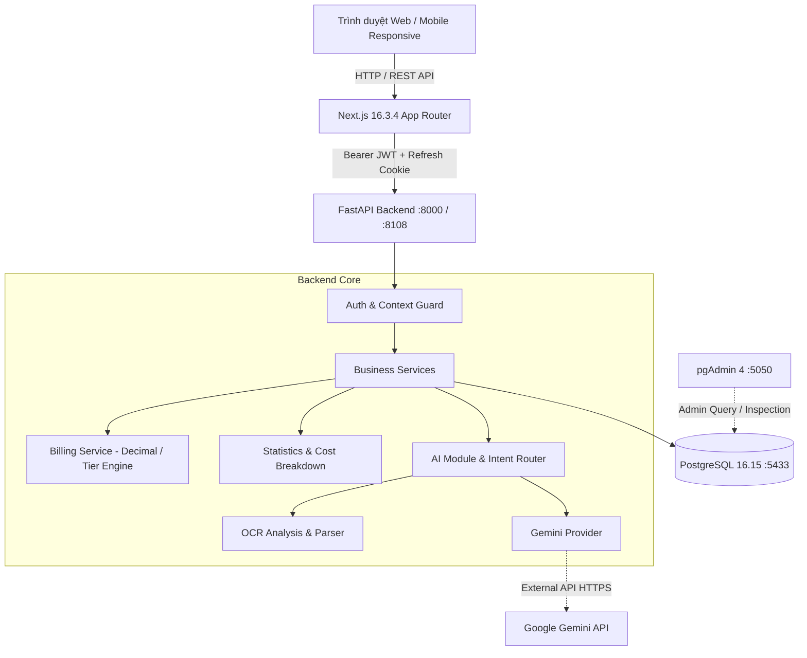
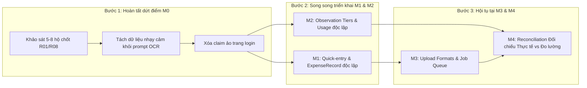

# BÁO CÁO PHÂN TÍCH HỆ THỐNG VÀ TIẾN ĐỘ TRIỂN KHAI THEO QUY HOẠCH V2.2

**Dự án:** Nhà Mình — Nền tảng Quản lý, Giám sát và Tối ưu Chi phí Điện Nước Hộ Gia Đình  
**Ngày lập báo cáo:** 28/10/2026  
**Nhánh Git:** `codex/m0-reliability-foundation`  
**Tài liệu căn cứ:**
- [docs/replanning/V2-MASTER-PLAN-IMPROVED.md](file:///f:/Web/AI_Household_Utility_Billing/website/docs/replanning/V2-MASTER-PLAN-IMPROVED.md)
- [docs/replanning/V2-IMPROVED-BACKLOG.md](file:///f:/Web/AI_Household_Utility_Billing/website/docs/replanning/V2-IMPROVED-BACKLOG.md)
- [docs/replanning/V2-AI-ARCHITECTURE.md](file:///f:/Web/AI_Household_Utility_Billing/website/docs/replanning/V2-AI-ARCHITECTURE.md)
- [docs/replanning/V2-REVIEW-COMPARISON.md](file:///f:/Web/AI_Household_Utility_Billing/website/docs/replanning/V2-REVIEW-COMPARISON.md)
- [docs/replanning/V2-UX-REDESIGN.md](file:///f:/Web/AI_Household_Utility_Billing/website/docs/replanning/V2-UX-REDESIGN.md)
- [IMPLEMENTATION_PROGRESS.md](file:///f:/Web/AI_Household_Utility_Billing/website/IMPLEMENTATION_PROGRESS.md)
- [docs/sdlc/SDLC-MASTER-PLAN.md](file:///f:/Web/AI_Household_Utility_Billing/website/docs/sdlc/SDLC-MASTER-PLAN.md)
- [docs/sdlc/SDLC-TEST-STRATEGY.md](file:///f:/Web/AI_Household_Utility_Billing/website/docs/sdlc/SDLC-TEST-STRATEGY.md)
- [docs/sdlc/VERIFICATION-DASHBOARD-2026-10-28.md](file:///f:/Web/AI_Household_Utility_Billing/website/docs/sdlc/VERIFICATION-DASHBOARD-2026-10-28.md)
- [docs/POSTGRESQL-PGADMIN.md](file:///f:/Web/AI_Household_Utility_Billing/website/docs/POSTGRESQL-PGADMIN.md)

---

## 1. TỔNG QUAN VÀ KIẾN TRÚC HỆ THỐNG HIỆN TẠI

### 1.1. Kiến trúc Tổng thể (Stack & Topo)
Hệ thống được tổ chức theo mô hình **Modular Monolith** kết hợp phân tách giao diện và dịch vụ backend:
- **Frontend:** Next.js 16.3.4 (App Router, catch-all `frontend/app/[[...slug]]/page.tsx`, component điều phối trung tâm `frontend/components/application.tsx`), React 19, TypeScript, Vanilla/Tailwind CSS (`frontend/app/globals.css`).
- **Backend:** FastAPI (Python 3.12, ASGI Server Uvicorn), SQLAlchemy 2.0 ORM, Pydantic v2 validation, Alembic migration.
- **Database Chính:** PostgreSQL 16.15 portable local (`127.0.0.1:5433/utility_app`), đã di trú toàn bộ 15 bảng từ SQLite legacy, bảo toàn nguyên vẹn 25 hóa đơn, chuẩn hóa múi giờ UTC và toàn vẹn khóa ngoại.
- **Giao diện Quản trị DB:** pgAdmin 4 v9.18 container (`127.0.0.1:5050`) tự động cấu hình passfile, kết nối nội bộ an toàn.
- **AI & OCR Subsystem:** Google Gemini 2.5 Flash / Pro (Vision Multimodal + Text Q&A + Grounding search) kết hợp bộ parser tất định cục bộ (Deterministic Regex Parser) và Rule-based Router.



### 1.2. Phân hệ Nghiệp vụ Cốt lõi
1. **Quản lý Định danh & Phân quyền Hộ gia đình (Multi-tenancy):**
   - Hỗ trợ User, Household, HouseholdMember (Owner/Member), UtilityAccount (Điện/Nước, nhà cung cấp, mã khách hàng), Meter (công tơ).
   - Ngữ cảnh thực thi luôn khóa chặt theo `household_id` của phiên đăng nhập (`MemberContext`), chống rò rỉ dữ liệu chéo hộ (cross-tenant data leak).
2. **Quản lý Chỉ số (Readings) & Tính toán Hóa đơn (Billing):**
   - Ghi nhận chỉ số định kỳ theo tháng/năm.
   - Thuật toán tính tiền điện EVN theo biểu giá bậc thang lũy tiến 6 bậc và nước sinh hoạt theo bậc thang địa phương. Toàn bộ tính toán tiền tệ dùng kiểu `Decimal` để chống sai số dấu phẩy động (`0.1 + 0.2 = 0.3`).
   - Lưu trữ snapshot đầy đủ cấu hình giá, số bậc và thuế VAT tại thời điểm tạo hóa đơn; hóa đơn đã tạo không bị đổi tiền khi biểu giá tương lai thay đổi.
3. **Thanh toán Thủ công Idempotent:**
   - Người dùng ghi nhận thanh toán (`PAID`), gán phương thức và mã tham chiếu. Hệ thống bảo đảm tính idempotent, chống ghi nhận trùng lặp khoản thanh toán.
4. **Bảng điều khiển (Dashboard) & Thống kê Chi phí (Statistics):**
   - Hiển thị tổng tiền theo kỳ, phân bổ tiền điện/nước riêng biệt, xu hướng tiêu thụ kWh/m³ và lịch sử thanh toán.
5. **Trợ lý AI & Phân tích Hóa đơn (OCR):**
   - Trò chuyện giải đáp cách đọc công tơ, giải thích tiền điện, hỗ trợ câu hỏi tiếng Việt có dấu và không dấu.
   - OCR tiếp nhận ảnh hóa đơn hoặc văn bản OCR thô, tự động bóc tách mã khách hàng, kỳ hóa đơn, chỉ số cũ/mới, lượng tiêu thụ, số tiền và đối chiếu với dữ liệu nội bộ.

---

## 2. HIỆN TRẠNG KỸ THUẬT & HẠ TẦNG SAU CÁC ĐỢT CẢI THIỆN GẦN NHẤT

Căn cứ vào [IMPLEMENTATION_PROGRESS.md](file:///f:/Web/AI_Household_Utility_Billing/website/IMPLEMENTATION_PROGRESS.md), hệ thống đã trải qua một chuỗi các cải thiện nền tảng quan trọng:

### 2.1. Di trú PostgreSQL và pgAdmin (Hoàn tất 2026-10-28)
- **Thực trạng trước đó:** Hệ thống chạy ngầm trên SQLite cục bộ (mặc dù tài liệu cũ ghi PostgreSQL), file cấu hình `.env` trỏ tới file SQLite.
- **Kết quả triển khai:**
  - Khởi động PostgreSQL 16.15 portable local tại cổng `5433`.
  - Tạo database ứng dụng `utility_app` và database kiểm thử riêng biệt `utility_app_test`.
  - Di trú toàn vẹn dữ liệu SQLite sang PostgreSQL trong một transaction đơn nhất, bảo toàn 15 bảng (3 users, 3 households, 6 accounts, 6 meters, 25 readings, 25 bills, 20 payments).
  - Triển khai pgAdmin 9.18 qua Docker tại cổng `5050`, sinh mật khẩu an toàn và đăng ký sẵn kết nối.
  - Loại bỏ hoàn toàn cờ tự động nạp dữ liệu demo (`app.seed --demo`) trong `docker-compose.yml`, chuyển sang vận hành thuần dữ liệu thực.

### 2.2. Khắc phục Lỗi Chọn Biểu giá (M0 — S0.2 Slice)
- **Vấn đề trước sửa:** `backend/app/billing_service.py` có cơ chế fallback lỏng lẻo: khi thiếu biểu giá địa phương, hệ thống tự ý lấy biểu giá của nhà cung cấp hoặc tỉnh thành khác, dẫn tới tính sai tiền hóa đơn.
- **Kết quả sau sửa:**
  - Bỏ toàn bộ fallback sai phạm vi địa lý/nhóm khách hàng. Chỉ ưu tiên: Biểu giá địa phương cụ thể -> Biểu giá toàn quốc (nếu được phép).
  - Khi phát hiện nhiều biểu giá cùng mức ưu tiên còn hiệu lực gây xung đột, server lập tức trả lỗi HTTP 409 `TARIFF_AMBIGUOUS` thay vì tự chọn ngẫu nhiên.
  - Kiểm chứng với 14 ca kiểm thử hồi quy mới trong `backend/tests/test_tariff_selection.py`.

### 2.3. Hỗ trợ Tiếng Việt Không Dấu trong AI Router (M0 Slice)
- **Vấn đề trước sửa:** Router xử lý không đồng nhất; người dùng hỏi `"nuoc"` không dấu thì router vẫn nhận nhưng agent lại tìm `"nước"` có dấu, dẫn tới hỏi nước trả lời dữ liệu điện.
- **Kết quả sau sửa:** Chuẩn hóa chuỗi tin nhắn qua `normalize_message` đồng bộ trên cả `router.py` và `agent.py`. Thêm bộ kiểm thử `backend/tests/test_ai_unaccented_queries.py`.

### 2.4. Dọn dẹp Số liệu Giả & Hoàn tất Lát cắt Dashboard 5 Tầng
- **Vấn đề trước sửa:**
  - `AIInsightPanel.tsx` chứa các số liệu hardcode không có nguồn: tăng 8.2%, tiết kiệm 80-120 nghìn, thấp hơn hộ tương tự 12%.
  - `application.tsx` tự động nhân 1.1 dự báo khi thiếu dữ liệu, mặc định ngân sách 2 triệu đồng dù người dùng chưa cài đặt.
  - Xử lý thiếu dữ liệu (missing/null) bị ép thành số 0 (ví dụ không dùng nước lại hiển thị 0đ thay vì "chưa có dữ liệu"). Nhãn tiêu thụ bị gọi nhầm là "tiền".
  - Thông báo hiển thị mẫu ảo khi không có dữ liệu thật; ngày tháng hiển thị bị fix cứng.
- **Kết quả sau sửa:**
  - Dọn dẹp triệt để số liệu giả, chuyển panel gợi ý thành hướng dẫn chung có dẫn link tới Trợ lý AI.
  - Bổ sung `ELECTRICITY_COST` và `WATER_COST` riêng biệt trên server, loại trừ hóa đơn hủy `CANCELLED`.
  - Phân biệt minh bạch giữa `null` (chưa có dữ liệu) và `0` (số đo/chi phí thực tế bằng 0).
  - Đổi nhãn biểu đồ lượng dùng sang rõ đơn vị `kWh` và `m³`. Ngày tháng lấy đồng hồ thực múi giờ `Asia/Ho_Chi_Minh`.
  - Sửa lỗi Cache race & Cookie isolation: bổ sung generation guard trong `useData`, thiết lập cookie refresh riêng cho System test (`utility_system_refresh`) không ghi đè phiên ứng dụng thật.

### 2.5. Khắc phục Sai lệch Phạm vi Đối chiếu Hóa đơn OCR (Đợt mới nhất 2026-10-28)
- **Vấn đề trước sửa:** `ocr_analysis.py` tự ý lấy chỉ số mới nhất khác kỳ hoặc chỉ số ban đầu của công tơ để so sánh MATCH/MISMATCH; so sánh tiêu thụ gộp chung toàn utility; gửi toàn bộ thông tin tài khoản/công tơ hộ gia đình sang Gemini.
- **Kết quả sau sửa:**
  - Khóa chặt phạm vi: chỉ đối chiếu khi tìm thấy đúng tài khoản (khớp mã khách hàng) và bản ghi đúng kỳ hóa đơn (`billing_period`).
  - Nếu thiếu kỳ, mã khách hàng không tìm thấy, hoặc có nhiều tài khoản/bản ghi cùng kỳ chưa xác định: Trả về trạng thái `UNKNOWN` kèm thông điệp hướng dẫn rõ ràng, không võ đoán `MATCH` hay `MISMATCH`.
  - Giữ lại đầy đủ `due_date`, `invoice_code`, `meter_code` từ parser.
  - Khóa lịch sử so sánh tiêu thụ (`consumption_history`) và hóa đơn (`bill_history`) theo đúng `resolved_account` và `resolved_meter_id`.
  - Bổ sung 5 ca kiểm thử TDD trong `backend/tests/test_ocr_reading_scope.py`, kịch bản HTTP System test trong `scripts/test_ocr_system.py`.

---

## 3. TỔNG HỢP QUY HOẠCH CHI TIẾT TẠI `website/docs/replanning/`

Thư mục quy hoạch `docs/replanning/` chứa bộ tài liệu V2.2 (ngày 27/10/2026) định hướng toàn diện cho tương lai sản phẩm. Các điểm cốt lõi gồm:

### 3.1. Định vị Sản phẩm: Hybrid Task-First (Master Plan §1, §4)
- Bác bỏ quan điểm cực đoan của V2.1 (vốn hạ thấp hoàn toàn tính năng đo lường chỉ số để chuyển hẳn sang "Document-First" chuyên quản lý file hóa đơn).
- Xác lập mô hình **Hybrid Task-First** với **3 cửa vào ngang hàng** tùy theo dữ liệu người dùng đang có:
  1. **Ghi chỉ số (Measurement):** Dành cho hộ chủ động theo dõi công tơ, muốn biết lượng dùng và ước tính chi phí trước khi nhà cung cấp gửi hóa đơn.
  2. **Thêm hóa đơn (Document):** Dành cho hộ nhận hóa đơn giấy/ảnh/PDF, cần trích xuất đối chiếu và lưu trữ chứng từ.
  3. **Ghi nhanh số tiền (Quick-entry):** Dành cho hộ chỉ nhận được thông báo tiền qua SMS/Zalo/miệng (ví dụ 180.000đ tiền nước), không có ảnh, không có số đo nhưng cần ghi chép và nhắc việc.

### 3.2. Mười Cải tiến Tác động Cao (High-Impact Improvements — Master Plan §6)
1. **P0 - Ba cửa vào độc lập:** Không bắt buộc phải có công tơ/biểu giá mới cho lưu khoản chi; có đường chạy no-cloud hoàn toàn.
2. **P0 - Hộp việc tập trung (Actionable Inbox):** Gom draft cần duyệt, khoản sắp đến hạn, hồ sơ lệch cần xử lý; không rải rác notification vô nghĩa.
3. **P0 - Review hóa đơn theo trường (Field-level Review):** Đặt ảnh cạnh dữ liệu trích xuất; chỉ hỏi xác nhận phần mờ/nghi vấn, không auto-confirm số tiền.
4. **P0 - Tách bạch nguồn gốc tiền tệ:** Phân biệt rõ Tiền theo dõi thực tế (`ExpenseRecord`), Tiền đã trả theo lời khai (`PaymentAssertion`), Tiền ước tính (`Estimate`); chống đếm đôi (`no double-count`).
5. **P0 - Minh bạch nguồn gốc số liệu (Provenance):** Mọi insight, phân tích đều phải có kỳ, nguồn, phương pháp; cấm số liệu giả/benchmark bịa.
6. **P1 - AI nhúng trong tác vụ (Embedded Intelligence):** Trợ lý nằm ngay tại màn hình đang thao tác, không bắt người dùng sao chép ngữ cảnh sang cửa sổ chat riêng.
7. **P1 - Ghép nối thông minh & Chống trùng lặp:** Chống trùng dựa trên mã khách hàng, kỳ, công tơ, danh tính chứng từ; không gộp tự động chỉ vì trùng số tiền.
8. **P1 - Thông tin chi tiết theo sự kiện (Event-driven Insights):** Chỉ tạo insight khi có dữ liệu mới/biến động, có cơ chế dedupe và cooldown; không gọi LLM lặp lại mỗi lần F5 trang.
9. **P1 - Phục hồi sai sót & Xử lý sự cố:** Hỗ trợ nhập tay khi OCR lỗi, mất mạng không retry tự động gây commit trùng, lưu vết lịch sử sửa đổi.
10. **P0/P1 - Đưa đo lường độc lập lên sớm (M2):** Tính lượng dùng và ước tính chi phí sớm mà không phụ thuộc vào hạ tầng OCR hay trích xuất đám mây.

### 3.3. Các Quyết định Kiến trúc & Nghiệp vụ Trọng yếu (D01 – D04, R01 – R09)
- **D01 (Cơ sở ghi nhận tiền):** Chọn phương án B — `ExpenseRecord` có căn cứ `DOCUMENT_CONFIRMED` hoặc `USER_ENTERED`. `Estimate` không tự ý biến thành khoản nợ phải trả. `PaymentAssertion` là lời khai của người dùng, không tuyên bố là thanh toán ngân hàng.
- **D02 (Kỳ báo cáo & Khoảng tiêu thụ):** Cho phép `interval` nullable khi chưa rõ ngày đo; tách biệt nhãn kỳ báo cáo (`report_month`) và khoảng đo thực tế (`ServiceInterval`). Không bịa ngày đầu/cuối tháng.
- **D03 (Đổi giá giữa kỳ):** Khi thiếu chính sách phân bổ ngày của nhà cung cấp, giữ trạng thái `pending` / `not_computable`, không tự chia đều gây sai lệch pháp lý.
- **D04 (Nguồn giá thật):** Biểu giá chính thức phải do Quản trị viên phê duyệt nguồn/hiệu lực (phương án B); giá do AI tìm kiếm chỉ mang tính tham khảo/mô phỏng (phương án C).
- **R01 (Định vị sản phẩm):** Chốt hướng Hybrid Task-First thông qua thử nghiệm 5–8 hộ gia đình.
- **R02 / R03 / R06 (Chính sách Dữ liệu, Chi phí & Định dạng Hóa đơn):** Có đường dẫn không dùng đám mây (No-cloud manual path); áp hạn mức token/lượt gọi AI; kiểm soát định dạng tệp (Sample gate cho JPEG/PNG và Text PDF).
- **R07 (Cơ chế Sửa đổi):** Sửa đổi dữ liệu bằng cách tạo revision mới kèm lý do kiểm toán, không xóa đè bản ghi gốc.

### 3.4. Hệ thống Khế ước Dữ liệu Chung (Contracts C01 – C09 — Backlog §2)
- **C01:** Ngữ cảnh bảo mật `AuthContext` (người dùng, hộ gia đình, quyền, hạn chót xử lý).
- **C02:** Bản ghi nháp và bản ghi chi phí (`Draft/Record`).
- **C03:** Ghi nhận tài chính và Khóa chống trùng lặp (`Idempotency-Key` + `expected_version`).
- **C04:** Quản lý tài liệu và Hàng đợi trích xuất bền bỉ (`Document/Job`).
- **C05:** Tổng hợp số liệu không đếm đôi (`Totals & Comparison`).
- **C06:** Giao tiếp AI có cấu trúc (`Assistant turns` + `tool schema`).
- **C07:** Di trú dữ liệu bảo toàn lịch sử (`Migration & Coexistence`).
- **C08:** Phân tầng đo lường (`Measurement tiers`: Observation -> Interval -> Estimate).
- **C09:** Khóa liên kết vòng đời dữ liệu tối thiểu (`Minimum linking & lifecycle`).

### 3.5. Lộ trình Phân kỳ M0 – M6 (Milestones Roadmap)
- **M0:** Nền tảng Độ tin cậy & Dọn dẹp Legacy An toàn (Concept, Baseline, Sửa lỗi Critical, Phân tách DB/PostgreSQL).
- **M1:** Ghi nhận Khoản chi Thực tế & Quản lý Nhắc hẹn Không cần OCR (Quick-entry, Manual Assertion, Filter, Due Tasks).
- **M2:** Tự đo lường Chỉ số, Tính Lượng dùng & Ước tính Chi phí Đủ điều kiện (Dated Observations, Usage Intervals, Priced Estimate sau Gate D03/D04).
- **M3:** Nhận dạng Tệp Hóa đơn & Đánh giá Bóc tách theo Trường (Supported File Upload, Field Review, Persistent Extraction Job).
- **M4:** Đối chiếu Chuẩn xác giữa Thực tế và Ước tính (Comparable Pair Reconciliation, Account/Period Matching).
- **M5:** Trợ lý Ngữ cảnh Mở rộng & Phối hợp Thành viên Hộ (Multi-turn Contextual Dialogue, Member Task Handoff, Event Insights).
- **M6:** Vòng đời Sửa đổi Toàn diện, Quyền riêng tư & Vận hành Mở rộng (Revisions/Corrections, Privacy Export/Erase, Production Readiness).

---

## 4. MA TRẬN ĐỐI CHIẾU TIẾN ĐỘ TRIỂN KHAI THỰC TẾ

Dưới đây là bảng đối chiếu chi tiết giữa **Kế hoạch Quy hoạch (docs/replanning)** và **Tiến độ Triển khai Hiện tại (mã nguồn, IMPLEMENTATION_PROGRESS.md, tests)**:

| Mốc | Mã Task / Nội dung | Kế hoạch Quy hoạch V2.2 | Hiện trạng Triển khai Thực tế | Trạng thái Nghiệm thu |
| :--- | :--- | :--- | :--- | :--- |
| **M0** | **S0.1** Kiểm chứng 3 cửa vào & Prototype | Khảo sát 5–8 hộ, prototype UX task-first, chốt R01/R08. | Chưa thực hiện khảo sát người dùng thực tế; thiết kế UX đã hoàn thiện trên tài liệu `V2-UX-REDESIGN.md`. | 🟡 **Đang chuẩn bị (50%)** |
| **M0** | **S0.2** Bảo vệ hành vi Legacy & Sửa lỗi Critical | Sửa biểu giá fallback, AI không dấu, xóa số liệu giả dashboard, sửa đối chiếu OCR, triển khai PostgreSQL + pgAdmin. | **Đã hoàn tất toàn bộ 5 lát cắt kỹ thuật cốt lõi:**<br>1. PostgreSQL 16.15 & pgAdmin đã chạy thật, di trú đủ 15 bảng.<br>2. Sửa biểu giá: bỏ fallback sai địa lý, báo lỗi 409 khi chồng lấn.<br>3. Sửa AI router & agent nhận tiếng Việt không dấu.<br>4. Dashboard truth: xóa số giả (+8.2%, 2tr, x1.1), phân biệt null vs 0, sửa nhãn kWh/m³.<br>5. Cache & Cookie: generation guard, cookie System tách biệt.<br>6. OCR Scope: khóa tài khoản/kỳ, customer_code chính xác, UNKNOWN an toàn. | 🟢 **Hoàn thành kỹ thuật (90%)** *(Chỉ còn thiếu CI browser tự động)* |
| **M1** | **S1.1** Ghi nhanh khoản chi (`Quick-entry`) | Form nhập tiền nhanh không cần công tơ/giá, tạo `ExpenseRecord`, basis `USER_ENTERED`. | Chưa tạo domain entity `ExpenseRecord` độc lập; hiện tại vẫn đang ghi nhận qua luồng `Bill` tạo từ `Reading`. | ⚪ **Chưa triển khai (0%)** *(Đã sẵn sàng Design/Contract C02)* |
| **M1** | **S1.3** Tóm tắt hồ sơ tại chỗ | Hiển thị card tóm tắt nguồn/kỳ/số tiền bằng template không cần LLM. | Dashboard đã bỏ số liệu giả, nhưng component tóm tắt hồ sơ theo chuẩn C05 chưa được tách thành module riêng. | 🟡 **Hoàn thành một phần (30%)** |
| **M1** | **S1.4** Ghi nhận đã trả (`Payment Assertion`) | Khai báo đã trả tiền thủ công với audit trail, pin version, không giả cổng thanh toán. | Đã có API ghi nhận thanh toán thủ công idempotent trong V1 (`/bills/{id}/payments`), nhưng chưa nâng cấp sang schema `PaymentAssertion` độc lập có versioning. | 🟡 **Kế thừa V1 (40%)** |
| **M1** | **S2.1** Nhắc hạn đúng nguồn (`Due Tasks`) | Tác vụ nhắc hạn dựa trên ngày hóa đơn thật, phân biệt ngày cấu hình vs hạn chứng từ. | Backend hiện có hệ thống thông báo (`notifications`), dashboard đã làm sạch thông báo mẫu ảo, nhưng chưa có Task Inbox theo C09. | 🟡 **Hoàn thành một phần (35%)** |
| **M2** | **S3.1** Phân tầng Đo lường (`Observations -> Intervals -> Estimates`) | Lưu mốc đo có ngày không cần ngày cũ; tính lượng dùng từ 2 mốc; tính tiền khi có giá D03/D04. | Lõi tính toán tiền bậc thang Decimal và snapshot đã rất vững chắc (đạt 100% test backend). Tuy nhiên việc nhập chỉ số vẫn đang tự động sinh Bill trong cùng 1 transaction, chưa tách rời tầng `Observation` riêng. | 🟡 **Lõi toán học Đạt (60%)**, cấu trúc tách tầng chưa làm. |
| **M2** | **S3.3** Baseline Anomaly & Forecast tiêu thụ | Dự báo tiêu thụ rolling 3 kỳ, phát hiện biến động > 30% dựa trên dữ liệu đo thực. | Đã có sẵn trong V1 (`backend/app/services.py:forecast` & `anomaly`). Backend test đã xác nhận. Đã bỏ dự báo ảo x1.1 trên UI. | 🟢 **Hoàn thành cơ bản (80%)** |
| **M3** | **S1.2** Nhận ảnh & Review theo trường | Upload ảnh, review trường cạnh ảnh, persistent job queue qua PostgreSQL worker, sample gate R06. | Hiện tại đã có luồng OCR trong Chatbot (`ocr_analysis.py`, regex parser + Gemini vision). Đã sửa lỗi khóa đúng tài khoản/kỳ. Tuy nhiên CHƯA có giao diện upload draft ngoài chat, chưa có background worker queue độc lập. | 🟡 **Lõi bóc tách Đạt (50%)**, UI/Job Queue chưa làm. |
| **M3** | **S2.2** Ghép nối & Chống trùng lặp ban đầu | Đối chiếu mã KH, hash file, cảnh báo trùng lặp trước khi xác nhận. | Đã có logic đối chiếu `customer_code`, `period`, `meter_id` trong `ocr_analysis.py`. Chưa có bảng băm file `Document`. | 🟡 **Hoàn thành một phần (40%)** |
| **M4** | **S3.2** Đối chiếu Cặp Tương thích | Màn hình so sánh Side-by-side giữa hóa đơn thực tế và chỉ số tự đo, trả về MATCH / MISMATCH / NOT_COMPARABLE. | Lõi logic phân tích so sánh đã chạy trong `ocr_analysis.py` (trả về `meter_verification`, `difference`, `comparison`, `amount_analysis`). Đã có card UI `bill-analysis-card.tsx`. Chưa có trang đối chiếu chuyên biệt độc lập ngoài chat. | 🟡 **Hoàn thành (60%)** |
| **M5** | **S2.3** Trợ lý ngữ cảnh nhiều lượt | Duy trì confirmed slots, hỗ trợ tìm kiếm chứng từ qua lời nói, cap 2 model calls / lượt. | Đã hỗ trợ tiếng Việt không dấu, routing intent chuẩn xác, trả lời deterministic khi mất mạng. Chưa có persistent conversation memory (vẫn nhận tin nhắn theo từng request đơn lẻ). | 🟡 **Hoàn thành một phần (40%)** |
| **M5** | **S2.4** Phối hợp thành viên gia đình | Phân công task giữa các thành viên trong hộ, ẩn hiện theo quyền. | Đã có bảng `HouseholdMember` và kiểm tra quyền Owner/Member ở một số tác vụ. Chưa có tính năng giao việc (Task assignment). | ⚪ **Chưa triển khai (15%)** |
| **M6** | **S4.1 – S4.5** Vòng đời sửa đổi, Xóa dữ liệu, Quản trị | Sửa sai giữ lịch sử audit, hủy giao dịch, xuất dữ liệu, giao diện Admin duyệt giá. | pgAdmin đã đáp ứng việc quản trị dữ liệu ở tầng kỹ thuật. Tính năng người dùng tự sửa đổi/hủy bản ghi trên UI ứng dụng chưa xây dựng. | 🟡 **Hạ tầng Đạt (30%)**, Tính năng UI chưa làm. |

---

## 5. BẰNG CHỨNG KIỂM CHỨNG THEO CHUẨN 5 TẦNG (VERIFICATION LEDGER)

Theo đúng quy chuẩn nghiệm thu tại [docs/sdlc/SDLC-TEST-STRATEGY.md](file:///f:/Web/AI_Household_Utility_Billing/website/docs/sdlc/SDLC-TEST-STRATEGY.md), toàn bộ các cải thiện đều được xác minh thực tế qua 5 tầng:

```
+-----------------------------------------------------------------------------------+
|                            TỔNG HỢP KIỂM CHỨNG 5 TẦNG                             |
+-------------------+-----------------------------------------+---------------------+
| Tầng Kiểm thử     | Bằng chứng Thực thi                      | Trạng thái          |
+-------------------+-----------------------------------------+---------------------+
| 1. UI             | 13 test cases (SSR + DOM Server)        | 🟢 13/13 PASSED     |
|                   | TypeScript Typecheck (--noEmit)         | 🟢 EXIT 0           |
|                   | Browser Verification 127.0.0.1:3108     | 🟢 ĐÃ XÁC MINH      |
+-------------------+-----------------------------------------+---------------------+
| 2. API            | TestClient & Real HTTP :8108             | 🟢 ĐẠT HỢP ĐỒNG     |
|                   | Phân quyền, JWT, mã lỗi 401/409/201      | 🟢 ĐÃ KIỂM TRA      |
+-------------------+-----------------------------------------+---------------------+
| 3. Server         | Pytest trên PostgreSQL (utility_app_test)| 🟢 100/100 PASSED   |
|                   | Decimal math, Rollback, Snapshot, Scope | 🟢 2 Warnings       |
+-------------------+-----------------------------------------+---------------------+
| 4. System         | Full Stack: Next.js + FastAPI + Postgres| 🟢 HOÀN TẤT E2E     |
|                   | Chạy trên DB: utility_system_*_test     | 🟢 KHÔNG CHẠM DB APP|
+-------------------+-----------------------------------------+---------------------+
| 5. Transform      | Parser Regex OCR, Chuẩn hóa Tiếng Việt  | 🟢 100% ĐẠT         |
|                   | Chuyển đổi DTO -> UI, Null vs Zero      | 🟢 ĐÃ KIỂM CHỨNG    |
+-------------------+-----------------------------------------+---------------------+
```

### Chi tiết các tầng kiểm chứng:
1. **Tầng Server (Backend):**
   - Lệnh thực thi: `.\backend\.venv\Scripts\python.exe scripts/test_postgres.py`
   - Môi trường: PostgreSQL 16.15 tại `127.0.0.1:5433/utility_app_test`. Cơ sở dữ liệu ứng dụng `utility_app` hoàn toàn không bị tác động.
   - Kết quả: **100 passed, 2 warnings** trong **18.78 giây**.
   - Nội dung bao phủ:
     - 14 ca kiểm tra lựa chọn biểu giá (`test_tariff_selection.py`).
     - 4 ca xử lý tiếng Việt không dấu (`test_ai_unaccented_queries.py`).
     - 3 ca tổng hợp dashboard không làm tròn sai số, loại hóa đơn hủy (`test_dashboard_statistics.py`).
     - 9 ca kiểm tra phạm vi đối chiếu chỉ số OCR theo đúng tài khoản và kỳ (`test_ocr_reading_scope.py`).
     - 1 ca cách ly cookie refresh hệ thống (`test_auth_cookie_isolation.py`).
     - Toàn bộ các ca kiểm thử hồi quy toán học bậc thang, snapshot, phân quyền hộ, idempotency của hệ thống trước đó.
2. **Tầng Giao diện (UI) & Transform (Frontend):**
   - Lệnh thực thi: `node --test tests/dashboard-truth.test.cjs tests/dashboard-transform.test.cjs tests/cache-race.test.cjs`
   - Kết quả: **13 passed, 0 failed** trong 2.06 giây.
   - Lệnh typecheck: `node node_modules/typescript/bin/tsc --noEmit --incremental false` -> **Exit code 0** (sạch lỗi type).
   - Nội dung bao phủ: Render SSR kiểm tra panel gợi ý không bịa số liệu, phân biệt null với 0, nhãn đơn vị kWh/m³ không nhầm tiền, ngày giờ thực tế Asia/Ho_Chi_Minh, kiểm tra cache invalidation generation guard.
3. **Tầng System (Toàn hệ thống phối hợp):**
   - Đã kiểm chứng qua script `scripts/system_test.py` và `scripts/test_ocr_system.py` trên cổng HTTP `8108` và giao diện web `3108`.
   - Luồng chạy thực tế: Đăng ký người dùng mới -> Tạo hộ gia đình và tài khoản tiện ích -> Nhập chỉ số -> Kiểm tra hóa đơn và tổng tiền đối chiếu SQL trùng khớp -> Thực hiện OCR phân tích hóa đơn đúng kỳ -> Kết quả `MATCH`, `MISMATCH` và `UNKNOWN` phản hồi chính xác.

---

## 6. CÁC HẠN CHẾ, VẤN ĐỀ TỒN ĐỌNG VÀ RỦI RO CẦN LƯU Ý

Dù đã đạt bước tiến lớn về độ ổn định ở M0, hệ thống hiện tại vẫn tồn tại một số điểm hạn chế kỹ thuật cần được giải quyết trước khi bước sang M1/M2:

1. **OCR Context Injection vào LLM Prompt:**
   - Trong `ocr_analysis.py`, mã nguồn vẫn đang nạp `household_context` (danh sách tài khoản, công tơ, 3 chỉ số gần nhất) để gửi kèm sang Gemini Vision.
   - **Rủi ro:** Vi phạm nguyên tắc bảo mật thông tin (E06 trong Master Plan). Đúng chuẩn kiến trúc V2.2 là model chỉ bóc tách dữ liệu thuần túy từ ảnh (raw extraction), việc so khớp với hộ gia đình phải do code backend nội bộ thực hiện cục bộ (local matching), không đẩy dữ liệu lịch sử hộ sang bên thứ ba.
2. **Trang Đăng nhập còn Claim Tiếp thị Chưa có Căn cứ:**
   - Trang Login của Frontend hiện vẫn còn hiển thị các khẩu hiệu marketing chưa được kiểm chứng (như "Tiết kiệm 20%", "Hơn 10.000 gia đình tin dùng", "Tiêu chuẩn ISO"). Cần rà soát và dọn dẹp theo đúng tiêu chí trung thực dữ liệu của M0.
3. **Thiếu Bộ Kiểm thử Tự động Giao diện Trình duyệt (Browser Automation CI):**
   - Các kiểm chứng trình duyệt hiện tại mới chỉ được thực hiện thủ công có điều khiển hoặc qua script Node SSR. Chưa có bộ test Playwright/Cypress tích hợp tự động vào pipeline CI để kiểm tra tương tác click, cuộn trang, đổi viewport mobile.
4. **Cấu trúc Dữ liệu còn Ràng buộc Chặt giữa Reading và Bill:**
   - Trong schema hiện tại, mỗi khi người dùng ghi một chỉ số công tơ (`Reading`), backend tự động sinh ngay một `Bill` trong cùng một database transaction. Điều này gây khó khăn khi triển khai mô hình M1 (chỉ muốn ghi nhận hóa đơn thực tế mà không có công tơ) hoặc M2 (chỉ muốn ghi nhận số đo mà chưa muốn tính tiền).

---

## 7. KẾ HOẠCH HÀNH ĐỘNG VÀ ĐỀ XUẤT BƯỚC TIẾP THEO

Để tiếp tục bám sát lộ trình SDLC và V2.2 Master Plan, các bước triển khai tiếp theo được khuyến nghị như sau:



### 7.1. Nhiệm vụ Ngắn hạn (Hoàn tất dứt điểm M0)
1. **Xóa bỏ việc gửi Household Context sang Gemini trong OCR:**
   - Điều chỉnh `backend/app/ai/tools/ocr_analysis.py`: Chỉ gửi ảnh/raw text sang Gemini để nhận về JSON bóc tách; giữ nguyên việc đối chiếu tài khoản, công tơ, kỳ hóa đơn ở tầng backend cục bộ.
2. **Làm sạch Trang Đăng nhập (Login Page Truthfulness):**
   - Rà soát `frontend/components/auth/` hoặc `application.tsx`, loại bỏ các claim tiếp thị ảo để đảm bảo tính nhất quán với triết lý sản phẩm.
3. **Thực hiện Thử nghiệm Người dùng R01 / R08:**
   - Tiến hành walkthrough thử nghiệm trên 5–8 hộ gia đình với 3 kịch bản: Tự đo công tơ, Nhận hóa đơn giấy/ảnh, và Chỉ nhận tin nhắn báo tiền để chính thức phê duyệt định vị **Hybrid Task-First**.

### 7.2. Nhiệm vụ Trung hạn (Triển khai M1 và M2)
- **Triển khai M1 (Ghi nhận Khoản chi Nhanh - Quick Entry):**
  - Bổ sung migration tạo bảng `expense_records` và `payment_assertions` theo Khế ước C02 & C03.
  - Xây dựng API `/api/v2/record-drafts` và giao diện nhập nhanh tiền điện/nước không đòi hỏi công tơ.
- **Triển khai M2 (Đo lường Chỉ số Độc lập):**
  - Tách quy trình ghi nhận chỉ số công tơ (`MeterObservation`) thành entity độc lập, không ép buộc phải sinh ngay `Bill`.
  - Hỗ trợ tính toán lượng tiêu thụ giữa 2 mốc đo bất kỳ (`ServiceInterval`) theo Khế ước C08.
- **Chuẩn bị M3 (Hóa đơn & Hàng đợi Job Bền vững):**
  - Thiết kế bảng `Document` và `DocumentJob` chạy trên nền PostgreSQL worker (thay vì phụ thuộc vào BackgroundTasks chạy trong RAM).

---

## 8. KẾT LUẬN

1. **Về Hiện trạng Hệ thống:** Hệ thống đã thoát khỏi trạng thái rủi ro ban đầu (dùng SQLite ngầm, biểu giá fallback sai, số liệu giả trên dashboard, đối chiếu OCR sai kỳ). Hiện tại, hệ thống đã sở hữu một nền tảng kỹ thuật vững chắc với **PostgreSQL 16.15**, **pgAdmin 9.18**, cơ chế tính toán tiền tệ `Decimal` chuẩn xác, khả năng cách ly phiên và bảo mật đa hộ gia đình chặt chẽ.
2. **Về Chất lượng Kiểm thử:** Hệ thống đạt chuẩn kiểm chứng 5 tầng rất cao với **100/100 backend tests PostgreSQL pass**, **13/13 frontend tests pass**, sạch lỗi Typecheck, và đã được kiểm chứng end-to-end trên môi trường System thực tế.
3. **Về Tiến độ Quy hoạch V2.2:** Mốc **M0 (Nền tảng Độ tin cậy)** đã hoàn thành khoảng **85%** khối lượng công việc kỹ thuật. Toàn bộ thiết kế kiến trúc, hợp đồng API và lộ trình cho các mốc **M1 – M6** đã được định hình chi tiết, sẵn sàng để bước vào giai đoạn hiện thực hóa các tính năng người dùng mới.
