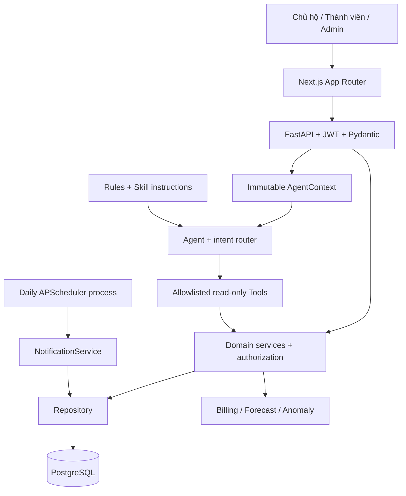

# Kiến trúc

Modular monolith: cùng một backend, chia module theo trách nhiệm. Scheduler là entrypoint khác dùng chung services và schema.

## Transaction và concurrency

`get_db` cung cấp SQLAlchemy Session theo request: commit khi thành công, rollback khi exception. Nhập chỉ số khóa meter/account/household; PostgreSQL row locks cùng unique constraints chống tạo bill trùng. Thứ tự meter → account → household nhất quán. Payment khóa bill và unique bill_id. Notification dùng savepoint để bắt unique conflict, chỉ bỏ qua lỗi đã xác định đúng dedupe key.

## Frontend

Next.js App Router dùng optional catch-all cho các route được yêu cầu; Application chọn screen và tải dữ liệu API. Layout import Tailwind và **Bootstrap grid-only** tránh Bootstrap reboot làm xung đột. Có sidebar/mobile menu, cards, Recharts, form validation, error/empty/loading/toast. Không có dữ liệu giả fallback. Token access giữ trong memory, refresh bằng HttpOnly cookie.

## Mở rộng

Provider API/OCR/IoT cần normalize trước khi vào domain service; chỉ số OCR phải được người dùng xác nhận. Không bổ sung repository riêng cho AI. Tách module đọc/ghi rõ hơn khi quy mô tăng; chưa cần microservices hay message broker.
