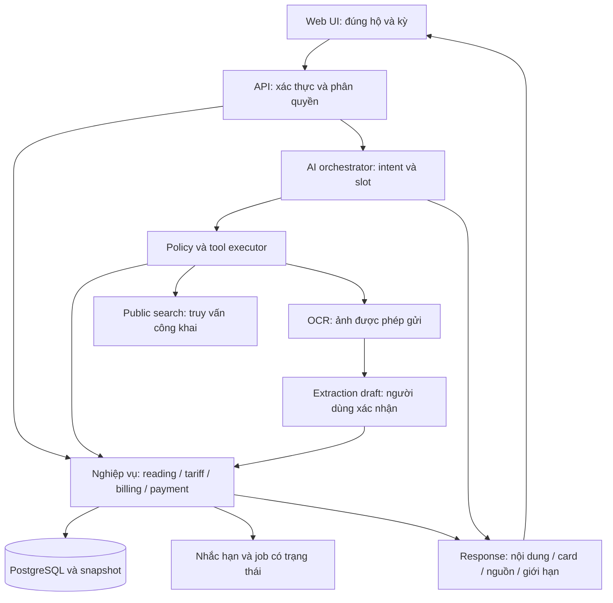

# Phân tích hiện trạng và đề xuất quy hoạch lại Nhà Mình

Ngày: 27/10/2026. Phạm vi: toàn bộ hệ thống trong `website/`.
Trạng thái: BẢN ĐỀ XUẤT ĐỂ REVIEW, chưa phê duyệt triển khai hoặc thay thế dữ liệu.

## 1. Kết luận điều hành

Cần thiết kế lại trải nghiệm và tổ chức lại cách hệ thống thực thi nghiệp vụ, không chỉ đổi màu hoặc thêm chatbot. Điểm yếu lớn là dữ liệu và ngữ cảnh chưa được liên kết đủ chặt xuyên suốt nhập chỉ số → biểu giá → hóa đơn → đối soát → AI. Một số nội dung giao diện và tài liệu tạo cảm giác hệ thống hoàn chỉnh hơn bằng chứng thực tế.

Hướng đề xuất: xây bản V2 theo từng luồng hoàn chỉnh trên nền Next.js, FastAPI và PostgreSQL đang có; giữ thuật toán và kiểm soát đúng, thay các điểm nối yếu, thiết kế lại UI. Không mặc định chuyển sang microservices, xây mô hình AI riêng, hay xóa cơ sở dữ liệu cũ.

Người dùng đã xác nhận chưa hài lòng về giao diện, chức năng, cách hoạt động, AI, skill, rule, luồng xử lý và giao tiếp AI. Đây là yêu cầu quy hoạch toàn hệ thống, không giới hạn ở một trang.

## 2. Nguồn và giới hạn phân tích

Đã đối chiếu các nguồn chính:
- `TONG_QUAN_DU_AN_CHI_TIET.md`: bản tổng quan 1.258 dòng; bản trong `docs/` chỉ là liên kết tới bản gốc.
- `README.md`, `docs/gemini.md`, `docs/verification.md`, `docs/design/open-questions.md`, `docs/design/conflicts-and-assumptions.md`.
- `frontend/app/`, `frontend/components/application.tsx`, `api.ts`, các thành phần dashboard, statistics và UI.
- `backend/app/models.py`, `main.py`, `services.py`, `repository.py`, billing, forecast, anomaly, scheduler.
- `backend/app/ai/agent.py`, router, registry, instructions, rules, skill và OCR/Gemini integration.
- `docker-compose.yml`, cấu hình package và các test backend.

Kiểm chứng mới trong phiên này:
- Backend: 68 passed, 2 deprecation warnings, chạy bằng môi trường `.venv` của dự án với `pytest -q -p no:cacheprovider`.
- Frontend: `npm run typecheck` đạt.
- Bộ fixture mặc định dùng SQLite nếu không có `TEST_DATABASE_URL`; không dùng kết quả trên để kết luận đã kiểm thử PostgreSQL/concurrency.
- Chưa chạy browser E2E, đánh giá hình ảnh thực tế, load test, Docker end-to-end hoặc gọi Gemini thật. Nhận xét UI dưới đây dựa trên cấu trúc code và dữ liệu, chưa phải kết luận kiểm tra trực quan.
- Git status bị chặn bởi ownership khác người dùng sandbox; không sửa global Git config.

Độ chắc chắn: mô tả nhánh code là bằng chứng tĩnh; rủi ro chỉ ra điều có thể xảy ra; mục tiêu V2 là đề xuất, chưa phải chức năng hiện có. Không sử dụng các tuyên bố “100% chính xác”, “production-ready” nếu chưa có điều kiện kiểm chứng cụ thể.

## 3. Hệ thống đang hoạt động thế nào

### 3.1. Kiến trúc và dữ liệu

Frontend dùng một route bắt tất cả `app/[[...slug]]/page.tsx` rồi đưa vào `Application`. Nhiều màn hình chọn theo pathname phía client. API client giữ access token trong bộ nhớ, refresh qua cookie HttpOnly. Backend có controller FastAPI tập trung, dịch vụ nghiệp vụ và repository SQLAlchemy, giao dịch commit/rollback theo request. Scheduler là tiến trình riêng chạy nhắc hạn lúc 07:00 theo giờ Việt Nam.

Có 15 model bảng: User, Household, HouseholdMember, AuthSession, UtilityAccount, Meter, BillingPeriod, MeterReading, Tariff, TariffTier, Bill, Payment, Notification, AIAnalysis, AuditLog.

Tài khoản điện/nước thuộc hộ; công tơ thuộc tài khoản; kỳ tính tiền hiện gắn hộ và tháng; mỗi công tơ có tối đa một reading/kỳ; mỗi tài khoản có tối đa một bill/kỳ. Payment hiện unique theo bill, phục vụ ghi nhận đủ tiền một lần. Có snapshot biểu giá và chi tiết tính tiền.

### 3.2. Luồng nghiệp vụ hiện tại

1. Đăng ký/đăng nhập → chọn hộ hoặc onboarding → tạo tài khoản tiện ích và công tơ.
2. Nhập reading → khóa meter/account/household → kiểm tra kỳ mới và chỉ số tăng → tạo kỳ → tính consumption → chọn tariff → tạo bill → phát cảnh báo/thông báo → audit → commit.
3. Ghi nhận trả tiền → khóa bill → kiểm tra payment hiện có → provider manual → Payment và PAID → thông báo → commit.
4. Scheduler → quét account/bill → phát notification có dedupe key.
5. AI → kiểm tra membership → phân loại từ khóa → chọn tools theo registry → gọi dịch vụ nội bộ hoặc Gemini → dựng câu trả lời và metadata → lưu tóm tắt AIAnalysis.

### 3.3. Điểm nên giữ

- Decimal trong billing, lượng dùng có ràng buộc không âm, snapshot lịch sử.
- Phân quyền server, kiểm tra membership lại tại lúc gọi AI/tool.
- Refresh rotation, Argon2, rollback request, khóa dòng ở thao tác nhạy cảm.
- Allowlist tool và tách public search khỏi truy vấn tính tiền nội bộ.
- Nhắc hạn và payment có cơ chế chống trùng.
- Có test hồi quy, có dữ liệu demo, có migration và đường chạy local.

## 4. Các vấn đề có bằng chứng và mức ưu tiên

### F01 — P0: chọn biểu giá có thể âm thầm sai phạm vi

`backend/app/billing_service.py::tariff` có năm tầng fallback; tầng cuối chọn bất kỳ tariff đang hiệu lực cùng utility type nếu provider không khớp. Tầng trước có thể bỏ category/province. Vì vậy “tính đúng số học” vẫn có thể ra sai hóa đơn nghiệp vụ.

V2: không fallback xuyên provider/category/địa bàn một cách âm thầm. Thiếu hoặc trùng biểu giá hợp lệ phải trả lỗi có hướng giải quyết. Demo chỉ được chọn bằng chế độ demo rõ ràng. Nghiệm thu bằng các fixture khác nhà cung cấp, khác tỉnh, hiệu lực chồng lấn, thiếu giá, đổi giá giữa kỳ.

### F02 — P0: OCR đối chiếu chưa khóa đúng kỳ và tài khoản

`ai/tools/ocr_analysis.py` lấy lịch sử theo utility rồi dùng bản ghi cuối; chưa dùng đầy đủ account, meter, billing period của ảnh để chọn đối tượng so sánh. Khi không có reading còn dùng initial_reading. Báo MISMATCH ở trường hợp này chưa đủ căn cứ để kết luận hóa đơn sai.

V2: trích xuất → nhận diện account/meter/period → người dùng xác nhận nếu mơ hồ → lấy bản ghi cùng kỳ → đối chiếu. Thiếu cặp dữ liệu thì trả NOT_COMPARABLE. Phân biệt ảnh hóa đơn với ảnh mặt công tơ.

### F03 — P0: chính sách dữ liệu AI phải thống nhất với đường gọi thật

OCR đang đưa ảnh, instruction và household_context gồm accounts, meters, latest_readings sang adapter Gemini. Public search là nhánh khác, không có nghĩa mọi hoạt động AI đều local. Tài liệu cũ ghi OCR chưa triển khai đã lỗi thời.

V2: khai báo dữ liệu nào được gửi ra ngoài cho từng tool; OCR chỉ gửi ảnh và dữ liệu tối thiểu cần thiết sau thông báo/xác nhận; đối chiếu DB làm local; không gửi toàn bộ accounts/meters/history để OCR đọc ảnh. Có thời hạn lưu ảnh, xóa ảnh, redaction log và kiểm thử payload.

### F04 — P1: AI còn bị chi phối bởi heuristic ngắn và nhánh hardcode

`ai/router.py` chứa danh sách từ khóa, cả chuỗi cụ thể `350` trong nhận diện phép tính. `agent.py` phối hợp routing, lấy dữ liệu, OCR, giải thích và soạn trả lời trong cùng file. Dễ nhầm giữa “giá nước”, “tiền nước tháng trước” và câu hỏi tiếp nối.

V2: chuẩn hóa request, giải quyết ngữ cảnh hội thoại, nhận diện intent và slot bằng schema; dùng quy tắc cho thao tác rõ ràng, model hỗ trợ trường hợp mơ hồ; thiếu thông tin phải hỏi lại. Tính tiền và quyền truy cập vẫn do code quyết định.

### F05 — P1: file rule/skill chưa tạo ra một hợp đồng thực thi thống nhất

`registry.py` ánh xạ intent → danh sách tools bằng Python; `instructions.py` nối tất cả rule Markdown và SKILL.md. Nhiều nhánh deterministic trả lời trực tiếp. Việc sửa Markdown không đồng nghĩa thay đổi logic mọi nhánh.

V2: một manifest skill có version, input/output, required slots, allowed tools, data policy, limits và evaluation cases. Rule quan trọng được enforce trong server/tool executor; Markdown mô tả cách diễn đạt và quy trình. Kiểm thử phát hiện manifest/registry/prompt lệch nhau.

### F06 — P1: cấu trúc frontend khó kiểm soát thay đổi

`application.tsx`: 1.610 dòng, 116.906 byte; `globals.css`: 6.559 dòng, 124.465 byte ở thời điểm khảo sát. Có UI helper cũ trong file lớn song song các component `ui/`. Dùng `Record<string, any>` và API trả `any`, làm giảm hiệu quả typecheck.

V2: route/layout theo nhóm public/app/admin, feature module có type và service rõ ràng. Tách từ từ theo luồng, giữ URL cũ tương thích. Một bộ component và token được áp dụng thống nhất; không đổi toàn bộ CSS trong một commit.

### F07 — P1: cache cần kiểm chứng khả năng cô lập ngữ cảnh

`endpointCache` hiện key theo đường dẫn như `/bills`, TTL 60 giây. Chỉ nhìn key không phân biệt user/hộ. Cần kiểm tra toàn bộ invalidation và request đang chạy lúc đổi hộ/đăng xuất trước khi kết luận có lộ dữ liệu.

V2: key chứa session/user + household + filters; abort hoặc loại response của context cũ; clear cache lúc logout và switch household; E2E hai hộ có dữ liệu khác nhau. Không coi đây là lỗ hổng đã tái hiện trong phiên phân tích này.

### F08 — P1: ngân sách hiển thị có giá trị mặc định thiếu dữ liệu thật

Dashboard dùng `house.monthly_budget` hoặc mặc định 2.000.000; model Household hiện không có trường ngân sách. Điều này có thể khiến người dùng hiểu số gợi ý là ngân sách đã đặt.

V2: chưa thiết lập thì hiển thị hành động “Đặt ngân sách”; chỉ tính % khi có budget đã lưu. Đề xuất Budget theo household, utility và tháng sau khi luồng billing đã ổn.

### F09 — P1: tính sẵn sàng triển khai chưa đủ bằng chứng

Compose có default secret, APP_ENV development và startup shell `alembic ... && seed ... || true && uvicorn ...`; lỗi migration/seed có thể bị bỏ qua. Rate limit auth nằm RAM một process. Không thấy pipeline CI hay test browser trong phạm vi file khảo sát.

V2: migration fail thì deployment fail; seed demo là lệnh riêng; cấu hình production không nhận secret mặc định. CI chạy core tests, PostgreSQL migration/integration và E2E. Dùng rate limit chia sẻ khi chạy nhiều worker, không lắp thêm Redis chỉ vì có thể.

### F10 — P1: luồng điều chỉnh dữ liệu chưa hoàn chỉnh

Hiện chỉ nhận kỳ mới; payment 1-1; chưa có lifecycle điều chỉnh hóa đơn đã ghi nhận, nhập lại kỳ cũ, thay công tơ giữa kỳ. Không nên mở nút sửa/xóa tùy ý vào dữ liệu tài chính.

V2: chọn rõ giới hạn bản phát hành; draft được sửa, confirmed dùng revision/correction có lý do, bill đã trả phải có quy trình điều chỉnh riêng. Partial payment và meter replacement chỉ bật khi có đặc tả/test.

### F11 — P2: dự báo và bất thường là baseline thống kê

Forecast dùng trung bình trọng số tối đa ba kỳ, nhãn confidence theo số kỳ; anomaly dùng tăng trên 30% so trung bình lịch sử. Đây không phải xác suất tin cậy đã hiệu chuẩn, không suy ra được rò rỉ hay thiết bị hỏng.

V2: hiển thị phương pháp, kỳ dữ liệu, ngày đo, missing data, giới hạn; backtest theo thời gian và so với baseline trước khi nâng mô hình. Chỉ nêu nguyên nhân là giả thuyết cần kiểm tra.

### F12 — P2: tài liệu thiếu phân biệt bằng chứng và tầm nhìn

Tổng quan hiện dùng các kết luận tuyệt đối về chính xác và deadlock; đề xuất Redis giảm 90% chưa có benchmark. Bảng phiên bản Recharts ghi 2.x trong khi package hiện dùng ^3.0.0. `open-questions.md` còn nội dung hệ thống tuyển dụng không thuộc dự án.

V2: mỗi tính năng có trạng thái implemented/tested/proposed/deferred; một bản yêu cầu gốc và traceability; ghi mốc kiểm chứng. Không biến tài liệu mô tả thành chứng nhận chất lượng.

## 5. Ba phương án và khuyến nghị

A. Vá và làm đẹp trên cấu trúc cũ: ít thay đổi ban đầu, phù hợp sửa gấp vài lỗi; khó đáp ứng yêu cầu thay đổi toàn diện hiện tại.

B. Tái cấu trúc theo luồng hoàn chỉnh, thiết kế UI mới, giữ dữ liệu và lõi đã chứng minh: có thể bàn giao dần, đối chiếu trước/sau, giảm nguy cơ mất hành vi đúng. Đòi hỏi kỷ luật tương thích và test. ĐÂY LÀ KHUYẾN NGHỊ, chưa phải lựa chọn người dùng đã phê duyệt.

C. Viết mới toàn bộ trong một lần: tự do kiến trúc nhưng phải dựng lại auth, migration, isolation, billing và test; rủi ro mất dữ liệu/hành vi đúng cao nhất. Chỉ chọn nếu audit tiếp cho thấy phần lõi không thể dùng hoặc yêu cầu đổi nền tảng bắt buộc.

Không yêu cầu người dùng duyệt ở giữa phân tích. Báo cáo và roadmap được cung cấp đầy đủ để việc lựa chọn dựa trên kết quả cụ thể. Chỉ bắt đầu code sản phẩm sau khi thống nhất hướng và phạm vi đợt đầu.

## 6. Tầm nhìn V2 và phạm vi phát hành

Đề xuất định vị: sổ quản lý điện nước có bằng chứng cho hộ gia đình, giúp ghi nhận, ước tính, đối chiếu và hiểu chi phí. AI là trợ lý sử dụng dịch vụ nghiệp vụ đáng tin, không phải nơi giữ luật tính tiền.

Release nền tảng: auth/hộ/quyền, provider và tariff đúng, reading, estimate, manual payment, reminder, dashboard thật, AI đọc dữ liệu và giải thích có nguồn, OCR bản nháp có xác nhận.

Release hoàn thiện: hội thoại nhiều lượt, quản lý correction, ngân sách thật, báo cáo/in, phục hồi tài khoản và lời mời nếu kênh email sẵn sàng; vận hành và bảo vệ dữ liệu.

Chưa đưa vào đường găng: microservices, IoT/MQTT, YOLO/OCR tự huấn luyện, nhà trọ/phân bổ phòng, ngân hàng hoặc EVN đồng bộ thật, ví điện tử. Các hướng này cần yêu cầu và điều kiện tích hợp riêng. VietQR tới tài khoản cá nhân không tự chứng minh đã thanh toán cho nhà cung cấp điện/nước.

## 7. Cấu trúc đề xuất — toàn bộ code trong website

```text
website/
  PRODUCT.md                     # ngữ cảnh sản phẩm bản được phê duyệt
  frontend/
    app/(public)/                # landing, login, register
    app/(app)/                   # layout và route nghiệp vụ
    app/(admin)/                 # route admin
    features/auth/
    features/households/
    features/readings/
    features/bills/
    features/analytics/
    features/assistant/
    components/ui/               # thành phần dùng chung
    lib/api/                     # transport, typed contracts, error mapping
    lib/session/                 # context và vòng đời session/cache
    styles/                      # tokens và style chung có kiểm soát
    tests/                       # component/integration
  backend/
    app/main.py                  # lắp ráp app/middleware/router
    app/core/                    # config, auth context, errors, database
    app/modules/identity/
    app/modules/households/
    app/modules/utilities/
    app/modules/tariffs/
    app/modules/readings/
    app/modules/billing/
    app/modules/payments/
    app/modules/notifications/
    app/modules/analytics/
    app/modules/documents/
    app/ai/                      # orchestrator, policy, skills, tools, providers
    app/jobs/                    # thực thi job có lưu trạng thái khi cần
    alembic/
    tests/unit/
    tests/integration/
    tests/ai_evals/
  e2e/
  scripts/                       # setup, verify, backup/restore
  docs/replanning/               # báo cáo và kế hoạch này
  docs/product/                  # requirements, workflows, glossary
  docs/architecture/             # ADR, ERD, contracts, AI boundaries
  .github/workflows/            # CI nếu Git hosting hỗ trợ
  docker-compose.yml
```

Đây là đích tổ chức, không tạo toàn bộ thư mục rỗng ngay. Mỗi module chỉ có router/schema/service/repository/model khi thực sự cần. Model hiện tại có thể giữ chung trong giai đoạn chuyển tiếp để giảm rủi ro metadata/Alembic. Không đổi tên bảng chỉ để khớp folder.

`website/` đang chứa Git repository; context PRODUCT.md đã tạo ở thư mục cha trong phiên init trước. Khi thực hiện V2 cần đưa bản đã review vào `website/PRODUCT.md` và cập nhật liên kết/config, không giữ hai bản độc lập làm nguồn sự thật. Báo cáo này không tự thay đổi bản context đã được xác nhận trước.

## 8. Quyền và ranh giới module

- Identity: tài khoản, session, refresh, password/recovery. Không đọc hóa đơn để xác thực.
- Households: membership, chọn hộ, owner/member và quyền write/pay; quyền admin hệ thống không mặc nhiên cho phép xem dữ liệu hộ trong AI.
- Utilities: provider danh mục, account, meter và lịch chốt chỉ số.
- Tariffs: phiên bản, phạm vi áp dụng, kỳ hiệu lực, bậc và phí đã cấu hình.
- Readings: draft/confirm, ảnh chứng cứ, validation và correction.
- Billing: pure calculation và estimate snapshot, reconciliation và revision.
- Payments: ghi nhận thủ công; nếu sau này có gateway thì tách attempt/webhook/settlement.
- Documents: upload, quyền xem/xóa, OCR draft và retention.
- Analytics: read model tổng hợp; không tự sửa reading/bill.
- AI: điều phối yêu cầu, policy, tools và câu trả lời; không truy cập SQL tùy ý.

API giữ `/api` tương thích trong giai đoạn đầu; thay đổi schema phá vỡ phải có version/deprecation rõ ràng. Mọi list dài cần pagination/filter; mọi lỗi có code ổn định và request_id. Ngày nghiệp vụ dùng date theo giờ Việt Nam, timestamp lưu UTC, decimal truyền chuỗi.

## 9. Luồng mục tiêu chi tiết

### 9.1. Onboarding

Đăng ký → tạo hộ → khai báo điện/nước → chọn provider/địa bàn/category → đối chiếu tariff hợp lệ → nhập chỉ số đầu và ngày bắt đầu → xác nhận. Có thể chỉ dùng điện hoặc nước; thiếu tariff vẫn được lưu cấu hình hộ nhưng chưa được phát sinh estimate. Có save/resume, không bắt người dùng nhập lại toàn bộ sau lỗi.

### 9.2. Nhập chỉ số và tạo ước tính

Chọn đúng account/meter → nhập số/ngày hoặc OCR draft → server trả reading trước và khoảng thời gian → validate không âm/không lùi/không trùng → preview lượng dùng và nguồn giá → xác nhận → transaction khóa theo thứ tự thống nhất → kiểm tra quyền và version lần nữa → tạo reading, estimate snapshot, audit, notification → trả kết quả. Preview có expiry/version; thay tariff hoặc reading giữa preview và confirm thì yêu cầu preview lại. Idempotency key chống double submit; lỗi không để lại nửa reading/nửa bill.

### 9.3. Đối chiếu hóa đơn thực tế

Upload ảnh → kiểm tra loại/kích thước và quyền → thông báo dữ liệu gửi AI → trích xuất trường kèm nguồn → người dùng xác nhận account/kỳ → tìm estimate cùng account/kỳ → so lượng dùng, bậc, thuế/phí, kỳ chốt → phân loại matched/different/not_comparable → lưu official document riêng nếu người dùng xác nhận. Không tự ghi đè estimate hoặc kết luận nhà cung cấp tính sai khi thiếu thuế/kỳ.

### 9.4. Thanh toán

Bill detail → “Ghi nhận đã thanh toán” → chọn ngày/reference → confirm → server kiểm tra quyền/payable amount → lock + idempotency → ghi nhận → cập nhật số dư/trạng thái → audit. Luôn nhãn manual. Bản nền tảng chỉ trả đủ một lần; trả một phần/hoàn tiền là phạm vi sau, không âm thầm hỗ trợ bằng nhiều row.

### 9.5. Điều chỉnh và thay công tơ

Draft sửa được. Confirmed reading chỉ điều chỉnh qua yêu cầu có reason, version trước/sau và tính lại các kỳ bị ảnh hưởng. Bill đã trả không sửa trực tiếp; tạo bản điều chỉnh có phê duyệt. Meter replacement cần reading đóng, reading mở và hệ số/segment rõ ràng; chưa làm xong thì UI báo chưa hỗ trợ, không dùng thủ thuật đặt số mới thấp hơn.

### 9.6. Nhắc hạn

Ngày cấu hình và ngày trên hóa đơn chính thức là hai nguồn khác nhau. Worker lấy hạn ưu tiên theo nguồn được xác nhận, tạo notification có unique business key, retry có giới hạn. Lưu job run/heartbeat và lỗi; khởi động lại không gửi trùng. Bản đầu in-app; email chỉ bật khi cấu hình và có kiểm chứng delivery.

## 10. Thiết kế AI V2

### 10.1. Pipeline

Request → xác thực → resolve household/conversation → phân loại tài liệu hoặc intent → resolve slots → policy gate → plan giới hạn → tool execution → kết quả có schema → kiểm tra căn cứ → soạn tiếng Việt → lưu trace tối thiểu → trả message/cards/sources/actions.

Orchestrator phải có giới hạn số tool/model call và deadline; không dùng vòng lặp agent vô hạn. Tool lỗi trả trạng thái rõ; không biến quota/timeout thành câu trả lời bịa. SSE là nâng cấp trải nghiệm khi có ích; không yêu cầu WebSocket chỉ để chat.

### 10.2. Hội thoại và ngữ cảnh

Conversation gắn user + household; message có role, thời gian, attachment reference. Context gồm slot đã xác nhận: utility, account, meter, period/range, intent gần nhất. “Còn nước thì sao?” kế thừa kỳ nhưng đổi utility; “tháng trước” quy đổi theo timezone và ngày hiện tại; nhiều tài khoản cùng utility thì hỏi chọn. Đổi hộ khởi tạo context riêng. Không dùng history của hộ A trong câu trả lời hộ B.

AIAnalysis hiện là tóm tắt vận hành, không thay thế kho conversation/messages. Không lưu chain-of-thought; có thể lưu decision code, tool name, phiên bản policy và thời gian để debug.

### 10.3. Skill và rule

Skill manifest đề xuất:
- id/version/purpose; input_schema và output_schema.
- required_slots; allowed_tools; permission; data_classification.
- max_tool_calls; timeout; fallback; examples/evaluation cases.
- prompt hướng dẫn giao tiếp, không chứa bí mật hoặc luật tài chính chỉ bằng lời.

Nhóm skill: household_overview, consumption_analysis/comparison, bill_explanation, forecast, anomaly, configured_tariff, public_tariff_lookup, document_extraction/reconciliation, saving_advice, payment_guidance. Chỉ thêm skill khi có nhu cầu riêng và bộ eval; không tạo hàng chục file chỉ khác vài từ.

Rule enforced bởi code: scope hộ, role/permission, allowlist, schema tool, giới hạn resource, no raw SQL, no external PII trong public search, no automatic write, nguồn/ngày/đơn vị, no fake payment. Rule về giọng nói: rõ ràng, tiếng Việt, không giả nguyên nhân, hỏi ngắn khi thiếu slot.

Phân biệt rule phát triển trong `.agents/` với runtime policy trong `backend/app/ai/`: cài skill cho coding agent không tự bổ sung năng lực cho trợ lý của sản phẩm.

### 10.4. Hợp đồng tool và câu trả lời

Tool nhận AuthContext từ server, không nhận household_id tùy ý từ model. Ví dụ `get_bill_summary(context, account_id, period)` kiểm tra account thuộc hộ trước truy vấn. Tool trả data, provenance, freshness, limitations và typed error. Tool lấy đủ dữ liệu cho câu hỏi, không tải toàn bộ history mọi lần.

Response gồm request_id, conversation_id, status (answered/needs_input/unavailable), message, cards, sources, suggested_actions, limitations. Card tiền lấy từ kết quả service; không parse lại số từ văn bản model. Sources nội bộ ghi account/kỳ/bill id được phép; sources web ghi URL, ngày truy cập, hiệu lực nếu xác minh được.

### 10.5. Ba kênh dữ liệu độc lập

Nội bộ: dữ liệu hộ → service → số liệu → câu trả lời; model chỉ nhận phần tối thiểu cần diễn đạt khi policy cho phép.
Public search: truy vấn chuẩn hóa utility/location/category/date, không có tên hộ, mã KH hay ảnh. Kết quả tham khảo không tự xuất bản tariff.
OCR: ảnh/tài liệu theo consent → extraction → local validation và reconciliation. Không gửi lịch sử hộ để đoán trường không đọc được. Dữ liệu thiếu phải null, không mặc định 0.

### 10.6. AI được phép làm gì

Bản đầu: đọc, phân tích, tạo draft và điều hướng. “Ghi nhận đã trả” trong chat trả action mở form xác nhận, không trả “đã thanh toán”. Nếu sau này cho write tool, phải có proposed action với token một lần, TTL, preview dữ liệu, quyền kiểm tra lại và audit trước/sau.

### 10.7. Eval và vận hành AI

Bộ eval đề xuất tối thiểu 80 tình huống có expected intent/slots/tools/provenance/refusal: tiếng Việt không dấu, nhiều lượt, nhiều tài khoản, kỳ thiếu, số 0, tariff sai, ảnh sai kỳ, injection trong ảnh/web, quota, timeout và cross-house access.

Mục tiêu nghiệm thu đề xuất: 100% các ca kiểm tra quyền và cấm ghi trái phép phải đạt; ít nhất 90% ca intent/slot trên tập cố định; mọi số tiền hiển thị phải khớp service fixture; không trả giá hiện hành đã xác minh nếu không có nguồn. Đây là target, chưa phải kết quả đo. Có human review câu trả lời, log latency/call count/error, không công khai nội dung nhạy cảm. Giới hạn chi phí theo user/ngày và concurrency được cấu hình sau khi đo mức dùng pilot.

## 11. Dữ liệu, trạng thái và migration

Giữ ID và snapshot cũ. Bổ sung theo từng release:
- Provider và tariff applicability rõ ràng; metadata source_url, verified_at, effective dates. Dữ liệu hành chính dùng danh mục versioned, không hardcode danh sách tên trong agent.
- Reading revision/confirmation và optimistic version; document reference thay vì ảnh base64 trong message lưu dài hạn.
- Official document và reconciliation result độc lập estimate; chưa xác minh thì không đánh dấu official verified.
- Conversation/Message/ToolExecution metadata; DocumentExtraction draft; consent/retention metadata.
- Budget nếu được duyệt; NotificationPreference; JobRun nếu đưa xử lý dài sang worker.

State đề xuất: Document uploaded → processing → needs_review → confirmed/rejected/failed. Estimate draft → confirmed → superseded/cancelled. Payment state độc lập; overdue nên suy ra từ due date và unpaid balance, tránh hai nơi tính khác nhau.

Migration theo expand → backfill → validate → switch → contract; thử trên bản sao đã ẩn dữ liệu. Unknown provider không tự map sang Demo. Bill snapshot cũ giữ nguyên, đánh dấu cần review nếu phạm vi giá không xác định. Báo cáo trước/sau gồm số hộ/account/reading/bill, tổng tiền, mapping thất bại. Không drop bảng/cột ở cùng release chuyển đổi. Có backup và diễn tập restore trước cutover.

## 12. Giao diện và trải nghiệm mới

Mục tiêu là hoàn thành tác vụ, có thứ tự thông tin và trạng thái rõ. Thiết kế lại thế giới hình ảnh cần một brief riêng; báo cáo này không chốt màu/font mà người dùng chưa xem.

- Dashboard: đúng hộ/kỳ đang chọn; số tiền ước tính và thực tế phân biệt; việc cần làm nổi bật; so sánh có baseline và missing data rõ ràng.
- Readings: một luồng ngắn nhập → xem trước → xác nhận; hiện reading trước/đơn vị/tariff; lỗi ngay tại field; chặn gửi trùng; dùng được trên điện thoại.
- Bills: filter utility/period/status/source, phân trang; detail có breakdown, chứng từ, payment và lịch sử điều chỉnh.
- Assistant: hội thoại có history và scope hộ; trạng thái đang đọc dữ liệu/đang tra cứu; hỏi tiếp slot; card số liệu có link; retry/cancel khi provider chậm.
- Household: account và meter nằm trong cùng bối cảnh; đổi hộ dễ nhận biết; phân quyền thành viên diễn đạt bằng hành động người dùng.
- Admin: tariff draft/validate/publish/version; xem trước ảnh hưởng; audit và AI failure metadata được che dữ liệu.
- Settings: profile, session, quyền riêng tư AI/ảnh, reminder preference, ngân sách nếu bật.

Tiêu chuẩn nghiệm thu đề xuất: kiểm tra ở chiều rộng 360, 768, 1440px; thao tác bàn phím, label/error/focus, tương phản theo WCAG 2.2 AA cho phạm vi màn hình triển khai; reduced-motion, trạng thái loading/empty/error/forbidden/offline. Không coi build/typecheck là bằng chứng các yêu cầu này đã đạt.

## 13. Hiệu năng, bảo mật và vận hành

Mục tiêu pilot đề xuất, phải đo trên cấu hình staging được ghi lại: API list/core read p95 dưới 500ms với 20 người dùng đồng thời và dataset 100 hộ × 24 kỳ; AI trả trạng thái tiến độ trong 1 giây, deadline end-to-end 60 giây, timeout provider ngắn hơn deadline. Không cam kết thời gian phản hồi model ngoài hệ thống.

Loại N+1 ở bills list; filter/pagination từ DB; index theo household/account/period; đo query count trước/sau. Cache public tariff dùng key location/category/date và có expiry/nhãn stale; không cache dữ liệu riêng theo path chung.

Production config fail-fast, secret từ môi trường không có fallback demo, HTTPS, cookie/CORS đúng origin, giới hạn upload trước decode và kiểm tra định dạng thực, không render HTML model tùy ý. Không đọc hoặc in file .env trong báo cáo. Rate limit AI/upload riêng với auth. Log request_id, tool id, duration/error; che số khách hàng/nội dung ảnh.

Backup DB và document store nhất quán; diễn tập restore; health và readiness riêng; theo dõi lỗi API, queue delay, scheduler heartbeat, provider failure và chi phí. Không lưu ảnh trong git hoặc Next public directory.

## 14. Lộ trình và tiêu chí ra khỏi từng giai đoạn

Ước lượng sơ bộ cho 1 lập trình viên full-time, người dùng phản hồi mỗi tuần; chưa có deadline/ngân sách được xác nhận. Tổng 12–18 tuần, có thể thay đổi sau pilot; không phải cam kết tiến độ. Tuần gồm tích hợp/test, không chỉ viết code. Xem backlog để biết phụ thuộc và acceptance.

G0 — tuần 1: chốt scope và source of truth, demo baseline và data fixtures, lập issue có acceptance, bảo toàn dữ liệu. Exit: danh sách pain point được xác nhận, roadmap chọn phương án, core journey được thống nhất.

G1 — tuần 2–3: khóa các lỗi tin cậy tariff/OCR context/privacy/cache/deployment startup; CI, PostgreSQL tests, typed API nền. Exit: các ca P0 có regression; migration lỗi chặn deploy; core baseline không hồi quy.

G2 — tuần 4–6: onboarding và luồng reading/estimate/payment xuyên suốt; schema/provenance và draft confirmation; tách feature/frontend route/backend modules theo nhu cầu. Exit: người dùng mới hoàn thành hành trình đầu bằng dữ liệu thật, không can thiệp DB.

G3 — tuần 7–9: AI orchestrator, skill manifest, policy enforcement, conversation/slot memory, response cards và eval. Exit: các ca quyền/tiền/nguồn đạt; câu hỏi tiếp nối giữ đúng hộ/kỳ; không dùng AI để sửa DB trực tiếp.

G4 — tuần 10–12: OCR draft có chọn account/kỳ, đối soát cùng kỳ, UI hoàn thiện, reminder, ngân sách nếu ưu tiên được duyệt. Exit: upload lỗi/ảnh mờ/sai kỳ/nhiều meter đều có đường xử lý; responsive và keyboard review đạt.

G5 — tuần 13–15: correction được chọn, báo cáo/in, account recovery/invite nếu có email, staging load/backup/restore và pilot. Exit: người dùng pilot tự thao tác; không còn P0/P1 theo release scope; runbook đã diễn tập.

Dự phòng — tuần 16–18: sửa vấn đề pilot, migration/cutover có rehearsal và bàn giao. Không dùng khoảng này để âm thầm thêm IoT hoặc gateway.

Bản đầu hữu dụng nên nghiệm thu sau G2; không chờ đủ mọi tính năng mới kiểm tra với người dùng.

## 15. Definition of Done và bàn giao

Mỗi luồng có requirement ID, state/permission/error cases, API contract, migration nếu có, test phù hợp, UI đã nhìn trên kích thước mục tiêu và tài liệu trạng thái thật. Test tài chính có fixture ranh giới và số thập phân; concurrency kiểm tra PostgreSQL thật; AI mock tests không thay thế smoke provider thật có kiểm soát.

Release chỉ phát hành khi: core journeys E2E đạt; không còn lỗi chặn trong scope; migration + rollback/restore rehearsal đạt; không còn claim giả; công khai giới hạn; có seed demo tách production; hướng dẫn chạy từ checkout sạch trong website.

Bàn giao gồm README một đường chạy chuẩn, requirements, glossary, ERD/sequence đúng implementation, API schemas, skill/rule catalog, eval report, test report có thời điểm/môi trường, data migration report, backup/restore và known limitations.

## 16. Các quyết định còn mở

Cần người dùng chọn phương án A/B/C sau khi review; khuyến nghị B. Deadline, số người tham gia, mục tiêu đồ án/pilot/public production và ngân sách AI chưa được xác nhận. Đề xuất mặc định để ước lượng là pilot cho hộ gia đình, giữ stack hiện có, AI read-only + draft, manual payment.

Cần chốt trước khi triển khai phần liên quan: cho phép gửi ảnh ra Gemini và thời gian lưu; phạm vi correction và thay công tơ; có cần partial payment không; có email delivery thật không; có giữ tên Nhà Mình không. Không chặn việc hoàn thành bản kế hoạch chỉ vì các quyết định này chưa có; mỗi task liên quan có gate riêng.

## 17. Thứ tự triển khai đề xuất ngay sau khi duyệt

1. Tạo baseline có thể phục hồi, ghi lại journey và fixture hiện tại.
2. Sửa chọn tariff và OCR matching bằng regression tests.
3. Chuẩn hóa privacy và frontend context/cache.
4. Chốt contract và prototype luồng reading/estimate để người dùng review.
5. Hoàn thiện hành trình đầu trước khi mở rộng AI.
6. Đưa AI vào đúng service, triển khai policy/eval và hội thoại nhiều lượt.
7. Hoàn thiện UI toàn hệ thống, vận hành và pilot theo gate.

Phạm vi phiên này là phân tích và quy hoạch; chưa sửa code sản phẩm, migration, dữ liệu, rule runtime hoặc dependency.

## 18. Kết quả review độc lập và quy tắc tạm để lập kế hoạch

Reviewer chỉ ra bốn quyết định nghiệp vụ ảnh hưởng trực tiếp schema. Các đề xuất dưới đây giúp đọc kế hoạch nhất quán; chưa phải quy định ngành điện/nước hoặc yêu cầu người dùng đã duyệt. Phải xác nhận tại G0 trước các task tương ứng.

### D01 — Ghi nhận trả tiền dựa trên giá trị nào

Đề xuất: estimate vẫn là estimate; official document đã người dùng xác nhận tạo payable amount riêng, không ghi đè snapshot. Bản đầu cho phép ghi nhận thủ công “đã trả theo ước tính” khi chưa có chứng từ, với amount_basis=ESTIMATE rõ ràng. Khi chứng từ đến sau mà số tiền khác, tạo trạng thái NEEDS_RECONCILIATION và khoản chênh lệch để người dùng xử lý, không tự đổi PAID hoặc tự bổ sung payment. Nếu muốn chỉ cho trả theo chứng từ thực tế, phải đổi acceptance G2 và quy trình onboarding/bill.

### D02 — Kỳ của account và kỳ báo cáo

Đề xuất: account có consumption interval riêng (start_date/end_date, ngày đo thực), còn YYYY-MM là nhãn kỳ báo cáo. Điện và nước có thể chốt khác ngày; không dùng chung tháng để khẳng định hai khoảng tiêu thụ tương đương. Bỏ một kỳ thì lượng tiêu thụ thuộc khoảng nhiều tháng được ghi rõ, không giả phân bố từng tháng. G2 chỉ cho confirm khi khoảng thời gian xác định được; nhập bù/điều chỉnh lịch sử là phạm vi correction. Cần thiết kế migration từ BillingPeriod hiện gắn household trước khi đổi schema.

### D03 — Đổi giá giữa kỳ

Đề xuất release đầu: khi một interval giao với nhiều tariff version và chưa có quy tắc phân bổ được xác nhận, chặn “ước tính theo giá đã xác minh” và yêu cầu bổ sung dữ liệu/quy tắc; có thể cho lưu reading với estimate_pending. Không tự chia đều theo ngày, không áp giá cuối kỳ cho toàn bộ khoảng rồi coi là chuẩn. Nếu cung cấp mô phỏng bằng giả định, phải chọn rõ giả định, gắn nhãn mô phỏng và lưu policy trong snapshot. Quy tắc tính thực tế cần nguồn theo provider/địa bàn/thời điểm được kiểm chứng trong task chuẩn bị dữ liệu, không suy ra từ tài liệu cũ.

### D04 — Ai chuẩn bị dữ liệu giá cho pilot

Đề xuất pilot giới hạn một provider điện và một provider nước tại địa bàn người dùng chọn. Chủ dự án hoặc người được chỉ định chịu trách nhiệm duyệt nguồn, hiệu lực, nhóm khách hàng và phí; admin nhập/publish, người thực hiện kỹ thuật kiểm tra fixture và snapshot. AI chỉ hỗ trợ tìm tài liệu. Chưa có dữ liệu được duyệt thì demo bằng dữ liệu minh họa có nhãn, không gọi đó là nghiệm thu tính đúng trên dữ liệu thực tế.

### Điều chỉnh dependency sau review

- G2 nghiệm thu bằng NHẬP TAY. OCR là đường mở rộng ở G4, không phải dependency ngầm của hành trình đầu.
- G1 chỉ chặn đối chiếu OCR thiếu căn cứ; matching hoàn chỉnh ở G4 phụ thuộc D01/D02 và contract document.
- T01.2/T01.3 cần hỗ trợ estimate_pending khi reading hợp lệ nhưng giá chưa đủ dữ liệu; không gộp thất bại tính tiền với thất bại lưu bản nháp.
- T01.1 vẫn giữ invariant của luồng confirmed legacy: không để lại confirmed reading/bill nửa vời khi resolve tariff thất bại. V2 draft hoặc reading có trạng thái pending là luồng riêng được định nghĩa rõ, không dùng rollback tùy trường hợp.
- D01–D04 là gate nội dung của G0, không để lập trình viên tự chọn âm thầm.

## 19. Sơ đồ hệ thống mục tiêu



Không có đường từ model trực tiếp sang SQL hoặc cập nhật PAID. Tool thực thi qua service và policy của server.
