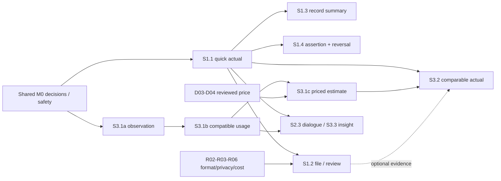

# V2.2 — Improved Backlog và roadmap theo giá trị

Ngày 27/10/2026 · Planning V2.2 · Trạng thái toàn backlog: PROPOSED, chưa duyệt triển khai.
Quy ước: CURRENT là source đang có; VERIFIED chỉ áp cho kiểm chứng có phương pháp/phạm vi/thời điểm ở evidence ledger Master; PROPOSED là phương án mới; DECISION REQUIRED là gate chủ dự án cần duyệt; DEFERRED là phạm vi chưa làm. Không task nào trở thành CURRENT hoặc VERIFIED chỉ vì được viết vào backlog.
Chỉ tạo kế hoạch. Mọi đường dẫn tương đối website/. Tên file/API mới dưới đây là đích đề xuất, chưa tồn tại hoặc chưa đổi.
Đọc Master, UX và AI cùng backlog; decision IDs dùng chung Comparison §5. Kế hoạch cũ giữ nguyên.

## 1. Quy tắc lập và thực hiện backlog

- Mỗi slice cho người dùng một outcome end-to-end; UI/backend/data/AI/test đi cùng. Không task refactor toàn bộ trước tạo giá trị.
- R01/R08 định hướng chung; D01/R05/R07 tối thiểu gate M1 record/payment; D02/R05 gate M2 observation/usage; D03/D04 gate priced estimate, không gate observation/usage. R02/R03/R06 gate M3 file/external, không chặn M1/M2 local.
- Chưa có lệnh sửa sản phẩm. Sau phê duyệt mới tách task thành implementation steps/signatures/migrations theo spec của slice.
- Priority P0 chặn tính đúng/quyền/giá trị đầu; P1 lõi cải tiến; P2 tùy chọn sau evidence. Size S/M/L là tương đối, không đổi thành số ngày.
- Mỗi task phải có regression/AC và trạng thái nguồn; không gọi CURRENT chỉ vì đã ghi task. Chứng cứ hiện trạng E01–E18 ở Master.
- Code mới/fixtures/e2e/scripts chỉ nằm website; không đọc/in .env, không reset dữ liệu hay thay global Git config.
- DoD chung: contract + migrations nếu cần + test thích hợp + UI states/permission/keyboard/mobile + provenance + docs + independent review. Chỉ chạy test môi trường riêng, không DB người dùng.

## 2. Contract nền đề xuất — dùng chung, không lặp/đổi tên âm thầm

Các endpoint mới viết rút gọn như /records hoặc /tasks bên dưới đều tương đối với /api/v2; endpoint legacy được ghi rõ /api. ID và tên field là contract đề xuất cần freeze ở spec slice, không phải API đã triển khai.

**C01 Context/security:** server tạo AuthContext(user_id, household_id, membership_revision, request_id, permissions, deadline). Client khai household rõ trong request/header và context_epoch, server xác minh; không lấy ID model làm quyền. Error {code,safe_message,request_id,fields?,retryable}; 404/403 không lộ entity hộ khác. Capability docs:read/upload/external_process, records:confirm, payments:assert là đề xuất, mapping legacy thuộc R05.

**C02 Draft/record (M1, không là prerequisite measurement M2):** draft {id,version,household_id,origin:MANUAL|EXTRACTION,utility?,account_id?,report_month?,service_interval?,amount?,currency:'VND',due_date?,due_source?,amount_basis,document_refs,field_evidence,warnings}. Unknown=null, amount decimal string, zero hợp lệ. Confirm cần household+utility+amount+currency+basis và lời xác nhận actual charge (không copy estimate thành actual) đã người dùng review; account/period/due có thể null với flag, không fabricate. Record có id/version/source refs, status confirmed/superseded/cancelled; object version kiểm tra lúc confirm.

**C03 Financial write/idempotency:** POST confirm/assertion mang expected_version và Idempotency-Key scoped user/hộ/operation; cùng key/hash replay response, khác hash→409 IDEMPOTENCY_CONFLICT. PaymentAssertion {record_id,record_version,amount,currency,asserted_paid_date,reference?,basis,actor,source:USER_REPORTED|LEGACY_MANUAL}. Bản đầu một full assertion hiện hành/record; amount khác total→NEEDS_REVIEW, không partial/refund. Estimate không tự thành payable. API response không gọi bank/provider verified.

**C04 Document/job:** private upload M3 với bộ format sau sample gate R06, không preset mọi PDF defer. JPEG/PNG/screenshots và text PDF là candidates; scan/multi-page cần evaluation riêng. Ingress/decoded/pixel/page caps theo corpus/resource test, candidate image cap10MiB chưa phải duyệt. Document {id,hash_scope,content_type,size,status,retention_policy_version}; Job {id,document_id,attempt,extractor_version,state,deadline,lease}; state accepted/processing/needs_review/failed/cancelled. Result theo field có null/provenance, không raw model HTML. PDF/multi-page/credit không được ép parse như bill dương.

**C05 Totals/comparison:** query household/account?,report_month?/interval?,basis,as_of; output Decimal totals theo actual/estimate/payment riêng, coverage+unknown_count+source revisions. Không cộng invoice+estimate trùng; missing≠0. Household actual totals gồm record chưa account; account totals loại chúng và hiển thị unallocated_count. report_month null thuộc nhóm Chưa gán kỳ, không tự dùng upload/paid/current month. Source revision đổi→derived stale, recompute version mới không rewrite history. Reconciliation {left_ref/version,right_ref/version,result:MATCH|DIFFERENT|NOT_COMPARABLE,reason_codes,field_deltas}; không rewrite nguồn.

**C06 AI:** dùng schema/version và budget cuối thống nhất ở AI §6/12; route mới POST /api/v2/assistant/turns, conversation/client_turn/context refs; old /api/ai/chat compatibility trong migration. Read models không commit tiền. SuggestedAction chỉ mở preview/confirmation của UI, server mới commit.

**C07 Migration:** preserve ID/snapshot/legacy source; mapping legacy_bill_id và payment_id, count+totals by basis/status+exception report. Upgrade Alembic test từ empty/legacy, rollback app còn đọc record mới; không xóa row mới để ép rollback.

**C08 Measurement tiers (M2, độc lập C02/C04/C06):** Observation {id,version,household_id,account_id,meter_id,value:decimal_string,unit,observed_date/time,source,confirmed_by,status}. Lưu baseline mới không cần previous observation/date cũ hoặc tariff. Interval {start_observation_ref/version,end_observation_ref/version,boundary_policy,consumption,elapsed_days} chỉ derive từ hai compatible dated observations; unknown không bịa đầu/cuối tháng. Estimate {measurement_refs,tariff/policy_versions,amount?,status:COMPUTED|NOT_COMPUTABLE,reasons} không phải ExpenseRecord.

POST /api/v2/meter-observations và /meter-observations/{id}/confirm; POST /usage-intervals/preview; POST /measurement-previews (detailed usage/price preview); POST /estimates tạo version khi đủ điều kiện. C01 auth và C03 idempotency/version protocol dùng chung, không cần tạo record tài chính. POST /meter-observations/{id}/invalidations pin expected_version/reason, ảnh hưởng interval liên quan được preview, giữ lịch sử; không unrestricted historical edit.

Consumption forecast baseline được giữ ở M2 khi đủ chuỗi comparable; predicted_amount nullable nếu thiếu giá. Method/window và insufficient-data rõ, không xác suất low/medium đã calibrated. No-invoice path phải có E2E riêng.

**C09 Minimum linking/lifecycle:** M1 manual/manual candidate+user resolution và cancel/supersede có reason ngay lúc được confirm; M3 manual/document candidate/link có trước tạo khoản. Không unique amount+month; linked business item có một canonical active record/version. Xóa file invalidate pending job/URL/summary theo policy, không erase financial assertion. Paid assertion luôn pin old revision; late document chỉ đổi actual projection sau user confirm proposed revision.

## 3. Revised roadmap và dependency graph V2.2

M là mốc release; ID Epic EP-S0–4 và 20 task Sx.y được giữ nguyên, không còn biểu thị thứ tự. Một task lớn có các acceptance portions được phát hành độc lập, không bắt hoàn thành mọi phần task để release phần đủ điều kiện.

| Mốc | Outcome và task portions | Hard prerequisite | Gate / không phải dependency |
|---|---|---|---|
| M0 | Concept/hồ sơ năng lực/legacy safety S0.1/S0.2 | Identity/security đã có được characterize | R01/R08; không mẫu OCR làm chậm sửa lỗi critical |
| M1 | Quick actual + read/explain + manual assertion + minimumcancel/reversal/due/filter | S1.1→S1.3/S1.4; S2.1 core; S2.3 filter; S3.3 cost delta | D01/D02/R05/R07 tối thiểu, không S1.2/OCR/measurement |
| M2 | Dated baseline→usage→estimate/forecast đủ điều kiện S3.1; S3.3 usage baseline; S1.3 usage summary | Shared M0/C01/C08, observation→compatible interval | D02/R05; D03/D04 CHỈ priced output. Không EP-S1/S2/OCR/Q&A requirement |
| M3 | Supported file→field review→link/create actual S1.2/S2.2 min | C02 actual record từ S1.1, R02/R03/R05/R06, persisted job/delete | Không M2 hoặc expanded conversation; textPDF có thể sớm theo corpus |
| M4 | Exact pair comparison S3.2 + S2.2 rich link/revision | Actual M1 hoặc M3 + applicable measurement/estimate M2 | Không cần ảnh khi actual entered; phải comparable, không latest utility |
| M5 | Expanded S2.3 dialogue/S2.4 handoff/S3.3 insights | Chỉ sources/permissions của capability bật | Không M4 mandatory cho mọi detector/query; R02/R03/R09 khi áp dụng |
| M6 | Broad correction/privacy/admin/recovery/pilot S4.1–4 | Theo enabled scope đã release | Minimum cancel/reverse/invalidate/delete có từ M1/M2/M3, không chờ M6 |

Optional S2.5 budget, S3.4 what-if/forecast nâng cao, S4.5 digest không gate core hoặc forecast baseline M2.

Edges Q→DOC là shared record contract+minimum duplicate capability, không đòi toàn EP-S1/payment xong để test draft. Critical paths: M1=S0→S1.1→summary/assertion; M2=S0→observation→usage, priced output thêm price gate; M3=record seam+format/policy gate→upload/review; M4 hội tụ hai nguồn. Không một longest path duy nhất trước R04/capacity và chosen release scope.

## 4. Epic và task chi tiết

### Epic EP-S0 — Chọn đúng việc và giữ nền đang dùng

**P0 · Size M, uncertainty cao về user need · PROPOSED**

**Mốc V2.2:** M0; safeguards tiếp tục trong mọi mốc

- **Mục tiêu:** Chốt concept có thể phản biện và không làm mất hành vi đúng trước thay domain.
- **Vấn đề:** Reading-first chưa có evidence, claim hardcode/giá sai vẫn tồn tại.
- **User story:** Là chủ dự án, tôi muốn thấy hành trình và giới hạn thật trước khi đầu tư làm lại.
- **Dependency/gate:** Không; R01/R08 được chốt qua task, không giả đã approve.
- **FE / BE / DB / AI:** FE: concept journey/current walkthrough; BE: source/math/auth characterization; DB: baseline/backup plan; AI: claim inventory/eval baseline. Không implementation ở nhiệm vụ này.
- **Input → Output:** Input: hai V2 cũ/source/test/chứng từ che dữ liệu; output: decision log, journey fixture và release risk baseline.
- **API/data contract và vị trí:** C01/C07 + requirement-to-scenario mapping; file docs/product và e2e/ chỉ khi execution được duyệt.
- **Acceptance criteria:** Ba mode measurement/document/quick có trade-off; baseline legacy có nguồn; không dùng sampleOCR/capacity gate để chặn sửa lỗi critical hiện hữu.
- **Test cases:** Review checklist + user walkthrough 5–8 người; legacy fixture snapshots, no data mutation.
- **Rủi ro/giới hạn:** Nhầm phản hồi chủ dự án với research đủ; evidence ledger ghi giới hạn.
- **Tiêu chí hoàn thành:** S0.1/S0.2 reviewed; R01/R08 và gates từng mode rõ; không fake approve, không tắt luồng V1 đúng.

### Task S0.1 — Kiểm chứng ba cửa vào và prototype task-first

**P0 · Size M · PROPOSED**

**Mốc V2.2:** M0, format research R06 không gate M1/M2 local

- **Mục tiêu:** Xác nhận định vị P-A/B/C và scope S1.
- **Vấn đề:** Chưa biết người dùng có ảnh hoặc muốn tự đo không.
- **User story:** Là người trả hóa đơn, tôi muốn chọn cách ghi ít phiền nhất.
- **Dependency/gate:** R01/R08; chưa cần D03/D04.
- **FE / BE / DB / AI:** FE: prototype không product code sau authorization riêng, UX01/04/07/10; BE: domain walkthrough; DB: sample đã ẩn danh; AI: extraction/quick-entry concept và limitations.
- **Input → Output:** Input prior workflow + measurement-only/document/quick fixtures + redacted format corpus; output R01/D01/D02/R06 options/selection, field+metric evidence, không cố chọn doc-first.
- **API/data contract và vị trí:** C02 trên fixture; docs/product/ux-brief, requirements, decision log dự kiến.
- **Acceptance criteria:** So A measurement/Bdocument/Chybrid; người dùng phân biệt estimate/actual/assertion; no-invoice và no-reading đều có outcome, sample nhỏ không đại diện.
- **Test cases:** Equivalent fixture jobs theo mode: 1datedbaseline,2mốc no tariff,actual nofile,PDFtext/photo review,paid vs actual,followup; đo completion/errors/help thay giả sốclick.
- **Rủi ro/giới hạn:** Prototype đẹp che dữ liệu sai; dùng null/zero/multi-account fixtures.
- **Tiêu chí hoàn thành:** Direction là approved hoặc có phương án sửa rõ; không tính silence là đồng ý.

### Task S0.2 — Bảo vệ hành vi legacy và loại claim không căn cứ

**P0 · Size M · PROPOSED**

**Mốc V2.2:** M0 và guardrail mọi mốc

- **Mục tiêu:** Người dùng hiện tại không nhận giá/insight sai trong chuyển tiếp.
- **Vấn đề:** E03–06/E09/E14; legacy có debt không thể đợi V2 xong.
- **User story:** Là người dùng hiện tại, tôi muốn số và trạng thái có căn cứ khi sản phẩm chuyển đổi.
- **Dependency/gate:** Không, có thể song song S0.1; behavior patch chỉ trong execution sau authorization.
- **FE / BE / DB / AI:** FE: AIInsightPanel/AISavingTips/budget/x1.1/real progress/cache epoch; BE: billing resolver/ocr matching fail-closed/config startup; DB: giữ snapshot; AI: no unsupported MATCH và fake personalized claim.
- **Input → Output:** Input: legacy fixtures, risk branches; output: safe legacy behavior và regression report.
- **API/data contract và vị trí:** Legacy /api giữ compatibility; typed TARIFF_NOT_FOUND/NOT_COMPARABLE, safe errors; C01/C07.
- **Acceptance criteria:** Không fallback giá provider khác; OCR chưa xác định pair không kết luận; personalized claim literal không render như data; migration fail stops startup.
- **Test cases:** backend/tests/test_tariff_resolution; wrong-period OCR; e2e auth-switch late response; startup failed migration; all legacy relevant tests.
- **Rủi ro/giới hạn:** Sửa legacy làm rộng scope; không national tariff import hoặc rewrite CSS ở task này.
- **Tiêu chí hoàn thành:** Regression bảo toàn auth/math/snapshot/usage/forecast/anomaly đúng; thay test đang encode OCR matching sai có reason; fail-closed scope, report coverage chưa có, không rewrite history.

### Epic EP-S1 — Hóa đơn đầu thành hồ sơ và việc giải quyết được

**P0 · Size L, uncertainty OCR/vendor policy · PROPOSED**

**Mốc V2.2:** M1 record-first theo nhu cầu, M3 file enrichment; không định vị document-first

- **Mục tiêu:** Ghi actual bằng tay và hiểu/ghi đã trả độc lập OCR; documents bổ sung theo mốc M3 riêng.
- **Vấn đề:** V1 chưa có actual expense path độc lập calculator.
- **User story:** Là hộ mới, tôi muốn lưu việc điện nước đầu tiên bằng dữ liệu đang có.
- **Dependency/gate:** M1: S0.1+D01/D02/R05/R07 tối thiểu; M3file: record seam + R02/R03/R06. Không buộc full EP-S1 trước M2.
- **FE / BE / DB / AI:** FE: capture/review/record/confirmation; BE: docs/records/assertions scoped; DB: additive draft/record/source/job; AI: extraction tối thiểu+embedded template.
- **Input → Output:** Input: ảnh JPEG/PNG hoặc entry manual; output: record có nguồn và assertion manual nếu user confirm.
- **API/data contract và vị trí:** C01–C04/C06/C07; /api/v2/record-drafts, /documents, /records, /payment-assertions.
- **Acceptance criteria:** No-key/no-meter/no-tariff vẫn hoàn thành manual path; cloud consent trước ảnh; không auto financial commit.
- **Test cases:** First-record E2E, blur/quota/null/zero/wrong tenant/duplicate/retry/cancel.
- **Rủi ro/giới hạn:** Cloud trở thành dependency sản phẩm hoặc OCR success giả.
- **Tiêu chí hoàn thành:** M1 release=S1.1/S1.3/S1.4 với minimal due/filter/lifecycle; M3release=S1.2 file portion khi policy/format đủ. Không bundle OCR vào first usable local release.

### Task S1.1 — Ghi nhanh khoản điện/nước và mở lại đúng nguồn

**P0 · Size M · PROPOSED**

**Mốc V2.2:** M1, first usable quick actual không meter/tariff

- **Mục tiêu:** Đường no-cloud tạo giá trị trước khi key/provider sẵn.
- **Vấn đề:** Không có ảnh hoặc không muốn AI vẫn cần lưu tiền/hạn.
- **User story:** Là chủ hộ, tôi nhập tiền nước 180.000 và chưa biết hạn để tìm lại sau.
- **Dependency/gate:** S0.1; D01/D02/R05/R07 tối thiểu cho record cancel; C01 identity chung. Không cần cloud hoặc phép đo.
- **FE / BE / DB / AI:** FE: frontend/features/capture manual + records/detail; BE: modules/records router/schema/service; DB: additive draft/record/source refs; AI: template summary, không LLM bắt buộc.
- **Input → Output:** Input: household/utility/amount/basis, optional account/period/due; output: versioned confirmed record+source USER_ENTERED.
- **API/data contract và vị trí:** POST /record-drafts → id/version; POST /record-drafts/{id}/confirm theo C02/C03; GET /records/{id}; POST /records/{id}/cancellations hoặc supersession được review, có reason/version và giữ lịch sử.
- **Acceptance criteria:** 0 khác null; kỳ null vào Chưa gán kỳ, account null vào unallocated_count. User xác nhận đây là khoản thực tế, không đổi nhãn estimate. Từ M1 có cảnh báo record tương thích: mở bản có, bổ sung evidence, hoặc giữ riêng có lý do. Không unique amount+month; cancel phải giữ audit.
- **Test cases:** Actual attestation vs estimate; manual zero/unknown; concurrent manual duplicate review trên PG; canonical active revision; cancel history; foreign confirm; key conflict; E2E no-key/no-OCR.
- **Rủi ro/giới hạn:** Amount tự nhiên như180 nghìn parse sai; manual form là baseline, parser phải preview.
- **Tiêu chí hoàn thành:** Contract/type/migration/record E2E+permission/mobile/error states đạt; legacy snapshot unchanged.

### Task S1.2 — Nhận ảnh, trích xuất và review theo trường

**P0 · Size L · PROPOSED**

**Mốc V2.2:** M3, không gate first usable M1/M2

- **Mục tiêu:** Giảm gõ lại từ ảnh, vẫn kiểm soát tài chính.
- **Vấn đề:** Ảnh hiện chỉ phân tích trong chat, chưa thành reviewable draft độc lập.
- **User story:** Tôi chọn ảnh, sửa số đọc sai và xác nhận một khoản, không phải khai công tơ trước.
- **Dependency/gate:** Record contract và minimum duplicate từ S1.1, không phải toàn EP-S1; R02/R03/R05/R06 và capability test theo corpus. Không phụ thuộc M2, D04 hoặc expanded dialogue.
- **FE / BE / DB / AI:** FE: upload format được bật, private preview, field evidence, trạng thái thật, reload và nhập tay khi lỗi. BE: validation/parser/extractor và persisted worker. DB: document/draft/job/tombstone, delete/expiry ngay M3. AI tùy nhu cầu; native text/rules có thể đủ, không gửi history hộ.
- **Input → Output:** Input format được R06 duyệt+policy; output document/job/field draft hoặc unsupported rõ và manualfallback; không cam kết JPEG/PNG-only hoặc mọi PDF.
- **API/data contract và vị trí:** POST /api/v2/documents →202 job_id/document_id; GET /document-jobs/{id}; PATCH /record-drafts/{id} expected_version; authenticated document read; DELETE /api/v2/documents/{id} expected_version + invalidate job + retention expiry tối thiểu S1.
- **Acceptance criteria:** Không gửi ngoài trước consent; giới hạn request trước parse. Native text PDF giữ nguồn và kiểm trật tự đọc; scan/multi-page theo sample gate. Null khác0; không reading vẫn ghi actual. Reload nối đúng job; exact-file và manual/document duplicate được review trước confirm; delete vô hiệu pending job.
- **Test cases:** Corpus theo enabled formats: image/screenshot/textPDF/scan/multi-page/blur/wrong-type/missing field. Type/size/pixel/page limits; payload privacy; timeout/schema/delete/restart/revoke/cancel; manual-document concurrent confirmation trên PG.
- **Rủi ro/giới hạn:** At-least-once external call có phí dù cancel; lease/retry budget, private staging cleanup và no-cache-PII policy.
- **Tiêu chí hoàn thành:** Provider mock contracts + bounded live smoke consent/budget nếu external pilot, job restart proof, accessibility upload, no household history payload.

### Task S1.3 — Hiểu hồ sơ ngay tại nơi làm việc

**P0 · Size M · PROPOSED**

**Mốc V2.2:** M1 actual summary, M2 usage/estimate summary; không cần OCR

- **Mục tiêu:** Hiểu nguồn/ngày/phương pháp ở record hoặc usage/estimate ngay màn đang làm.
- **Vấn đề:** Estimate/official/PAID và AI claim dễ nhầm; E03/E08.
- **User story:** Tôi muốn hiểu số 530.000 từ đâu và việc nào còn phải làm.
- **Dependency/gate:** Record summary cần S1.1; usage/estimate summary cần C08/S3.1 độc lập record. Document refs chỉ bổ sung từ S1.2, không là prerequisite chung.
- **FE / BE / DB / AI:** FE: records/detail, source viewer, inline assistant entry, state card; BE: summary read model; DB: source/version links, không amount truth mới; AI: template provenance-first, optional phrasing chỉ khi allowed.
- **Input → Output:** Input typed RecordRef hoặc Observation/Interval/EstimateRef và revision; output amount hoặc usage/unit/method/source/missing/next action theo đúng loại, không trộn actual.
- **API/data contract và vị trí:** GET /records/{id}/summary C05 hoặc /usage-intervals/{id}/summary,/estimates/{id}; enum UI action chỉ mở đúng review, no model JS.
- **Acceptance criteria:** Không LLM vẫn có template/source cards. Một baseline không có usage giả; hai mốc đủ điều kiện hiển thị usage dù thiếu giá. Unknown không0; USER_ENTERED/DOCUMENT_CONFIRMED khác Estimate, scope đúng account/interval.
- **Test cases:** test_record_summary_basis, usage_summary_no_tariff_không hóa đơn, source_version_stale, provenance/foreign_ref;E2E template whenGeminiUnavailable.
- **Rủi ro/giới hạn:** Prose LLM đổi số/authority; cards từ schema và template fallback.
- **Tiêu chí hoàn thành:** Summary có thể dùng với 0 model calls; rendered checks scope+keyboard/mobile; no fabricated claims.

### Task S1.4 — Ghi nhận đã trả với căn cứ rõ và không trùng

**P0 · Size M · PROPOSED**

**Mốc V2.2:** M1, noOCR/estimate required

- **Mục tiêu:** Khép việc đầu tiên mà không giả kết nối ngân hàng.
- **Vấn đề:** Payment V1 copy final_amount/PAID; record khác estimate cần policy D01.
- **User story:** Tôi đã trả khoản này và muốn lưu ngày/reference đúng số đang xem.
- **Dependency/gate:** S1.1 và payment preview của S1.3; D01/R05/R07 minimum reversal tại M1. Không chờ correction tổng quát M6.
- **FE / BE / DB / AI:** FE: assertion preview/form/confirm+result; BE: short transaction auth/record lock/version/idempotency; DB: assertion source/actor/version; AI: open confirmation only.
- **Input → Output:** Input record_id/version/full amount/date/ref; output user_reported assertion, record task outcome; no bank proof.
- **API/data contract và vị trí:** POST /payment-assertions theo C03; POST /payment-assertions/{id}/reversals có reason/version/idempotency. Amount mismatch → NEEDS_REVIEW. New assertion tham chiếu actual record; không tự tạo actual từ estimate. Legacy bill payment giữ amount/date/basis gốc.
- **Acceptance criteria:** Hai confirm đồng thời chỉ một active assertion; record change yêu cầu review lại; ngày user nhập tách issued/due; label manual trong UI và AI.
- **Test cases:** test_assertion_concurrent_pg, revoked_beforecommit, changed_amount_conflict/replay/reversal_history, estimate_not_actual_conversion,late_document_revision_preserves_assertion;offline noautosubmit.
- **Rủi ro/giới hạn:** Ghi nhầm tiền khó sửa; lịch sử/reversal guard, không erase assertion; credit/refund unsupported rõ.
- **Tiêu chí hoàn thành:** PG concurrency+audit+full E2E first record→assertion; no gateway claim, legacy manual source preserved.

### Epic EP-S2 — Quay lại kỳ sau không quên hoặc ghi hai lần

**P1, P0 cho isolation/dedup · Size L · PROPOSED**

**Mốc V2.2:** M1/M3/M4/M5 portions bysource

- **Mục tiêu:** Tìm, ghép, nhắc và phối hợp từ hồ sơ đã có.
- **Vấn đề:** Một lần upload chưa tạo vòng lặp sử dụng; duplicate/reminder context yếu.
- **User story:** Gia đình tôi muốn biết hồ sơ nào thiếu, ai cần xử lý và tìm lại bằng lời thường.
- **Dependency/gate:** Task/read-model dùng nguồn liên quan: actual M1, usage M2, document bổ sung M3. R09 cho tín hiệu, R02/R03 chỉ khi hội thoại/external được bật.
- **FE / BE / DB / AI:** FE: task inbox/search/assistant/member handoff; BE: matching/tasks/conversation; DB: source revisions/preferences/slots; AI: bounded tools, không financial commit.
- **Input → Output:** Input: records mới/đổi và queries; output: đúng task/record/suggested action, không duplicate obligation.
- **API/data contract và vị trí:** C01/C05/C06 + /tasks /records/search /assistant/turns, context/permission versioned.
- **Acceptance criteria:** Read/dismiss không trả tiền; auto-task dừng khi nguồn resolved; đổi hộ không lẫn dữ liệu.
- **Test cases:** Two-household inflight, duplicate rescan/version, unknown due, slot follow-up, revoked assignee.
- **Rủi ro/giới hạn:** Spam và AI gọi thừa; event dedupe+budget+preferences.
- **Tiêu chí hoàn thành:** Due/filter có thể release M1, identity enrichment M3/M4, hội thoại/handoff M5; không dùng toàn EP-S2 làm prerequisite của measurement hoặc file.

### Task S2.1 — Hôm nay và nhắc hạn đúng nguồn

**P1 · Size M · PROPOSED**

**Mốc V2.2:** M1 due-task core; M5 richer preferences/usage tasks

- **Mục tiêu:** Người dùng thấy và xử lý việc, không chỉ unread count.
- **Vấn đề:** Ngày cấu hình có thể hiểu official overdue, task lẫn notification.
- **User story:** Tôi muốn biết khoản sắp hạn theo chứng từ và ngừng nhắc khi đã ghi trả.
- **Dependency/gate:** S1.1 cho actual due/source; S1.4 bổ sung trạng thái đã trả khi bật. Measurement reminder chỉ theo lựa chọn của người dùng; R09. Không bắt có OCR/document.
- **FE / BE / DB / AI:** FE: inbox/tasks/notification states; BE: deterministic task projection+reminder worker after-commit; DB: business key/preference/job run; AI: no model needed.
- **Input → Output:** Input record due+source/status/event; output open/resolved/dismissed/snoozed task và in-app signal.
- **API/data contract và vị trí:** GET /api/v2/tasks; PATCH /tasks/{id} version/action; source revision/window key; 0 LLM calls.
- **Acceptance criteria:** Unknown due không overdue; ngày cấu hình là dự kiến. Read/dismiss không trả tiền. Source/payment/reversal thay đổi thì cập nhật task theo projection hiện hành. Không suy account coverage từ record chưa liên kết. Deadline detector gọi0model.
- **Test cases:** test_due_source_unknown/configured/document, month_end/leap, duplicate_worker, payment_after_reminder, dismissed_no_unchanged_repeat.
- **Rủi ro/giới hạn:** Spam/nhắc sai; cooldown/expiry/preference và run heartbeat.
- **Tiêu chí hoàn thành:** Date-fixed worker tests + UI states+notification E2E; không email fake.

### Task S2.2 — Ghép account, chống trùng và version có review

**P0 cho double count · Size L · PROPOSED**

**Mốc V2.2:** M3 minimum doclink, M4 richer identity/version; M1 minmanualdedup inS1.1

- **Mục tiêu:** Upload lại/thêm bản sửa không ghi thêm khoản giả.
- **Vấn đề:** Hash khác cho rescan, same month/amount không đủ identity.
- **User story:** Tôi đưa ảnh rõ hơn hoặc hóa đơn điều chỉnh, muốn nối hồ sơ cũ mà không mất bản nào.
- **Dependency/gate:** Minimum manual/manual candidate nằm sẵn trong S1.1/C09 tại M1. File identity dùng S1.2/M3; rich revision/link tại M4. Không gate usage hoặc basic filter.
- **FE / BE / DB / AI:** FE: duplicate candidate comparison/account picker; BE: local matching+lock+link/revision rules; DB: household fingerprint/doc links/account optional; AI: normalize fields optional, không quyết merge.
- **Input → Output:** Input manual record hoặc document identity/source versions; output candidate/reason/link/canonical record hoặc giữ riêng có lý do. Không tự overwrite actual.
- **API/data contract và vị trí:** GET /documents/{id}/match-candidates; POST /records/{id}/document-links expected_version/action ADD_EVIDENCE|PROPOSE_REVISION; C03 dedupe.
- **Acceptance criteria:** Exacthash safe scoped; rescan candidate only; same amount/month notautomerge; unknownaccount saved unallocated; existingmanual +doc linked no secondexpense; proposedactualrevision changesprojection onlyafterconfirm.
- **Test cases:** test_rescan_duplicate, corrected_invoice_version, two_bills_same_amount_month, simultaneous_link_pg, foreign_hash; E2E override reviewed.
- **Rủi ro/giới hạn:** False merge/mất evidence; link không delete và reason bắt buộc cho override scope nhạy cảm.
- **Tiêu chí hoàn thành:** No double count fixture, provenance preserved, ambiguity user-selects; changes financial total require confirmation path.

### Task S2.3 — Tìm hồ sơ và hội thoại nhiều lượt đúng ngữ cảnh

**P1 · Size L · PROPOSED**

**Mốc V2.2:** M1/M2 basicfilter; M5 bounded dialogue, not prerequisite core

- **Mục tiêu:** Hỏi theo lời thường hoặc filter đều mở được cùng record.
- **Vấn đề:** Current-message-only/keyword router không giữ basis/kỳ/account.
- **User story:** Tôi hỏi điện tháng trước rồi 'còn nước?' mà không nhập lại từ đầu.
- **Dependency/gate:** Filter/search chỉ cần scoped read-model: S1.1 actual hoặc S3.1 usage; không S2.2/S3.2. Hội thoại mở rộng M5 cần C06 và confirmed context; R02/R03 cho external/retention.
- **FE / BE / DB / AI:** FE: contextual assistant/history/filter UI; BE: orchestrator/executor/slot resolver/scoped tools; DB: conversation/message refs/confirmed slots; AI: hybrid bounded read tools, capability manifest+evaluation.
- **Input → Output:** Input C06 turn/ui context; output answered/needs_input/partial/unavailable, cards/source/action và persisted confirmed slots.
- **API/data contract và vị trí:** POST /api/v2/assistant/turns; GET /conversations/{id}; GET /records?filters; C06 plus tool schema AI §6.
- **Acceptance criteria:** Basic filter không LLM. Hội thoại resolve hộ/account/report period/interval/basis/document; WATER không dấu đúng. Chỉ có tiền không kết luận usage, chỉ có reading không đòi invoice. Giữ cap2model/3read/45s.
- **Test cases:** AI E01–30 và mode-level gates; filter/query cùng projection; hai account/ngày mơ hồ; đổi hộ/revoke/late response; budget/outage; không dùng accuracy trung bình để bù critical fail.
- **Rủi ro/giới hạn:** Conversation summary thành evidence hoặc token leak; re-read source/current permission, metadata logs only.
- **Tiêu chí hoàn thành:** Critical gates đạt, trace/calls/cost measured or unknown explicitly, same filter and AI query totals match.

### Task S2.4 — Phối hợp trong hộ và giảm nhắc sai

**P1 · Size M · PROPOSED**

**Mốc V2.2:** M5 handoff; minimal tracking preference can accompany M1/M2

- **Mục tiêu:** Giao việc đúng quyền, tạm ngưng theo dõi thay vì tạo dữ liệu 0.
- **Vấn đề:** Người upload có thể không có quyền confirm/pay; missing record không luôn quên.
- **User story:** Tôi nhờ chủ hộ kiểm tra draft và tạm bỏ theo dõi nước vì phí gộp.
- **Dependency/gate:** S2.1; R05/R09; no external invite delivery assumption.
- **FE / BE / DB / AI:** FE: header scope/member task assignment/skip reason/preferences; BE: membership capabilities/assignee checks; DB: task assignee+coverage exception; AI: navigation/template.
- **Input → Output:** Input task+assignee hoặc account tracking window; output scoped handoff/notification/snooze/skip history.
- **API/data contract và vị trí:** PATCH /tasks/{id}/assignment; PATCH /accounts/{id}/tracking; expected_version, assignee membership validated.
- **Acceptance criteria:** Không grant quyền qua assignment; revoked member không mở doc; skip không tạo expense0 hoặc paid; account-null records có coverage unknown, không suy missing account kỳ; direct-add không gọi email invite.
- **Test cases:** test_assign_without_permission, revoked_assignee, skipped_month_no_false_alert, preference_scope; E2E viewer path.
- **Rủi ro/giới hạn:** Lộ nội bộ/spam/ẩn khoản thật; clear scope+expiry+restore and audit.
- **Tiêu chí hoàn thành:** Role matrix reviewed, no external messaging, all access checked server and UI; undo tracking available.

### Epic EP-S3 — Tự đo, ước tính và hiểu biến động khi có bằng chứng

**P1 · Size L, uncertainty tariff data · PROPOSED**

**Mốc V2.2:** M2 measurement core, M4 reconciliation, M5 enriched insights

- **Mục tiêu:** Measurement/usage/estimate là core sớm và độc lập records; đối chiếu làm khi có cặp nguồn.
- **Vấn đề:** Latest utility/calendar month/fallback tariff gây so sai.
- **User story:** Khi muốn kiểm tra tiền tăng, tôi thêm phép đo và so đúng kỳ/nguồn.
- **Dependency/gate:** Observation M2: S0.2+C01/C08+D02/R05/R07 tối thiểu, không EP-S1/S2. Priced estimate thêm D03/D04 và reviewed pricing tối thiểu. M4 comparison mới cần actual từ M1 hoặc M3.
- **FE / BE / DB / AI:** FE: optional usage/preview/compare; BE: calculator+resolver+comparison; DB: intervals/snapshot/reconciliation; AI: grounded explanation/event insight.
- **Input → Output:** Input confirmed observations/approved tariff/document; output estimate hoặc pending, comparable deltas và insight có nguồn.
- **API/data contract và vị trí:** C05 + /measurement-previews /measurements /estimates /reconciliations; never payable automatically.
- **Acceptance criteria:** Baseline dateunknownold stillsave newdated; usage no tariff; forecastconsumption nếu đủhistory; pricedamountpending ifmissingcoverage; noinvoicemode firstclass.
- **Test cases:** PG intervals+tariff coverage, Decimal boundaries, wrong-period/account, missing/zero, comparable explanation.
- **Rủi ro/giới hạn:** Dữ liệu giá sai và causation overclaim; reviewer source and pending fallback.
- **Tiêu chí hoàn thành:** S3.1 observation/usage release độc lập M2; priced output có gate riêng. S3.2 ởM4, S3.3 theo nguồn sẵn có; optional S3.4 không gate baseline forecast.

### Task S3.1 — Phép đo và estimate preview không ngầm tạo nợ

**P1, P0 math · Size L · PROPOSED**

**Mốc V2.2:** M2A datedbaseline; M2B usage; M2C price output gate; same taskID stable

- **Mục tiêu:** Ba outcome nghiệm thu riêng: lưu baseline có ngày; tính lượng dùng từ hai mốc hợp lệ; ước tính tiền hoặc dự báo khi đủ dữ liệu.
- **Vấn đề:** Initial date thiếu, kỳ tháng hộ, resolver fallback scope; E05/E10.
- **User story:** Tôi nhập reading có ngày thực, xem estimate đúng scope hoặc biết vì sao chưa tính được.
- **Dependency/gate:** Tầng A observation: identity/auth từ S0.2 + C01/C08 + D02/R05 và R07 tối thiểu. Tầng B usage: hai dated observations hợp lệ. Tầng C tiền: D03/D04 đã duyệt phạm vi/policy. Không phụ thuộc S1.1, ExpenseRecord, OCR, S2, hội thoại hoặc full admin UI.
- **FE / BE / DB / AI:** FE: entry Ghi chỉ số, meter setup theo nhu cầu, confirm baseline và preview usage/giá. BE: transaction lưu observation riêng, derive interval, calculator/resolver. DB: observation/version/interval/snapshot additive, không auto-create Bill; invalidation/replacement tối thiểu giữ lịch sử. AI: card giải thích phương pháp local, không bắt gọi LLM.
- **Input → Output:** A: meter/value/unit/ngày thật → baseline. B: hai observation refs/versions → interval/consumption. C: consumption + tariff/policy phù hợp → estimate COMPUTED hoặc NOT_COMPUTABLE. Consumption forecast độc lập giá khi có đủ chuỗi; predicted_amount null nếu chưa có giá.
- **API/data contract và vị trí:** C08: POST /meter-observations; /{id}/confirm; /{id}/invalidations; POST /usage-intervals/preview; POST /measurement-previews; POST /estimates versioned. Dùng C01/C03 cho quyền, version và idempotency; không tạo record tài chính C02.
- **Acceptance criteria:** Không biết ngày chỉ số cũ vẫn lưu mốc mới có ngày, chưa tính usage giả. Hai mốc 1.000→1.120kWh ngày20→27/10 cho120kWh/7ngày theo convention D02. Thiếu/sai scope/đổi giá chưa có policy → estimate pending, không rollback observation. Kiểm meter/unit/thứ tự mốc; invalidate mốc sai phải preview ảnh hưởng hai interval kề và giữ lịch sử.
- **Test cases:** test_first_dated_baseline_without_old_date; usage_without_tariff_noinvoice; no_record_or_ocr_dependency; fixture120kWh; zero/precision/date_order; PG concurrent confirm/overlap/stale/invalidation; tariff gap/ambiguity/cross-provider/mid-change; baseline forecast amount nullable; legacy snapshot unchanged.
- **Rủi ro/giới hạn:** V1 reading tạo Bill cùng transaction; cần seam observation và adapter, không đổi nghĩa Bill quá khứ. Counter rollover/thay công tơ/ngày ước đoán chưa có policy thì chưa hỗ trợ, không tự đoán.
- **Tiêu chí hoàn thành:** Báo cáo A/B/C riêng: A/B release được không OCR/giá, C sau D03/D04. Có minimum invalidation, scope/version và no-invoice E2E. Giữ regression của calculator/history/forecast/anomaly đang đúng.

### Task S3.2 — Đối chiếu cùng account/khoảng/phiên bản

**P1, P0 wrong conclusion · Size M–L · PROPOSED**

**Mốc V2.2:** M4, no mandatory OCR for manually confirmed actual

- **Mục tiêu:** Người dùng biết chỗ nào so được và thiếu gì.
- **Vấn đề:** OCR latest utility/initial meter không là căn cứ hóa đơn sai.
- **User story:** Tôi tải hóa đơn tháng8 khi đã có reading tháng9, muốn so đúng tháng8.
- **Dependency/gate:** Cặp thích hợp từ S3.1 và actual từ S1.1 hoặc S1.2; C05 identity/version. Chỉ dùng S2.2 khi identity mơ hồ; không đòi full rich matching. D01/D02/D03 theo phạm vi so sánh.
- **FE / BE / DB / AI:** FE: side-by-side comparison/evidence; BE: comparable matcher/delta calculator; DB: pair refs+versions+reason codes; AI: explain limits, no provider accusation.
- **Input → Output:** Actual amount/usage user-confirmed từ manual hoặc document và measurement/estimate refs → compare từng field hoặc NOT_COMPARABLE; ảnh không bắt buộc.
- **API/data contract và vị trí:** POST /api/v2/reconciliations preview/save C05; no source update in read comparison.
- **Acceptance criteria:** Unknown account/interval/VAT→not comparable corresponding field; initial_reading alone not MATCH; stale version invalidates saved result; late document doesn't mutate paid.
- **Test cases:** test_old_month_not_latest, multiple_same_utility, fees_unknown, account_mismatch, corrected_source_invalidation; E2E choosing pair.
- **Rủi ro/giới hạn:** Badge trùng một field bị hiểu mọi bill đúng; per-field result+scope labels.
- **Tiêu chí hoàn thành:** Fixture comparisons exact, source links permission-tested, no automatic changes to record/payment.

### Task S3.3 — Insight theo sự kiện, giải thích biến động có căn cứ

**P1 · Size M · PROPOSED**

**Mốc V2.2:** M1 costdelta, M2 baselineusage/anomaly/forecastsummary, M5 richerinsights

- **Mục tiêu:** Thấy thay đổi đáng chú ý và bước kiểm tra hợp lý.
- **Vấn đề:** Hardcoded savings/benchmark, month-to-month totals thiếu interval context.
- **User story:** Tôi biết tiền tăng do lượng dùng hay số ngày khi đủ dữ liệu, hoặc biết chưa thể kết luận.
- **Dependency/gate:** Amount-only delta dùng S1.1/M1; usage detector dùng compatible observations S3.1/M2. Chỉ giải thích paired-price claim cần S3.2. Phần diễn đạt phong phú/hội thoại M5 là bổ sung, không global dependency M4.
- **FE / BE / DB / AI:** FE: contextual insight/task/provenance; BE: deterministic detectors/decomposition/outbox jobs; DB: source revisions/dismiss/cooldown; AI: optional phrasing cache, hypothesis not causation.
- **Input → Output:** Input actual/usage/estimate event theo availability mode; output metric/provenance/limitations/action. Code tạo candidate trước; không event mới thì0model call.
- **API/data contract và vị trí:** GET /api/v2/insights?scope; source_refs/method_version/data_window/delta/limitations/action; C05 basis.
- **Acceptance criteria:** Money-only chỉ so tiền, không suy usage. Usage-only không giả invoice. Thiếu giá không predicted_amount. Nguồn không đổi không LLM/nhắc lặp. Áp permission/cooldown/expiry/test matrix của từng automation.
- **Test cases:** test_event_dedupe/replay, missing_vs_zero, changed_source_version, unequal_days, no_evidence_literal, cancelled_task.
- **Rủi ro/giới hạn:** Alert fatigue/false certainty; threshold+cooldown configuration and user feedback, no auto writes.
- **Tiêu chí hoàn thành:** No fabricated financial claims in rendered scope, detector fixtures/human rubric, latency/cost report not guess.

### Task S3.4 — Forecast và what-if có giả định — OPTIONAL

**P2 · Size M, pilot value chưa rõ · PROPOSED**

**Mốc V2.2:** OPTIONAL after M2; not coreforecast gate

- **Mục tiêu:** Optional advanced forecast/what-if scenarios; không trì hoãn baseline forecast/anomaly đã có ở M2.
- **Vấn đề:** Multiplier1.1/fake savings tạo tin cậy giả.
- **User story:** Tôi thử lượng dùng mục tiêu và xem số tiền mô phỏng, không biến thành actual.
- **Dependency/gate:** S3.1 tiers/dataquality; D03/D04 onlyprice scenarios; evidencepilotneed. BaselineforecastM2 không phụ thuộc taskoptional này.
- **FE / BE / DB / AI:** FE: sandbox inputs/reset/method disclosure; BE: pure simulation+baseline backtest; DB: optional saved scenario tách truth; AI: explain assumptions only.
- **Input → Output:** Input hypothetical consumption/scope/date; output simulation+policy/coverage, forecast only enough comparable history.
- **API/data contract và vị trí:** POST /api/v2/scenarios/preview read-only; no payable/actual mutation; method/sample_count/uncertainty explicit.
- **Acceptance criteria:** Missing tariff unavailable, user custom rate labelled; training/validation theo thời gian; no guaranteed savings/no calibrated probability claim.
- **Test cases:** test_scenario_does_not_mutate, tariff_boundary, insufficient_history, zero baseline, temporal backtest leakage.
- **Rủi ro/giới hạn:** Nâng model trước data; baseline first, held-out and drift report.
- **Tiêu chí hoàn thành:** User value confirmed, exact math fixtures and backtest shown; nếu không đủ evidence giữ DEFERRED.

### Epic EP-S4 — Sửa sai an toàn và pilot có thể phục hồi

**P1; P0 release gates · Size L · PROPOSED**

**Mốc V2.2:** M6 expanded lifecycle/pilot; minimum safety remains early

- **Mục tiêu:** Người dùng tiếp tục tin hồ sơ khi sai, xóa, đổi tài khoản hoặc hệ thống restart.
- **Vấn đề:** S1 thành công chưa chứng minh lifecycle/ops/migration thật.
- **User story:** Tôi muốn sửa nhầm, quản lý dữ liệu riêng và dùng qua các kỳ mà không mất chứng cứ.
- **Dependency/gate:** Enabled-scope milestones M1/M2/M3/M4/M5 theo release chọn, R04/R07/R02 tươngứng; không mọi EP-S1/S2/optional là harddep.
- **FE / BE / DB / AI:** FE: history/privacy/export/recovery; BE: revisions/delete/recovery/admin; DB: lifecycle/migration; AI: retention/source invalidation.
- **Input → Output:** Input correction/delete/export/legacy dataset/failure scenarios; output audited state+recoverable release.
- **API/data contract và vị trí:** C01–C07 + private data lifecycle; restore/release report.
- **Acceptance criteria:** No destructive overwrite/unsupported rollback, data basis/source giữ; recovery không giả email delivery.
- **Test cases:** Correction race, deletion with job/cache, DB/files restore, clean/legacy upgrade, whole-journey pilot.
- **Rủi ro/giới hạn:** Pilot bị kéo thành enterprise infra; scope gates, defer unsupported features.
- **Tiêu chí hoàn thành:** S4.1–4 broadlifecycle/pilot đủenabledscope; minimalcancel/reversal/invalidate/delete đãđi cùng M1/M2/M3;no waituntilM6 tocorrect firstmistakes.

### Task S4.1 — Correction/reversal và hồ sơ lịch sử

**P1, P0 history · Size L · PROPOSED**

**Mốc V2.2:** M6 broadcorrection, not minimumundo dependency

- **Mục tiêu:** Sửa lỗi người dùng mà không xóa bằng chứng.
- **Vấn đề:** Bill đã trả không thể sửa số tùy ý; estimate/official khác cần resolution.
- **User story:** Tôi sửa số tiền bị gõ sai hoặc bỏ ghi đã trả nhầm và thấy trước/sau.
- **Dependency/gate:** D01/R07/R05; record/measurement portions tươngứng. Minimumrecordcancel M1,assertionreverse M1,observationinvalidate M2 cótrước; tasknày broadrevision/downstreamreviewM6.
- **FE / BE / DB / AI:** FE: correction preview/reason/history/diff; BE: revision/reversal services with auth/version; DB: immutable old versions/links; AI: invalidate summaries/insights, open action not commit.
- **Input → Output:** Input old_version/proposed fields/reason; output new revision hoặc reversal event, reconciliation task.
- **API/data contract và vị trí:** POST /records/{id}/corrections; POST /payment-assertions/{id}/reversals; C03; paid history cannot erase.
- **Acceptance criteria:** Originalsnapshot/assertion preserved;sourcechange marksdependentsstale, recomputecreatesversion;actualprojection changes onlyconfirmcanonicalrevision;legacybasis notassumedinvoice;no unapproved ledgerpartial/refund.
- **Test cases:** test_correct_paid_record_keeps_assertion, concurrent_revision_pg, stale_preview, downstream_invalidation, reversal_idempotency.
- **Rủi ro/giới hạn:** Accounting semantics phình scope; full ledger/refund separate DEFERRED.
- **Tiêu chí hoàn thành:** Domain-approved policy+fixtures, history browser proof+restore compatibility; no implicit negative-to-zero conversion.

### Task S4.2 — Quyền dữ liệu, xóa, in/xuất và tài liệu nâng cao

**P1 · Size M–L · PROPOSED**

**Mốc V2.2:** M6 broadprivacy/export, format-specific add-ons; not prerequisiteM3 basicdelete

- **Mục tiêu:** Người dùng tìm/xuất/xóa dữ liệu trong phạm vi hiểu rõ.
- **Vấn đề:** Ảnh/chat/backups/job có vòng đời khác nhau; PDF không chỉ thêm extension.
- **User story:** Tôi xem nguồn, in hồ sơ hoặc xóa ảnh và hiểu phần nào còn giữ.
- **Dependency/gate:** R02/R06/R05+enabledcapture contract;M3alreadyhas authorizeddelete/expiry/tombstone/job invalidation. M6 addsbroaderprivacy/export/approvedadvancedformats.
- **FE / BE / DB / AI:** FE: privacyscope/print/source/export;BE: authfilelifecycle/export+parserfeatures ifR06evidence;DB: retention/link/tombstone;AI: memory/sourcepurge and noresurrection. TextPDF mayalreadyM3, not alwaysadvanced/deferred.
- **Input → Output:** Input owner/member permitted requests; output export/print or lifecycle status with documented scope.
- **API/data contract và vị trí:** DELETE /documents/{id} version; GET /records/{id}/export; no permanent public URLs; PDF capability explicit on supported parser/page/size limits.
- **Acceptance criteria:** Deletedfile nojobresurrection;expiredaccessnoauthbypass;PDFtext/scan/multipage onlyenabledsubset-tested;unassignedperiod/unallocatedaccount explicitinexport;financialassertion noterasedwhenfiledeleted.
- **Test cases:** test_delete_while_extracting, signed_url_expiry/auth, backup_retention_report, PDF encrypted/oversize/multipage only if enabled; print 360/desktop.
- **Rủi ro/giới hạn:** Promise deletion everywhere; document vendor/backup windows and legal retention need owner confirmation, not legal claim.
- **Tiêu chí hoàn thành:** R02 scope reviewed, lifecycle tests, accessible export/print visual check, capability labels honest.

### Task S4.3 — Quản trị dữ liệu giá và phục hồi tài khoản khi có hạ tầng

**P1, recovery conditional · Size M · PROPOSED**

**Mốc V2.2:** M2 minimalpricing-governance inS3.1; M6 fulladmin/recovery

- **Mục tiêu:** Admin publish có căn cứ; người dùng không mất quyền dài hạn vì quên mật khẩu.
- **Vấn đề:** Direct tariff create/false email affordances làm mất tin cậy.
- **User story:** Admin duyệt nguồn/hiệu lực trước publish; user khôi phục tài khoản qua kênh thật.
- **Dependency/gate:** D03/D04 before M2 priced estimate: minimalreviewedimport/validation/publication/overlapguard viaS3.1, notthisfullUI. M6fulladmin+recovery require R04/R05 and emailaccess ifenabled.
- **FE / BE / DB / AI:** FE: admin draft/validate/publish/audit, recovery flow only enabled capability; BE: tariff applicability/approval, single-use reset tokens if configured; DB: revisions/approval/token hashes; AI: public search candidate only.
- **Input → Output:** Input price source/dates/scope or recovery email; output approved revision hoặc neutral recovery response.
- **API/data contract và vị trí:** POST /api/v2/admin/tariff-drafts, validate/publish; /auth/recovery only if email configured, token TTL/single-use and revoke sessions.
- **Acceptance criteria:** No overlap published same scope, old snapshot stable; self-disable guard; recovery doesn't reveal email existence; no actual email send in planning.
- **Test cases:** test_tariff_overlap/null_scope_pg, bad_source/fees, self_disable, reset_token_expiry/replay/rate_limit, delivery sandbox proof if enabled.
- **Rủi ro/giới hạn:** Email vendor not available or regulatory source not validated; feature disabled+documented, no fake success.
- **Tiêu chí hoàn thành:** Price governance signed; admin UI/permissions covered; recovery Done only after real configured delivery verification, else DEFERRED.

### Task S4.4 — Pilot, migration và vận hành khôi phục được

**P0 release gate · Size L, environment uncertainty · PROPOSED**

**Mốc V2.2:** Per-wave limited pilot gates; M6 broader endurance/ops

- **Mục tiêu:** Triển khai cohort mà vẫn giữ dữ liệu và đường phục hồi.
- **Vấn đề:** SQLite/create_all và healthy SELECT1 không chứng minh PG/Alembic/files/queue.
- **User story:** Người dùng pilot dùng từ checkout sạch qua các kỳ và dữ liệu không mất sau lỗi.
- **Dependency/gate:** R04 và enabled-scope tasks: M1 record hoặc M2 usage có thể pilot độc lập; M3/M4/M5 cần gate riêng nếu bật. Không bắt toàn S1/S2 hoặc optional.
- **FE / BE / DB / AI:** FE: full journeys/a11y/browser against confirmed checkout; BE: fail-fast/schema readiness/metrics/limiter/backpressure; DB: additive migration/backfill/restore; AI: eval/provider-outage/cost/limits.
- **Input → Output:** Input redacted legacy copy+load fixture+release cohort; output migration report/counts/totals/restore evidence/pilot findings/rollback decision.
- **API/data contract và vị trí:** C07; health!=readiness, snapshot/basis preserved; rollout flag cohorts and legacy adapters; no destructive downgrade.
- **Acceptance criteria:** Upgrade clean+legacy, DB/files restore, worker crash/reclaim, migration failure halts; auth switches safe; no default secrets in production; no critical known fail; no production-ready blanket claim.
- **Test cases:** Theo enabled mode: quick-only; reading-only no-invoice/no-OCR; baseline thiếu ngày cũ; usage thiếu giá; corpus file; compare manual actual; Gemini outage; context/concurrency; clean/legacy upgrade+restore; keyboard360/768/1440; đo resource thật, không giả kết quả.
- **Rủi ro/giới hạn:** Rollback old app can't read new records, existing user edits dirty tree; backup/adapter compatibility+forward-fix choice, no reset.
- **Tiêu chí hoàn thành:** Traceability coverage, independent review, owner go/no-go and support contact, report timestamps+limits, all enabled-scope evidence fresh.

### Task S2.5 — Ngân sách tự đặt có dữ liệu thật — OPTIONAL

**P2 · Size M · PROPOSED, conditional**

**Mốc V2.2:** OPTIONAL M5 after actualcoverage/budgetneed, no coregate

- **Mục tiêu:** Có ngưỡng do người dùng thật sự đặt thay fallback 2 triệu.
- **Vấn đề:** Chưa có model Budget nhưng UI claim cá nhân hóa; không phải mọi hộ muốn theo dõi budget.
- **User story:** Tôi đặt ngân sách điện riêng và chỉ nhận nhắc khi dữ liệu cùng nguồn vượt ngưỡng.
- **Dependency/gate:** S1.1/S2.1; chủ dự án/pilot xác nhận giá trị, scope utility/household/report_period được duyệt.
- **FE / BE / DB / AI:** FE: budget setup/edit/threshold message; BE: deterministic totals detector; DB: budget scope/version+preference; AI: optional explanation, không dự báo tiết kiệm.
- **Input → Output:** Input saved budget/scope/month/threshold; output spending ratio và task theo nguồn rõ hoặc insufficient_coverage.
- **API/data contract và vị trí:** PUT /api/v2/budgets/{scope}; GET /budgets/progress C05; budget null không render%; no invoice+estimate double count.
- **Acceptance criteria:** Unset là CTA, budget=0 có policy riêng không chia0; record account-null không bị gán sai utility/account; threshold crossing dedupe, dismissed không lặp khi nguồn không đổi.
- **Test cases:** test_unset_zero_budget, source_basis_exclusion, partial_coverage, repeated_crossing, role_scope; UX budget states/mobile.
- **Rủi ro/giới hạn:** False completeness/notification fatigue; show coverage, no fake remaining amount from missing data.
- **Tiêu chí hoàn thành:** Value evidence và owner opt-in; contract/tests/rendered states đúng; nếu chưa chốt giữ DEFERRED, không gate core.

### Task S4.5 — Digest theo kỳ có thể kiểm tra nguồn — OPTIONAL

**P2 · Size M · PROPOSED, conditional**

**Mốc V2.2:** OPTIONAL M6 after relevant sources/eventprefs, no coregate

- **Mục tiêu:** Tóm tắt việc thay đổi có ích mà không spam hoặc phát sinh calls nền vô hạn.
- **Vấn đề:** Nhiều event rời rạc khó nắm, nhưng digest không đổi sẽ gây phiền.
- **User story:** Tôi xem một tóm tắt những khoản mới/đã xử lý/còn thiếu của kỳ này.
- **Dependency/gate:** S2.1/S3.3/S4.2; R09 cadence/kênh opt-in, R03 nếu model diễn đạt.
- **FE / BE / DB / AI:** FE: in-app digest/view sources/preferences; BE: deterministic aggregation + persisted job; DB: dataset revision/template version/dedupe/expiry; AI: optional one phrasing call, local template mặc định.
- **Input → Output:** Input changed records/tasks/coverage window; output digest có từng evidence ref và action, hoặc suppressed_no_change.
- **API/data contract và vị trí:** POST /api/v2/digests/preview; GET /digests/{id}; schedule chỉ khi cadence approved; no external email send by default.
- **Acceptance criteria:** Không thay đổi→không digest mới/no model; actual/estimate/paid tách; no household benchmark; dismiss+unsubscribe effective; private refs vẫn kiểm quyền khi mở.
- **Test cases:** test_unchanged_suppression, correction_invalidation, no_duplicate_period, revoked_membership, budget_exhaustion_template, unsubscribe.
- **Rủi ro/giới hạn:** PII ở notification hoặc insight lặp; minimal title, authorized full view, cost cap.
- **Tiêu chí hoàn thành:** User value/cadence được xác nhận và monitoring rõ; thiếu thì DEFERRED, không gọi đây core release Done.

## 5. Thứ tự triển khai, sizing và release gates

First usable releases độc lập: M1=S1.1/S1.3/S1.4+minimumdue/filter/lifecycle; M2A/B=S3.1 observation/usage+localcards/anomalyhistory, không invoice/OCR/record dependency; M2Cprice sau D03/D04. M3documents không gate hai release đó. Mỗi mốc có permission/idempotency/migration envelope/GUI evidence; không gọi manual-only là OCR đã hoàn tất.

S/M/L chỉ phản ánh relative scope (S: ít biến đổi contract; M: một journey vài seams; L: domain/external/lifecycle nhiều case). Không tính tổng size thành tuần. Sau M0 xác định capacity/fixtures/format distribution; sau 3–5 task portions ở M1/M2 dùng cycle time thực, review overhead và buffer để estimate phần còn lại. Work phụ thuộc consent/vendor/source data có uncertainty riêng.

Không bỏ test quan trọng để hợp lịch. Nếu cần giảm scope: defer forecast nâng cao/what-if/digest/các format chưa đủ evidence/recovery-email/gateway; giữ manual capture, privacy, source/basis, idempotency, no double count và phục hồi.

Gate mỗi task: red/characterization phù hợp → change hẹp → relevant unit/integration/E2E → rendered states nếu UI → review → docs/evidence. Gate release thêm clean+legacy migration/restore và source-of-truth check. Không chạy test mirrors implementation thay acceptance.

## 6. Traceability rút gọn

UX01–03 → S0.1/S1.1/S2.4; UX04 → S1.2; UX05 → S3.2; UX06 → S3.1; UX07 → S1.3/S1.4/S4.1; UX08 → S2.1/S3.3/S3.4; UX09 → S2.1; UX10 → S1.3/S2.3; UX11 → S4.2/S4.3; UX12 → S4.3.

AI automation A01–03 → S1.2/S2.2/S1.3; A04–07 → S3.3/S2.1/S2.4/S3.2; A08 budget → S2.5 OPTIONAL, không gate core; A09 baseline → S3.1/S3.3 tại M2; forecast nâng cao → S3.4 OPTIONAL; A10 public tariff monitoring → S4.3 optional admin-trigger, scheduled monitor DEFERRED khi chưa cadence/budget; A11 → S3.3; A12 → S4.2, digest periodic → S4.5 OPTIONAL sau opt-in.

D01 → M1 actual/payment (S1.1/S1.4),M4comparison vàS4.1broadrevision; D02 → S1.1period,C08/S3.1measurement/S3.2comparison; D03/D04 → S3.1PRICE PORTION vàS4.3fulladmin, không observation/usage. R02/R03/R05/R06 → S1.2; R07 → S1.4 minimum assertion reversal và S4.1 correction mở rộng; R04 → S4.4; R09 → S2.1.

## 7. DEFERRED và điều kiện xét lại

Provider/bank/email ingestion: cần quyền/access/docs/sandbox và giá trị pilot chứng minh; không dựng API giả. Runtime multi-agent/planner: held-out task/cost gain đủ rõ so hybrid. Redis/broker: measured contention/process rate-limit/backpressure cần. Custom OCR/IoT: dataset hợp lệ/hardware/cost hợp lý. Room billing/partial/refund/meter replacement: yêu cầu sản phẩm riêng và ledger/measurement policy rõ. National tariff registry/neighbor benchmark: nguồn/governance/dataset/consent riêng.

## 8. Hoàn tất nhiệm vụ tài liệu này

Deliverable V2.2 là cập nhật đúng năm Improved hiện có; hai bản V2 gốc giữ nguyên, không code/migration/test implementation. Claims CURRENT/VERIFIED có evidence hoặc giới hạn. Các gate chưa approved không được tự thực hiện. Khi chủ dự án review và cho triển khai riêng, chọn slice và freeze contract trước code.

## 9. Changelog V2.2 và kiểm tra chuyển spec

Giữ nguyên 20 task IDs và 5 epic IDs để trace, thay thứ tự theo M0–M6 và acceptance portions. S3.1 đưa lên M2 độc lập C02/C04/C06; D03/D04 chỉ gate giá. S1 tách M1quick/records và M3file, không OCRcriticalpath. Minimum duplicate/cancel/reversal/invalidation/delete ở ngay mốc tạo source, không đợiM6. S2.3filter và S3.3cost/usage detectors không cần full matching/reconciliation/dialogue. R06 sample-gated format, no blanket PDF deferral. C08/C09 bổ sung measurement/provenance/lifecycle; C05 rõ unknownperiod/unallocatedaccount và stalehistory. AI caps/policy không đổi; M5bounded dialoguenotcoreprerequisite.

Mỗi Task/Epic ở trên đã có trường MốcV2.2 và dependency mới, không chỉ roadmapdiagram. Trước spec phải chọn acceptance portion+gate phùhợp, phê duyệt policy còn mở, pin input/output/error/state/tests. Không task nào đòi engineer tự quyết lại D01-D04/R01-R09. Microservices/multiagent/framework/broker không được tự thêm bằng label hybrid.

