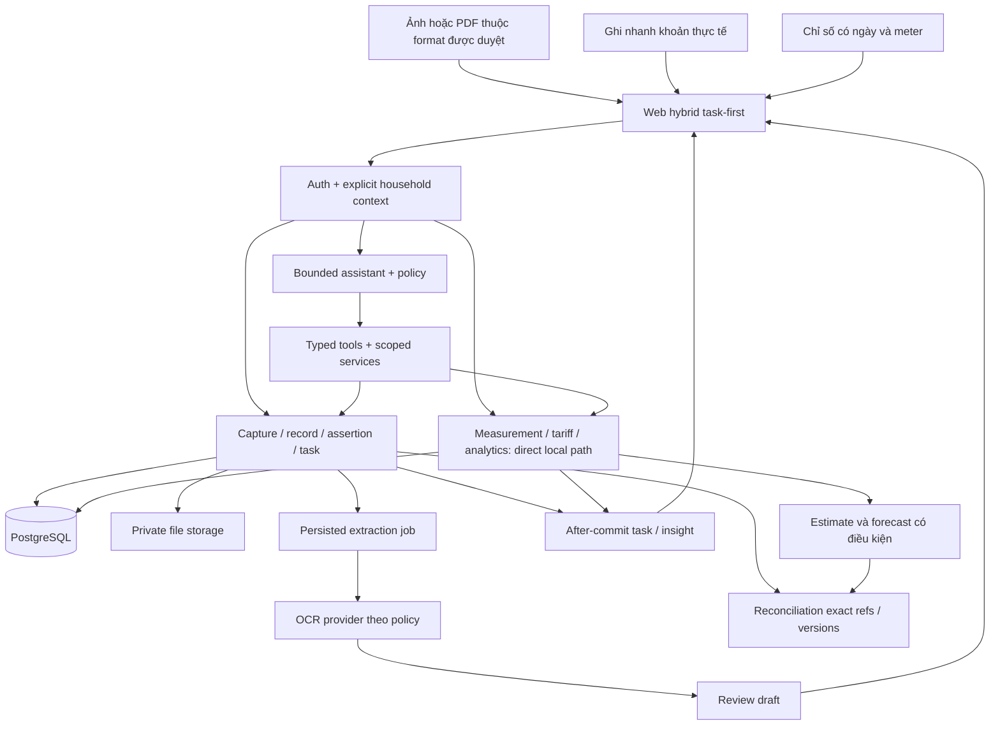
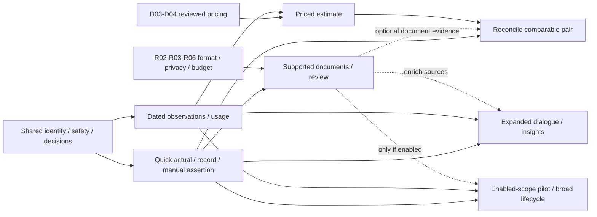

# Nhà Mình — V2 Master Plan Improved

Ngày: 27/10/2026 · Bản đề xuất V2.2 · Toàn bộ code tương lai đặt trong `website/`.
**Planning only:** không triển khai, không sửa code/database/migration. Hai tài liệu V2 cũ được giữ nguyên.

Đọc cùng [UX](V2-UX-REDESIGN.md), [AI](V2-AI-ARCHITECTURE.md), [Backlog](V2-IMPROVED-BACKLOG.md), [So sánh/quyết định](V2-REVIEW-COMPARISON.md).

## 1. Sản phẩm trước kiến trúc — refinement V2.2

**PROPOSED, DECISION REQUIRED R01:** Nhà Mình là nền tảng giúp hộ gia đình hiểu, quản lý, dự đoán và tối ưu việc dùng điện nước: quản lý chỉ số, tính/ước tính chi phí, lưu hóa đơn/khoản chi, đối chiếu và nhận hỗ trợ có căn cứ. **Hybrid task-first** là hướng khuyến nghị có điều kiện, chưa phải quyết định đã duyệt hay định vị đã thắng trong user research.

V2.1 đúng khi bỏ setup meter/tariff bắt buộc cho người chỉ lưu khoản chi, nhưng đi quá xa khi lấy document-first làm lõi và đưa toàn bộ measurement/estimate xuống sau. PRODUCT.md đã xác nhận theo dõi chỉ số/chi phí/forecast/anomaly là giá trị sản phẩm; không có bằng chứng để biến chúng thành tính năng phụ chỉ vì một giả thuyết thu thập dữ liệu mới.

Ba cách vào cùng workspace: **Ghi chỉ số để hiểu lượng dùng/ước tính; Thêm hóa đơn để ghi actual/đối chiếu; Ghi nhanh tiền để theo dõi khoản chi.** Task-first là tổ chức quanh việc cần làm trong cả ba nhánh, không đồng nghĩa document-first. Mỗi hộ tự chọn mục tiêu; không buộc chọn một mode vĩnh viễn và không đưa cả ba form lên cùng màn.

Hai vòng giá trị song song: trước hóa đơn — đo → tiêu thụ → estimate/dự báo đủ điều kiện → kiểm tra biến động; khi nhận hóa đơn — thêm/ghi nhanh → xác nhận khoản → nhắc việc/ghi đã trả → đối chiếu với estimate nếu có. Giá trị đầu có thể là một phép đo hợp lệ, một estimate có nguồn, hoặc một khoản được ghi rõ, không phải chỉ một upload thành công.

Không sửa PRODUCT.md ở nhiệm vụ này. Dòng PRODUCT ghi OCR là future interface đang lệch so với nhánh OCR trong source; đây là drift mô tả phải review riêng, không phải lý do phủ nhận thế mạnh đo lường đã xác nhận.

## 2. Trạng thái và evidence ledger

- **CURRENT:** có trong source, chưa đồng nghĩa hoạt động đúng.
- **VERIFIED:** có phương pháp/phạm vi kiểm tra cụ thể, ghi thời điểm; đọc tĩnh chỉ xác minh cấu trúc/nhánh code.
- **PROPOSED:** khuyến nghị chưa triển khai/chưa được duyệt.
- **DECISION REQUIRED:** chủ dự án cần quyết định trước phần triển khai bị ảnh hưởng.
- **DEFERRED:** ngoài phạm vi release đề xuất; có điều kiện xét lại.

Hypothesis được ghi trong PROPOSED, không giả làm nhu cầu đã xác nhận. “Người dùng duyệt chứng từ” không phải “nhà cung cấp xác thực chứng từ”; “ghi đã trả” không phải “ngân hàng xác nhận”.

Các dòng dưới tương đối với `website/`, kiểm tra tại lượt review:

- E01 **CURRENT, VERIFIED tĩnh:** `frontend/app/[[...slug]]/page.tsx:3` và `components/application.tsx:72` dùng catch-all/Application chọn màn hình theo pathname. Chưa có lý do thay framework.
- E02 **CURRENT, VERIFIED tĩnh:** `frontend/components/application.tsx:621–624` có onboarding bốn giai đoạn; `cleanAccounts` không mang tariff_category/province từ form vào payload. Cần test ý nghĩa dữ liệu, không chỉ ảnh UI.
- E03 **CURRENT, VERIFIED tĩnh:** `frontend/components/dashboard/AIInsightPanel.tsx:7–31` hardcode +8,2%, tiết kiệm 80–120 nghìn, benchmark thấp hơn hộ tương tự 12%; được render từ Application:933. `statistics/AISavingTips.tsx:22–24` hardcode 180 nghìn/12% và claim phân tích sáu kỳ, được render StatisticsPage:111. Chưa có dữ liệu cá nhân hóa trong các component chứng minh các câu này.
- E04 **CURRENT:** `application.tsx:748` fallback ngân sách 2 triệu; Household model chưa có monthly_budget. Không được diễn đạt thành ngân sách người dùng đã chọn.
- E05 **CURRENT:** `backend/app/billing_service.py:9–51` fallback có thể bỏ provider/category/province. Decimal không bảo đảm tính đúng khi sai biểu giá.
- E06 **CURRENT:** `ai/tools/ocr_analysis.py:49–66` gửi accounts/meters/latest_readings sang provider; `:119–164` so latest cùng utility hoặc initial_reading. Chưa ghép đúng account/kỳ.
- E07 **CURRENT:** `ai/router.py:1`, `registry.py:14`, `instructions.py:3` dùng heuristic, mapping tool và ghép Markdown; rule chưa là cơ chế enforce chung. Chi tiết ở AI document.
- E08 **CURRENT:** `schemas.py:101` không có conversation_id; `frontend/components/application.tsx:1204–1209` gửi lượt hiện tại. `main.py:170` lưu status/source_count, không phải hội thoại. `application.tsx:1127–1128` chuyển thinking step bằng timer, không phải tiến độ server.
- E09 **CURRENT:** `application.tsx:632–649` cache theo path, logout `:140–144` không clear cache này; `:699–706` response có thể vào cache trước alive guard. Là rủi ro có căn cứ, chưa tái hiện browser leak.
- E10 **CURRENT:** `models.py:131–146` Bill yêu cầu account/period/consumption/estimate/snapshot; `services.py:106–127` reading tạo bill trong transaction. Không thuận cho document không meter/tariff.
- E11 **CURRENT:** `models.py:149–156`, `services.py:137–146`: payment unique bill, copy final_amount và manual provider; chưa có bank/provider settlement.
- E12 **CURRENT:** forecast/anomaly hiện là trung bình trọng số/rolling baseline ba kỳ và ngưỡng 30%, chưa có calibration/backtest chứng minh xác suất hoặc nguyên nhân thiết bị.
- E13 **CURRENT:** `repository.py:11–13`, `services.py:128–135` list toàn bộ và query trong vòng lặp; chưa benchmark để kết luận chậm bao nhiêu.
- E14 **CURRENT:** `docker-compose.yml:29–37` development/fallback secret/startup nuốt lỗi; `main.py:40–55` limiter RAM; `config.py:21–27` chỉ check độ dài secret. Production readiness chưa chứng minh.
- E15 **CURRENT:** `backend/tests/test_ai_ocr.py:218–225` chấp nhận None hoặc dict, không chứng minh extraction đúng schema/nội dung. Test tier math/isolation/idempotency vẫn đáng giữ.
- E16 **VERIFIED lịch sử cùng ngày:** lượt phân tích trước chạy 68 backend tests đạt và frontend typecheck đạt. Lượt review này không chạy lại; không suy ra PostgreSQL locking/Alembic/E2E/Gemini-live đạt.
- E17 **VERIFIED lịch sử browser ở review V2.1, chưa kiểm tra lại V2.2:** localhost:3000 hiển thị Build Error `src/app/globals.css:8170`, Next 16.3.6; checkout có `frontend/app/`, package metadata 16.3.4 và CSS 6.559 dòng. Chưa xác minh process/root, nên không gán lỗi build cho checkout hoặc phán xét UI đẹp/xấu. Browser đúng checkout là gate review hình ảnh trước implementation.
- E18 **VERIFIED tĩnh:** repository trong website có nhiều thay đổi từ trước nhiệm vụ. Git status dùng safe.directory theo invocation, không sửa global config. V2.1 đã tạo năm Improved; V2.2 chỉ cập nhật đúng năm tài liệu đó.

Nguồn nghiên cứu chính thức hỗ trợ phương pháp, không chứng minh nhu cầu thị trường: [GOV.UK thiết kế theo toàn bộ vấn đề](https://www.gov.uk/service-manual/service-standard/point-2-solve-a-whole-problem), [kiểm tra sự đơn giản với người dùng](https://www.gov.uk/service-manual/service-standard/point-4-make-the-service-simple-to-use), [W3C kiểm tra/xác nhận/đảo ngược dữ liệu quan trọng](https://www.w3.org/WAI/WCAG22/Understanding/error-prevention-legal-financial-data.html), [OWASP upload](https://cheatsheetseries.owasp.org/cheatsheets/File_Upload_Cheat_Sheet.html).

Không áp dụng biểu giá/thuế/quy định hiện hành chỉ từ bản tổng quan cũ. Nguồn giá thật phải qua D04; reviewed import/publication và overlap guard tối thiểu có trước priced estimate ở M2; admin UI hoàn chỉnh M6 không là dependency ngược. Đây là kế hoạch kỹ thuật, không phải xác nhận pháp lý.

## 3. Critical review V2.1: giữ tiến bộ, sửa lệch hướng

1. Bỏ reading bắt buộc cho khoản chi là đúng; kết luận document-first là lõi tối ưu chưa có evidence. V2.2 đề xuất Hybrid, không chuyển toàn scope theo giả thuyết.
2. Bundle S1.1–4 khiến first usable release vẫn phải có OCR/job/cloud dù manual path không cần. Tách mốc M1 quick/records và M2 measurement; M3 upload độc lập sau format gate.
3. S3.1 cũ phụ thuộc S1.1 và D03/D04 cho toàn task; phải tách acceptance observation→usage→estimate, tariff chỉ gate tầng estimate.
4. Chưa rõ baseline khi không biết ngày initial_reading: lưu mốc mới có ngày được, không bịa ngày cũ/consumption; có hai mốc đủ điều kiện mới tính interval.
5. Ba cửa vào chung UI nhưng chưa có quy tắc liên kết/đếm tổng rõ khi bổ sung dữ liệu sau. Bổ sung source-of-truth/lifecycle và cases §17; liên kết evidence không đồng nghĩa thêm khoản.
6. Quick-entry từ estimate có nguy cơ biến dự đoán thành actual do đổi nhãn USER_ENTERED. D01 cần explicit actual-charge assertion; không convert tự động hoặc sửa lịch sử payment legacy.
7. PDF bị hoãn theo loại tệp trước khi biết corpus. Đổi sang R06 sample gate: ảnh/screenshots, text PDF, scan và multi-page có giá trị/chi phí riêng.
8. Insight/forecast không nên đợi full orchestrator. Metrics tất định, template/source cards có sớm M1/M2; hội thoại mở rộng sau, không thay math bằng LLM.
9. Giữ nhánh đúng: Decimal/snapshot, quyền server, job bền khi nhận upload, provenance, no doublecount, cache scope, bounded tool-calling. Không cần thay framework, runtime multi-agent hoặc refactor tổng lực.
10. Chưa đủ research/browser/OCR/PG/load evidence. V2.2 bổ sung gate và test outcome, không tự cấp chứng nhận hoặc cam kết tuần.

## 4. Product Direction Decision Matrix — A/B/C

Ba phương án V2.2 dưới đây khác ba định vị P-A/P-B/P-C ở V2.1; tên cũ chỉ là lịch sử, không đổi nghĩa R01. Không dùng điểm trọng số chưa được xác nhận để tạo cảm giác khách quan. Bảng là trade-off dựa source/capability và giả thuyết cần kiểm chứng, không ranking đo từ thị trường.

| Tiêu chí | A Measurement-first | B Document-first | C Hybrid task-first |
|---|---|---|---|
| Giá trị người dùng | Hiểu lượng dùng và chi phí trước hóa đơn; cần mốc đo | Lưu/tìm khoản, nhắc hạn khi đã có tiền/chứng từ | Chọn việc theo dữ liệu có; nối trước/sau hóa đơn |
| Tần suất giả thuyết | Theo nhu cầu đo, không tự hứa hằng ngày | Thường theo lúc nhận/trả hóa đơn, chưa có dữ liệu khảo sát | Theo event đo/hóa đơn/việc cần xử lý; không ép tần suất |
| Khác biệt | Calculator/forecast/usage sâu | Dễ thành expense tracker có OCR nếu chỉ lưu tiền | Chuỗi đo→ước tính→actual→đối chiếu→giải thích, khi đủ dữ liệu |
| Giữ chân giả thuyết | Có thể tốt với hộ chủ động đo; burden nhập có thể cao | Có thể tốt ở nhắc hạn/tìm chứng từ; ít giá trị trước bill | Có đường quay lại phù hợp từng hộ; rủi ro nhiều lựa chọn |
| Chi phí triển khai tương đối | Vừa: tái dùng lõi, cần sửa scope/time/policy | Vừa–cao: records/docs/jobs/privacy/OCR mới | Cao hơn một nhánh đơn nếu làm cùng lúc; chia M1/M2/M3 giảm rủi ro |
| Độ phức tạp | Interval/meter/tariff/correction | Document identity/review/dedup/retention | Link/canonical totals/availability modes; cần contract chung |
| Vai trò AI | Explain trend/forecast, tool service; không tính tiền | Extraction/quality review/expense explanation | Embedded trợ giúp ở cả đo, khoản và đối chiếu, code metrics trước |
| Mở rộng | Thiết bị/IoT chỉ khi access/data cần | Tệp/provider import khi có quyền | Shared provenance và service, không thêm deploy boundary mặc định |
| Rủi ro | Buộc đo/thiếu tariff; sample chưa đủ forecast | Phụ thuộc tài liệu/cloud, demote core measurement | Overload UI/scope; phải progressive onboarding và release nhỏ |
| Hợp code hiện có | Cao về primitives, chưa đủ bảo đảm toàn luồng đúng | Có OCR nhánh nhưng records domain mới | Giữ thế mạnh V1, thêm seams actual/docs không phá URL/snapshot |

**Khuyến nghị PROPOSED C:** mức phù hợp với yêu cầu đã xác nhận cao hơn về bảo toàn cả measurement lẫn quản lý hóa đơn, không phải bằng chứng retention tốt hơn. Nếu pilot chỉ cần một nhánh, mặc định màn đầu theo mục tiêu của hộ; nền dữ liệu vẫn hỗ trợ nhánh còn lại. A/B vẫn là phương án hợp lý cho nhóm người dùng riêng, không bị gạt bỏ.

Research M0: 5–8 hộ/người thực trả hóa đơn (mẫu khám phá, không đại diện), phân nhóm tự đo/chỉ có bill/chỉ biết tiền; thử cùng nhiệm vụ trên A/B/C. Đo completion, lỗi hiểu actual/estimate/payment, gõ/sửa, thời gian nhận giá trị và nhu cầu quay lại; ghi cả trường hợp không cần AI/OCR. Chủ dự án duyệt R01 sau evidence hoặc chấp nhận hypothesis với pilot giới hạn.

## 5. Giá trị khác biệt và các phép thử bỏ năng lực

| Tình huống | Giá trị vẫn có | Không được hứa / fallback |
|---|---|---|
| Bỏ LLM/Gemini | Reading, Decimal calculator khi có giá, baseline forecast/anomaly, records, nguồn, reminder, manual assertion | Không extraction hoặc prose thông minh nếu adapter phụ thuộc; template và form thay thế |
| Bỏ OCR | Nhập tay khoản/field chứng từ, tự đo, estimate/compare đủ dữ liệu, tìm/filter | Không tự đọc ảnh; vẫn lưu file riêng khi policy cho phép và user nhập field |
| Không nhập chỉ số | Theo dõi actual cost/paid/due, trend tiền, so kỳ có nhãn nguồn, document explanation | Không kết luận lượng dùng tăng, hiệu suất thiết bị/rò rỉ hoặc forecast consumption từ tiền đơn thuần |
| Không có hóa đơn | Mốc đo→usage→estimate/dự báo đủ dữ liệu→anomaly có giới hạn | Không actual invoice/confirmed provider due hoặc reconciliation chưa có cặp |
| Không có tariff hợp lệ | Lưu phép đo, usage/unit/ngày, lịch sử và consumption-only baseline phù hợp | Estimate tiền pending/unavailable; không fallback provider khác hoặc amount0 |
| Chỉ biết một số tiền | Record USER_ENTERED, kỳ/hạn optional, tổng và reminder đúng scope | Không đoán consumption/VAT/tariff/interval/mã KH hoặc ngân hàng đã trả |

**Core product value:** sổ điện nước có nguồn + phép đo/chi phí có thể kiểm tra + nối estimate với actual đúng đối tượng + việc cần xử lý. **Supporting:** file capture/OCR, tìm kiếm/print, dữ liệu giá có quản trị. **AI differentiators:** hiểu ngữ cảnh nhiều lượt, giải thích bằng service evidence, giảm nhập, hỏi thiếu slot, insight theo sự kiện. **Optional:** what-if, budget/digest khi có nhu cầu; forecast nâng cao khác baseline đang có. Không loại forecast/anomaly hiện hữu chỉ vì model mới chưa làm.

Hai vòng quay lại là self-measure/pre-bill và receive/pay/reconcile, không daily engagement giả. Metrics PROPOSED tách: hoàn thành việc theo mode, số khoảng đo hợp lệ, estimate tái hiện được, khoản rõ source/paid, review friction, data coverage, quay lại event kế tiếp, cost/useful outcome. Không ép record hoặc PAID để ghi nhận activation của người chỉ muốn đo.

Overengineering cần tránh: mọi capability một microservice; full ledger cho manual full payment; vector DB cho filter có cấu trúc; LLM cho nhắc hạn/math; planner/multi-agent trước eval. Thiếu có tác động lớn: mốc đo độc lập thiếu giá, schema metrics nguồn rõ, revision invalidation, sample-gated text PDF và hướng sửa dữ liệu nhầm.

## 6. Mười cải tiến tác động cao

1. P0: ba cửa vào, không meter bắt buộc; no-cloud luôn có đường dùng được.
2. P0: inbox task gồm draft cần duyệt, sắp hạn có nguồn, hồ sơ lệch cần xử lý; không rải thông báo rời rạc.
3. P0: review hóa đơn theo trường, ảnh cạnh dữ liệu; hỏi đúng phần mơ hồ, không tự confirm OCR.
4. P0: tiền theo dõi/đã trả/ước tính tách rõ; không đếm đôi invoice và estimate.
5. P0: mọi insight có kỳ/nguồn/phương pháp; bỏ số giả/benchmark không dataset.
6. P1: AI trong review/record/usage, không bắt chuyển qua chat và nhập lại context.
7. P1: ghép account/kỳ local có giải thích, chống trùng có review; không merge vì trùng tiền.
8. P1: insight/digest theo event mới, dedupe và dừng khi giải quyết; không LLM theo mỗi refresh.
9. P1: OCR lỗi ghi tay, mất mạng không tự retry commit, correction có lịch sử, request cũ không nhiễm hộ mới.
10. P0/P1: đưa tự đo/usage/estimate baseline lên M2 độc lập OCR; what-if vẫn tùy chọn, không hứa chẩn đoán thiết bị hoặc tiết kiệm cố định.

Chi tiết UX/AC ở UX document; trigger/data/rule/AI/confirm/dedupe/failure/cost ở AI automation catalog; đề xuất mới có ví dụ/trade-off ở Comparison.

## 7. D01–D04: phương án, khuyến nghị và gate

### D01 — Cơ sở ghi nhận tiền — DECISION REQUIRED

A: chỉ theo chứng từ, chặt nguồn nhưng loại người biết số tiền mà mất ảnh. B: khoản chi người dùng xác nhận có thể từ chứng từ hoặc nhập nhanh; estimate riêng. C: giữ final_amount chung estimate/official như cũ; ít schema nhưng mơ hồ nguồn.

**Khuyến nghị B:** ExpenseRecord có basis DOCUMENT_CONFIRMED/USER_ENTERED, không gọi verified invoice để ám chỉ nhà cung cấp xác thực. Estimate không tự tạo khoản phải trả. PaymentAssertion là lời ghi đã trả, có amount/date/reference/actor, không phải settlement. R07 tối thiểu cho cancel/supersede record và reversal assertion có reason/audit phải chốt ở M1; invalidation phép đo nhầm có ở M2; correction tổng quát/ledger mở rộng ở M6. Bản đầu một assertion toàn phần/record; khác amount → NEEDS_REVIEW, chưa giả hỗ trợ partial/refund.

Quick-entry USER_ENTERED chỉ là actual khi người dùng chủ động xác nhận đó là khoản thực tế họ biết, không chỉ xác nhận con số sao chép từ estimate. Không tự chuyển estimate thành ExpenseRecord/actual do đổi nhãn nguồn. New estimate-based payment là lựa chọn D01 chưa bật mặc định; payment legacy trên estimate được giữ nguyên amount/date/basis, không coi là chứng từ hay actual charge mới. Chứng từ đến sau đề xuất link/revision, giữ assertion cũ, giải quyết chênh lệch. Ví dụ: estimate 500.000, chứng từ 530.000, assertion 500.000 → hiện ba nguồn và chênh lệch cần review, không tự tuyên bố nợ xác minh hoặc chuyển tiền.

### D02 — Kỳ tiêu thụ/account và kỳ báo cáo — DECISION REQUIRED

A: household/calendar month hiện tại, đơn giản nhưng không phản ánh ngày chốt lệch. B: interval account khi biết, report period riêng, dates null khi không biết; lưu observation mới có ngày làm baseline độc lập interval. C: bắt mọi khoản có full interval, tốt cho phân tích nhưng chặn capture.

**Khuyến nghị B:** record có report_period và optional account/consumption interval. Không biến nhãn “10/2026” thành ngày đo 1–31/10. Expense view theo nhãn kỳ chứng từ đã xác nhận; cash view theo paid_date, due view theo due_date; không prorate để lấp tháng thiếu. Lưu observation chỉ cần ngày/giá trị/đơn vị/meter thật; không cần initial date cũ. Tính interval/usage cần hai compatible dated observations và convention boundary D02; nếu ngày initial cũ không biết thì mốc mới là baseline, không tính usage/estimate cho khoảng giả. Khoảng không so được không ngăn lưu hóa đơn với flag chưa đối chiếu. Giữ raw period text bên cạnh normalized dates.

### D03 — Đổi giá giữa kỳ — DECISION REQUIRED

A: giá cuối kỳ, dễ nhưng có thể sai; B: phân bổ ngày, cần quy tắc provider và input; C: chỉ tính verified estimate khi đủ policy/data, còn lại pending/not_computable; simulation dùng giả định explicit.

**Khuyến nghị C làm guardrail; B chỉ khi D04 kiểm chứng quy tắc.** Không bịa consumption ở mốc đổi giá. Snapshot đơn giá/thuế/phí/rounding/policy. Không ngăn document capture/expense/reminder vì thiếu tariff. Chặn publish/resolve interval overlap không phân giải được, không chọn latest-created thay policy.

### D04 — Nguồn giá thật — DECISION REQUIRED

A: AI search rồi auto publish — không khuyến nghị; B: admin duyệt nguồn/phạm vi/hiệu lực; C: giá user tự đặt có nhãn mô phỏng. **Khuyến nghị B cho provider tariffs, C cho mô phỏng.** AI tìm candidate, không là price registry.

Chủ dự án chọn địa bàn/provider pilot và người chịu trách nhiệm duyệt; lưu nguồn chính thức, retrieved/published/effective dates, applicability/category, tax/fee treatment, reviewer/version. Chưa chọn tỉnh không hardcode tỉnh. Nhánh actual record không cần danh mục giá toàn quốc; release estimate mới cần phạm vi giá đã duyệt. Không dùng trích dẫn pháp quy cũ làm giá hiện hành.

Các policy trên là đề xuất nhất quán, chưa được phê duyệt vì đã ghi vào tài liệu.

## 8. Domain mục tiêu và invariant

**PROPOSED**, thêm theo slice, không scaffold hàng loạt:

- Document: private file/chứng cứ, household, content fingerprint, retention; source không đồng nghĩa authenticity. Một document có nhiều extraction version, có thể nhiều record.
- ExtractionDraft: raw/normalized fields, source snippet/page/bbox nếu có, unknown=null, warning, human edit/version. Model confidence không đủ auto-confirm tiền.
- ExpenseRecord: household, utility, optional account, report_period, amount/currency, due+source, amount_basis, source docs, revision. Không tạo meter giả để thỏa schema.
- Estimate: input consumption/interval, tariff/policy snapshot và result riêng obligation.
- PaymentAssertion: user-reported amount/date/ref, record revision, actor, reversal reason; không bank confirmed.
- Reconciliation: exact object/version so sánh, result MATCH/DIFFERENT/NOT_COMPARABLE và reason; không sửa nguồn.
- Task/Insight: open/resolved/dismissed/snoozed, source revision và event/business dedupe; không cần bảng riêng cho mọi loại nhắc.
- Conversation: user/hộ, confirmed slots, record/document refs+revision, retention; tool trace metadata tối thiểu, không chain-of-thought.

Record chưa ghép account được tính trong household totals theo basis nhưng coverage account là unknown; không tạo missing-bill reminder account từ record chưa ghép. Không gộp lifecycle vào một Bill.status: document uploaded→processing→needs_review→retained/deleted; record draft→confirmed→superseded/cancelled; assertion not_recorded/user_reported/reversed; đối soát riêng. Overdue chỉ derived khi có due+source đủ điều kiện và balance chưa đóng; ngày cấu hình chỉ là nhắc dự kiến.

Invariants:
- Invoice và estimate không cộng thành hai khoản; cost theo kỳ, cash paid và forecast là ba metric riêng.
- Null khác 0; decimal strings ở API, Decimal tại tính tiền; signed adjustment không bị ép thành zero.
- Credit/refund và multi-page/PDF chưa hỗ trợ phải được giữ ở trạng thái unsupported/needs_review, không phát sinh khoản dương giả.
- Hash chỉ nhận exact duplicate; chụp lại khác bytes, invoice correction/version cần human review; không unique amount+month.
- Confirm/payment kiểm tra quyền và revision hiện tại; không chỉ tại preview/model start.
- Job sau revoke/deletion không trả kết quả nhạy cảm hoặc phục sinh document; đã-upload không nghĩa quyền còn vĩnh viễn.
- Dữ liệu cũ giữ ID/snapshot/basis, không tự gắn nhãn provider_verified.

## 9. Kiến trúc phục vụ trải nghiệm

**PROPOSED:** giữ Next.js/FastAPI/PostgreSQL, modular monolith và một worker cùng backend khi cần extraction bền. New journey `/inbox`, `/records`, `/usage` với ba entry ngang quyền truy cập, assistant contextual; deep-link bill cũ giữ tương thích. Phân chia logical capability trước, folder sau.

### 9.1. Reuse và tổ chức code

Giữ calculator, auth/session primitives, membership guard, snapshot, transaction patterns, reminder dedupe, fixtures đúng. Thay tariff fallback/OCR matching sai. Generic repository không scoped sẵn nên service/query phải enforce mọi entity reference.

Tách Application theo route/slice vừa làm, giữ phần chưa chạm; một component system sau inventory. Typed API là boundary, không Record<any>. Cache key user/session_epoch/household/filter/revision; clear+cancel+discard late responses. Request scope rõ, không phụ thuộc mutable active household mơ hồ khi hai tab đang đổi hộ.

New DTO domain khác dùng `/api/v2` đề xuất; legacy `/api` giữ trong quá độ. Adapter read provenance rõ, không bắt toàn client đổi trước. Generated types từ OpenAPI chỉ khi toolchain phù hợp; không thêm wrapper SDK không cần.

Cấu trúc đích tối thiểu trong website: frontend/app + features/capture, records, usage, assistant + components/ui + lib/api/session; backend/app/core, modules/documents, records, measurements, tariffs và ai; tests, alembic, scripts, docs. Tạo module khi slice cần, không tạo 12 skeleton ngay.

### 9.2. Transaction, concurrency và background

Upload stream vào private staging với ingress size/content limits → metadata/job; model request ngoài transaction giữ lock; confirm lấy version hiện thời+permission+dedupe trong transaction ngắn. Idempotency scoped user/hộ/operation, request hash, lưu response; cùng key khác payload trả conflict.

Lock cùng record khi confirm/payment/correction; constraint chống trùng cuối. Thứ tự lock và retry deadlock có test PostgreSQL, không hứa mọi deadlock biến mất. Membership revoke với request đang chờ lock cần policy/version/lock phối hợp trước financial commit.

Durable extraction/job hữu ích vì reload/restart không được mất review state, không chỉ vì latency. Phương án nhỏ nhất đề xuất: PostgreSQL Job có lease/attempt/deadline/reclaim + worker cùng backend. Không gọi in-process BackgroundTasks là queue bền. Claim queue có thể dùng SKIP LOCKED, không áp vào report số liệu người dùng. Thêm broker/shared limiter khi số process/tải/backpressure đo được cần; ADR nêu ngưỡng và trade-off.

Task/insight after-commit và idempotent; guaranteed delivery dùng Job/outbox cùng transaction thay commit rồi publish dễ mất event. Không event bus phân tán mặc định. Không hứa exactly-once external model calls.

### 9.3. Privacy/security

Owner/member write/pay không tự định nghĩa quyền gửi ảnh cloud; map quyền observation/record/payment từ M1/M2 và documents upload/read/external-process/confirm từ M3. Admin tariff không tự đọc hộ. R06 sample gate M0 quyết định bộ format M3: JPEG/PNG/screenshots là candidate có gần code hiện có; text PDF có thể được đưa vào sớm nếu corpus/chi phí chứng minh. Scan/multi-page không tự động có, cũng không blanket-defer mọi PDF. Chi tiết economics/fallback ở UX.

Kiểm ingress body trước parse/decode, magic bytes và image decode/pixel limit, random object key private, authorized download/short-lived URL theo hosting. Không public path, không fetch URL ảnh tùy model để tránh SSRF. File/text/web là dữ liệu, không instruction. Không raw error/key/prompt/ảnh trong log. M3 ngay khi nhận file phải có authorized delete/expiry/tombstone và vô hiệu pending job/URL tối thiểu; privacy controls/export nâng cao M6, không trì hoãn lifecycle thực tới M6.

**DECISION REQUIRED R02:** processing vendor/region, consent và retention original/thumbnail/extraction/chat/log/backup; quyền xóa và pending job invalidation. Có manual no-cloud nếu từ chối; không auto gửi tài liệu. Không hứa xóa tức thì khỏi backup/vendor chưa xác minh.

### 9.4. Hiệu năng và observability

Đo core API, thời gian nhận trạng thái job đầu, extraction/confirm duration, cost per confirmed record, correction/false task rate. Không dùng p95 500ms khi chưa pin máy/dataset/load. Hiển thị stage thực từ server, không timer giả.

Filter/pagination/query count trước cache; index theo access path. Public cache theo utility/location/category/date và source freshness; private cache không path-only. Rate limit auth/AI/upload; nhiều process cần shared control hoặc deploy one process có giới hạn công khai.

## 10. AI và tự động hóa thực dụng

Hybrid: workflow tất định capture/validate/confirm/pay/remind; OCR/LLM tạo draft; bounded tool-calling Q&A; metrics tất định tạo insight candidate, LLM diễn đạt khi có ích. Planner/executor có giới hạn chỉ nghiên cứu khi eval chứng minh hơn baseline; runtime multi-agent DEFERRED.

Context user/hộ và account/interval từ slots đã xác nhận; thiếu hỏi lại, không có cặp so thì nói thiếu. Card số liệu lấy tool output, không parse ngược prose. Financial commit qua action/form confirm và quyền server; không cần chat để upload hoặc trả tiền.

Budget khởi tạo PROPOSED: tối đa 2 model calls và 3 read tool calls/Q&A turn, 1 clarification question/turn, deadline 45s (provider attempt 20s, local read 3s); extraction 1 call/job + tối đa 1 transient retry, cùng job/version, không rerun tự động sau cancel. Đây là limit logic, không performance đã đo. Concurrency/token/cost cap hữu hạn cần R03 trước mọi external pilot có chi phí; đo và điều chỉnh trong pilot. AI document §12 là contract budget/eval/call accounting chung; retry hoặc repair đều tiêu thụ cùng tổng call cap.

## 11. Cải tiến đã có trong plan, sắp lại thay vì mở rộng tùy ý

- M1: quick-entry no-cloud, record summary/template và minimal cancel/reversal; actual attestation không bị thay bằng estimate.
- M2: dated observation → usage khi có hai mốc → estimate khi giá đủ; history, baseline anomaly/forecast và giải thích số liệu đã xác nhận không phụ thuộc OCR.
- M3: extraction/review theo trường và format sample gate, minimal delete/dedupe/job recovery ngay khi nhận file.
- M4: account/evidence linking, reconciliation exact versions, actual cost và estimate không đếm đôi.
- M5: expanded multi-turn tìm cả records/usage/estimate, family handoff và event insights; detector đơn giản có thể phát sinh sớm hơn theo nguồn M1/M2.
- OPTIONAL: what-if/budget/digest giữ task cũ và chỉ kích hoạt theo nhu cầu đã kiểm chứng; không trì hoãn forecast baseline hiện có vì what-if optional.
- DEFERRED: provider/bank/email ingestion, IoT, custom OCR training, benchmark hộ tương tự, ledger partial/refund và meter replacement phức tạp khi chưa có hợp đồng/data/policy.

## 12. Revised roadmap V2.2 — mốc M, task ID S giữ nguyên

M là mốc release/nhánh; Sx.y là task ID đã tồn tại, không dùng chữ S để suy thứ tự thời gian nữa. Không đổi nghĩa D01–D04/R01–R09. Mỗi mốc có FE/BE/data/AI/QA đủ outcome, không refactor tổng lực trước.

| Mốc | Outcome độc lập | Task hoặc phần task cũ | Hard dependency / gate | Acceptance tối thiểu |
|---|---|---|---|---|
| M0 | Concept/baseline và legacy an toàn để cải tiến | S0.1/S0.2 | R01/R08 và gate tác vụ tương ứng; không cần cloud | Ba mode fixture, snapshot/nguồn bảo toàn, sai giá/claim được chỉ rõ |
| M1 | Ghi khoản thực tế→mở lại/hiểu→nhắc đơn giản/ghi đã trả có sửa nhầm tối thiểu | S1.1/S1.3/S1.4; S2.1 core due; S2.3 filter; S3.3 amount-only delta | C01/C02/C03, D01/D02/R05/R07 tối thiểu | No OCR/key/meter/tariff; no doublecount; actual/paid/estimate riêng |
| M2 | Tự đo→hiểu usage→estimate/forecast đủ điều kiện | S3.1 tiers; S3.3 usage baseline; S1.3 measurement summary | Shared M0/C01/C08/D02/R05; giá D03/D04 CHỈ cho priced output | Baseline thiếu prior date vẫn lưu; no tariff giữ usage; no document/record/OCR dependency |
| M3 | Upload supported file→review→nối/tạo record đúng nguồn | S1.2; S2.2 minimum candidate/link | M1 record contract; R02/R03/R05/R06, durable job/delete; không M2 | Format matrix đã duyệt, lỗi→manual, duplicate/pending/deletion an toàn |
| M4 | Thực tế và estimate đối chiếu đúng cặp | S3.2 + S2.2 rich identity/revision | C05; actual M1 hoặc M3 + estimate/usage M2; D01/D02/comparability | NOT_COMPARABLE khi thiếu pair/thuế/kỳ; không sửa nguồn |
| M5 | Hiểu/hỏi/nhận gợi ý chủ động từ dữ liệu đang có | S2.3 dialogue; S2.4; S3.3 enriched insights | Chỉ nguồn liên quan M1/M2/M3, không bắt M4 cho mọi insight; R02/R03/R09 | Follow-up đúng context, quyền/dedupe/cooldown, 0 LLM cho simple deadline |
| M6 | Correction rộng/privacy/export/admin và pilot mở rộng phục hồi được | S4.1–4; S4.5 optional | Gate theo enabled scope, R04/R07/R02; không bắt mọi optional | Restore/migration/job/budget/UI evidence và giới hạn công khai |

M1 và M2 có thể song song sau shared identity/security; không buộc phải cùng phát hành và không cần hoàn thiện OCR. M2-observation/usage là một release hữu ích nếu nguồn giá chưa sẵn; M2-priced estimate phát hành sau gate giá, không trì hoãn quan sát đã đúng. Nhánh legacy đang dùng tiếp tục phục vụ, không tắt trước khi replacement tương ứng đạt regression.

Hard edge khác shared-interface, optional-enrichment và release-gate. Critical paths theo outcome: record M0→S1.1→S1.3/S1.4; usage M0→S3.1 observation→interval; priced estimate thêm D03/D04; documents M0→S1.1 contract + format/privacy gate→S1.2; reconciliation cần hai nhánh hội tụ. Không có “critical path toàn hệ thống” duy nhất nếu scope release chưa chọn; đo longest path chỉ sau R04 capacity/estimate.

Sizing S/M/L vẫn tương đối. Sau M0 đo prior workflow và mẫu format; sau task thực đầu ở M1/M2 dùng cycle time/capacity để estimate. Không cam kết tuần, không cộng size thành ngày. Shared guardrail/QA và minimum lifecycle đi trong từng mốc, không đợi M6.

## 13. Migration và bảo toàn

M1 thêm records/drafts và M2 thêm observation/interval seams độc lập; M3 mới thêm document/extraction/job. Legacy bill/reading vẫn đọc được. Dùng legacy_bill_id khi mapping 1:1; SYSTEM_ESTIMATE giữ là Estimate hoặc legacy estimate-based user entry theo D01, không relabel invoice.

Payment cũ giữ amount/date/ref/source LEGACY_MANUAL, không bank verified. Unknown provider/interval/due_source giữ unknown và exception report, không Demo/giả ngày. URL bill cũ đọc snapshot, không tính lại bằng giá mới. Check tổng theo basis/status, không một grand total đếm estimate+actual.

Expand → dry-run/backfill report → validate counts/ID/links/Decimal totals → cohort/adapter read → cutover → contract sau rollback window được duyệt. Không dual-write hai financial truths. Rollback app phải vẫn đọc được record mới hoặc giữ route mới cho cohort; checkout commit cũ không tự giải quyết schema/data mới. Nếu cần forward-fix thay rollback, runbook ghi rõ.

Backup DB+files cùng manifest/check missing object, restore rehearsal và access policy. Alembic upgrade test từ DB trống lẫn legacy fixture, không chỉ create_all. Không thao tác DB thật ở nhiệm vụ planning.

## 14. Test và release gates

- Contract: decimal/date/unknown/basis/source/revision và legacy adapters.
- PostgreSQL separate connections: duplicate confirm/pay, idempotency hash conflict, revision race, intervals/uniqueness, revoke trong lúc job/lock; SQLite không chứng minh locking.
- AI: schema và semantic field correctness, multi-turn slots, correct evidence/unknown, privacy/no write; per-slice fixtures, repeat/subgroup checks.
- UX/E2E: first record no-meter/no-key, upload failure→manual, missing due, find/review/pay, duplicate, switch hộ với inflight, low bandwidth, keyboard/reader/360–1440, auth recovery/print.
- Ops: failed migration stops readiness, worker crash/reclaim bounded, provider outage/manual fallback, DB+file restore, redacted log, rate-limit under concurrency.

Critical gate: zero observed cross-house disclosure, unauthorized commit, silent wrong money/account/interval và duplicate obligation/payment trên bộ scenarios release. Đây không phải bảo đảm tuyệt đối. Math fixture phải exact; OCR uncertain cần review. E2E automation không thay manual/a11y review.

**DECISION REQUIRED R04:** team, môi trường, pilot audience, support và người quyết định rollback; không claim production-ready khi chưa đủ evidence.

## 15. Review độc lập và giải quyết xung đột

Ba agent đọc độc lập: Product/UX; AI/LLM systems/AI QA; Data/Backend/Security/Operations. Main tổng hợp Product/Fullstack/QA. Review source không thay user research hoặc penetration test.

- V2.1 document-first làm measurement xuống muộn → V2.2 Hybrid, M1/M2 độc lập OCR; M3 chỉ nhận file khi policy/format sẵn.
- Official-only loại người thiếu chứng từ → D01 B đề xuất, source/basis thật, quyền duyệt cuối của chủ dự án.
- Interval bắt buộc làm kẹt capture → record interval nullable, strict interval khi derive usage/calculate; lưu dated observation không bị gate bởi interval cũ.
- Tự động hóa vs an toàn tiền → auto candidate/draft/task, final confirm kiểm quyền/version; không modal lặp vô nghĩa.
- Cleanup vs tốc độ → seams từng slice, không chuyển mọi folder trước.
- OCR privacy vs prompt context → chỉ tài liệu tối thiểu được phép, matching local, không toàn history.

Decision register/risk owner/controls trong Comparison; yêu cầu review không đồng nghĩa duyệt direction, D01–D04 hay cloud processing.

## 16. Executive summary

**10 cải tiến:** ba cửa vào; inbox task; review theo trường; tiền tách nguồn; insight có provenance; AI trong tác vụ; ghép+chống trùng; event/digest có giới hạn; phục hồi lỗi; measurement sớm, tùy nhu cầu nhưng không bị demote. Priority/tác động ở §6.

**5 quyết định kiến trúc khuyến nghị:** giữ modular monolith/stack; tách Document–Expense–Estimate–PaymentAssertion; hybrid workflow+bounded tools; context explicit/financial confirm server; persisted extraction job bắt buộc ở M3 khi accepted upload, outbox khi cần delivery bền, không broker/multi-agent mặc định.

**5 rủi ro lớn nhất:** định vị chưa qua user research; OCR/ghép sai tài chính; lộ dữ liệu vendor/cache/ảnh; nhầm estimate/manual assertion thành tiền thực xác minh; mất dữ liệu/hành vi khi migration. Control/test/owner ở Comparison.

**Khác V2 cũ:** activation nhiều cửa, record không phụ thuộc tariff; measurement và quick-entry có mốc đầu độc lập, extraction theo mốc riêng; provenance/task thay fake insight; D01–D04 có options/consequences/gate; timeline dựa quan sát thực thay số tuần kế thừa.

**Khuyến nghị PROPOSED:** review C Hybrid task-first và chọn mốc M1 hoặc M2 theo nhu cầu pilot, có thể song song; không bắt OCR hoàn thiện và không bỏ thế mạnh đo/estimate. Đo usefulness/completion của từng mode; giữ lõi V1 đúng, thay coupling sai theo slice. Đây là đề xuất cho chủ dự án review, chưa phải lệnh triển khai.

## 17. Refined data architecture — ba nguồn, một nền tảng identity/provenance

**PROPOSED:** dùng chung household/account identity, typed refs, permission và projection, không bắt cả ba nhánh tạo cùng một loại financial record. Source of truth là theo thuộc tính, không phải một bảng Bill có quyền ghi đè mọi giá trị.

| Domain | Chủ sở hữu / source of truth | Lifecycle / version / retention | Quyền và legacy |
|---|---|---|---|
| Household / UtilityAccount | Household service quản lý identity/membership; account provider label chưa là provider verified | Active/paused/closed, membership revision; không xóa cascade lịch sử | R05; giữ ID/account cũ, unknown mapping có report |
| MeterReading / observation | Measurement service: giá trị counter, unit, observed_date/time, meter, source người dùng xác nhận | Draft→confirmed→invalidated/replaced; raw observation không cần previous/date cũ; historical version không rewrite | readings write server; legacy BillingPeriod tháng giữ là reporting context, không giả ngày đo |
| ServiceInterval / BillingPeriod | Derived từ hai compatible observations và D02; reporting month là nhãn khác | Interval có boundary policy/ref versions; thiếu mốc không có interval; query stale khi source invalidated | Scoped meter/account; không tạo đầu/cuối tháng làm measured interval |
| Estimate | Calculator: input refs + consumption + tariff/policy/rounding snapshot + computed result | Pending/not_computable hoặc computed→stale→new version; snapshot cũ vẫn xem được | No financial write từ model; legacy SYSTEM_ESTIMATE giữ source, không đổi official |
| ExpenseRecord | Records service: khoản thực tế user xác nhận, basis DOCUMENT_CONFIRMED/USER_ENTERED | Draft→confirmed→superseded/cancelled; canonical active version, reason/audit; minimum cancel từ M1 | records confirm, fresh auth/version; estimate không tự trở thành actual |
| Document | Documents service: bytes/source/identity metadata, không tài chính authority | Accepted→processed/reviewed hoặc failed/deleted/expired; private policy/tombstone, backup window riêng | docs read/upload/delete/external-process độc lập; không giả authenticity nhà cung cấp |
| ExtractionDraft | Adapter + review service: máy đề xuất/raw/normalized fields, user edits có actor | Immutable attempt/schema refs; unknown null, review confirm version; consent/retention theo R02 | Chưa có quyền commit tiền; retry không ghi đè field đã review |
| PaymentAssertion | Payments service: lịch sử user khai đã trả, pin amount/date/ref/basis/record revision | Current assertion→reversed, không erase; late record revision không sửa lời khai cũ | payments assert/reverse; legacy payment giữ nguyên không suy basis user đã chọn |
| Reconciliation | Compare service: result exact pair/version và reason codes | Preview→saved→stale, recompute creates version; không overwrite hai nguồn | Phải có quyền cả hai refs; thiếu account/interval/tax→NOT_COMPARABLE theo field |
| Conversation | AI context service: confirmed slots/turn refs, không là evidence tiền | Scoped user/hộ/permission/source revision, reset/change slots; retention/xóa R02 | Đổi hộ/thu hồi quyền chặn source/cache; memory summary không thay service query |
| Insight | Analytics detector: metrics/rule/source versions; model chỉ phrasing | Candidate→published→dismissed/resolved/expired/stale; dedupe+cooldown | Scope output không rộng hơn nguồn; correction invalidates, no false personal benchmarks |
| Task / notification | Task projection: cần hành động từ source/rule/date; notification là tín hiệu | Open/snoozed/dismissed/resolved khác read/unread; preference và expiry | Assignment không grant quyền; giữ configured deadline khác document due |

### 17.1. Liên kết, doublecount và bổ sung dữ liệu sau

- M1 đã có duplicate candidate tối thiểu giữa các record tương thích (hộ/utility/account nếu biết/kỳ/amount/source); người dùng chọn mở bản có, bổ sung evidence, hoặc giữ riêng có lý do. Không unique amount+month, không đợi semantic OCR matching mới chống đếm đôi.
- Upload ảnh chỉ tạo Document/Draft. Confirm phải chọn tạo khoản mới hay link existing; link evidence không tăng tổng tiền. Một business item đã user xác nhận liên kết có một canonical active record/version; tài liệu sửa có thể nhiều bản chứng cứ.
- Account/meter/kỳ trên ảnh là candidate; local matcher theo mã KH/provider/utility/interval/document identity, không latest utility. Thiếu identity hỏi hoặc lưu unlinked; không tự ghép đo khi cùng tháng nhưng khác interval.
- Observation là phép đo thực tế do người dùng ghi; reading trên hóa đơn là supplier-reported field, không tự thay independent measurement. Lượng dùng trong invoice chưa chứng minh counter nhà được đo lại.
- Record chưa gán account có trong household actual totals, không trong account totals; hiển thị unallocated_count. Không biết report_month vào nhóm Chưa gán kỳ, không dùng upload_date/paid_date/current_month tự gán.
- Actual-spend theo report label, cash paid theo asserted_paid_date, due theo due_date+source, consumption theo measured interval; forecast riêng. Estimate và actual link không cộng đôi, không mặc định hai loại tiền có cùng basis.
- Correction nguồn làm dependent estimate/reconciliation/insight stale; không sửa snapshot hay PaymentAssertion. Recompute có quyền tạo version mới, hiển thị as_of/source_versions; task cũ ngừng/đổi theo source version.
- Xóa ảnh hủy access/job/derived summary theo policy; không tự xóa khoản người dùng đã xác nhận. Nếu giữ field/provenance metadata khác retention ảnh phải công bố trong R02; không hứa xóa backup/vendor ngay.

### 17.2. Bảy acceptance scenarios cho ba cách vào

| Scenario fixture | Output được phép | Không được làm / confirm cần thiết |
|---|---|---|
| Chỉ tiền nước 180.000, không kỳ/hạn | USER_ENTERED actual sau attestation, unassigned period, no due reminder | Không consumption/VAT/date giả; confirm amount/utility/source |
| Một mốc mới 1.000kWh ngày20/10, initialdate cũ unknown | Confirm dated baseline, history một mốc; chưa có usage interval | Không trừ oldvalue để gán interval tưởng tượng; có quyền/meter/unit thật |
| Hai mốc 1.000→1.120kWh, 20/10→27/10, không tariff | Usage120kWh/7 ngày theo D02, estimate pending, usage trend giới hạn | Không amount0 hoặc price fallback; measurement confirm độc lập |
| Hai mốc trên + đúng tariff/policy có coverage | Estimate tái hiện được, forecast khi data gate đủ | Không tạo invoice/actual/payment; preview+version confirm |
| Invoice530.000 đến khi estimate500.000 đã có | Document user reviewed + actual530.000, linked estimate riêng, difference30.000 nếu comparable | Link pair phải đúng account/interval; không nói nhà cung cấp sai hoặc debt đã xác minh |
| Actual500.000 đã user khai trả500.000, invoice530.000 đến sau | User chọn evidence hay proposed revision; sau confirm revision actual530.000, paid_cash500.000 giữ lịch sử, needs_review delta30.000 | Không tự partial-pay/debt ledger, không rewrite old assertion/version; mới candidate chưa đổi total |
| Hai người ghi cùng manual khoản/cùng ảnh sau đó | Candidate/review/idempotent canonical link; keep separate có reason nếu thật khác | Không auto merge hoặc vô tình tạo hai canonical records cho item đã liên kết; concurrent confirm có test |

### 17.3. Measurement forecast/anomaly tiers không bỏ thế mạnh V1

M2 giữ existing baseline method và lịch sử/snapshot có regression, nhưng tách khả năng dự báo lượng dùng khỏi quy đổi tiền: đủ chuỗi compatible observations thì consumption forecast có thể hiển thị với method/window, thiếu giá chỉ predicted_amount unavailable. Không gọi nhãn low/medium là xác suất. Một interval chưa đủ seasonal/forecast evidence; abnormality là deviation có nguồn và giả thuyết kiểm tra, không chẩn đoán rò rỉ.

No-invoice mode là first-class: mốc→usage→priced estimate nếu đủ→pre-bill explanation/alert. No-meter mode là first-class: actual records/due/cash trend nhưng không usage causation. Hai mode bổ sung cho nhau khi dữ liệu tới sau, không yêu cầu một mode làm nền cho mode kia.

## 18. Changelog V2.2 và điều kiện chuyển sang spec

- Sửa hypothesis document-first thành khuyến nghị Hybrid task-first có Product Direction Decision Matrix A/B/C; chưa tự phê duyệt R01.
- Bảo toàn measurement/calculator/baseline forecast/anomaly là core capability, không gắn với OCR hoặc actual record.
- Chia S1 bundle thành mốc M1/M2/M3 độc lập, giữ nguyên 20 task ID; mốc M và task S không phải cùng hệ thứ tự.
- Chốt acceptance observation/usage/estimate theo tầng, minimum cancellation/invalidation từ mốc tạo dữ liệu, no tariff vẫn lưu và phân tích usage.
- Bổ sung authority/lifecycle/invalidation/projection và explicit actual attestation, không convert estimate do đổi nhãn USER_ENTERED.
- R06 đổi từ mặc định ảnh-only/PDF-later sang sample/quality/security/cost gate; không hứa format chưa có test.
- UX thêm wireframe cấu trúc và ba-entry hierarchy; AI bổ sung embedded surfaces, automation permissions/cooldown/test và mode-level eval.
- D01–D04/R01–R09 giữ nguyên ý nghĩa; chỉnh gate áp dụng phần nào, không rename để tránh quyết định khó.

Trước implementation, chủ dự án duyệt hướng và policy của mốc được chọn; có thể duyệt M2 observations trước cloud/format. Mỗi contract có unknown/error, ownership/version và test outcome; phần chưa duyệt luôn PROPOSED/DECISION REQUIRED, không yêu cầu engineer tự đoán thay. Không yêu cầu duyệt mọi optional để bắt đầu core đã đủ quyết định.

