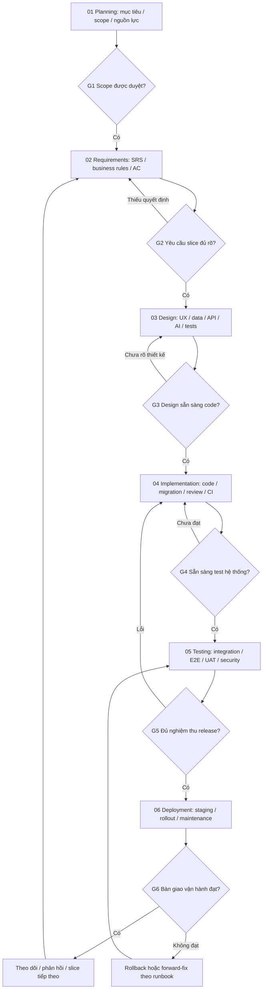

# Nhà Mình — Kế hoạch thực hiện theo SDLC

Ngày lập: 28/10/2026 · Phiên bản kế hoạch SDLC: 1.0 · Đầu vào sản phẩm: V2.2.
**Trạng thái: PROPOSED — kế hoạch để review, chưa phê duyệt triển khai.**
Phạm vi nhiệm vụ hiện tại: lập tài liệu; không sửa code, dữ liệu, migration, dependency hoặc các kế hoạch cũ.

Đọc cùng [Requirements & Traceability Register](SDLC-REQUIREMENTS-TRACEABILITY.md), [Master V2.2](../replanning/V2-MASTER-PLAN-IMPROVED.md), [UX](../replanning/V2-UX-REDESIGN.md), [AI](../replanning/V2-AI-ARCHITECTURE.md), [Backlog](../replanning/V2-IMPROVED-BACKLOG.md), [Decision register](../replanning/V2-REVIEW-COMPARISON.md).

## 1. Cách áp dụng SDLC đúng cho dự án đang có V1

Sáu giai đoạn theo ảnh người dùng: Planning → Requirements Analysis → System Design → Implementation → Testing → Deployment & Maintenance. Đây là mô hình quản lý chọn cho dự án, không phải tuyên bố chỉ có một quy trình SDLC bắt buộc chung cho mọi hệ thống.

Áp dụng **SDLC có gate và triển khai lặp theo vertical slice**: thống nhất mục tiêu chung, sau đó mỗi mốc M1/M2/M3 có yêu cầu, thiết kế, code, kiểm thử và phát hành riêng. Không cần viết xong mọi thiết kế toàn quốc/OCR/tích hợp rồi mới làm phép đo đầu tiên. Security, QA, privacy và vận hành được chuẩn bị xuyên suốt, không chỉ xuất hiện sau khi code xong.

Tài liệu đã có không đồng nghĩa được duyệt: source V1 vẫn tồn tại, V2.2 là đề xuất; chưa có bằng chứng sign-off cho scope/SRS/design/release V2. Vì vậy không đánh dấu đã hoàn tất Planning/Requirements chỉ vì có sơ đồ kiến trúc. Cũng không xóa/làm lại V1 để bắt đầu SDLC.

**Sơ đồ tổng quan trong chat thuộc System Design, mức high-level architecture.** Nó chưa thay thế SRS, thiết kế dữ liệu, API, state machine, sequence, test plan hoặc biên bản duyệt thiết kế. Chỉ những thành phần thuộc slice đã duyệt mới được coi là design baseline để triển khai.

Cơ sở tham khảo: [NIST SP800-218 SSDF1.1](https://csrc.nist.gov/pubs/sp/800/218/final) mô tả các thực hành phát triển an toàn tích hợp vào SDLC; [Microsoft SDL](https://www.microsoft.com/en-us/securityengineering/sdl) mô tả áp dụng thực hành bảo mật cho nhiều mô hình từ waterfall tới DevOps. Kế hoạch này chỉ tham khảo, không tự chứng nhận tuân thủ NIST/ISO hoặc sao chép toàn bộ quy trình doanh nghiệp lớn.

Nếu thay đổi ảnh hưởng yêu cầu, quay lại requirements/design tương ứng; không chỉ sửa code rồi bỏ qua traceability. G1 không đạt thì sửa Planning; không chuyển bước bằng im lặng.

## 2. Project charter rút gọn — bản nháp Planning

### 2.1. Mục tiêu và người dùng

Người dùng: hộ gia đình Việt Nam, chủ hộ/thành viên có quyền khác nhau; quản trị viên quản lý hệ thống/biểu giá. VND, nghiệp vụ theo giờ Việt Nam; code hệ thống đặt trong `website/`.

Mục tiêu đề xuất: giúp người dùng hiểu, quản lý, dự đoán và kiểm tra điện nước bằng ba đường có thể dùng riêng: chỉ số, hóa đơn, ghi nhanh khoản thực tế. Khả năng tính tiền tất định và dữ liệu có nguồn là nền; AI giảm nhập và hỗ trợ giải thích, không quyết định quyền hay tiền.

Kết quả cần đo theo mode, không chỉ một KPI upload: lưu/mở lại baseline đúng; hiểu usage và estimate đủ điều kiện; ghi/mở lại actual có nguồn; phân biệt actual/estimate/user-reported payment; hoàn thành việc đúng quyền; tỷ lệ phải sửa và thời gian nhận giá trị. Target số về thời gian, tải, chi phí chốt sau baseline/pilot, chưa phải cam kết.

### 2.2. Phạm vi dự kiến

Core: auth/hộ/account/meter, chỉ số và interval, calculator/tariff đủ scope, estimate/forecast baseline/anomaly có giới hạn, actual records/nguồn, payment assertion manual, task/reminder, embedded explanation, quyền/version/audit và bảo toàn snapshot.

Theo gate: formats/OCR, public-search, conversation nhiều lượt, reconciliation, correction rộng, export và pilot operations. Optional: what-if nâng cao, budget/digest theo nhu cầu. Chưa đưa vào baseline: API EVN/nước chưa có quyền, bank gateway thật, IoT, custom OCR training, runtime multi-agent, nhà trọ/phân bổ phòng, partial/refund ledger.

Định vị Hybrid và mọi policy D01–D04/R01–R09 còn PROPOSED/DECISION REQUIRED trong V2.2; charter này không tự phê duyệt thay. R01 chọn hướng; R04 xác định nhân lực/hosting/pilot; R08 nghiên cứu/UX.

### 2.3. Ràng buộc, giả định và feasibility

Giữ stack hiện có Next.js/FastAPI/PostgreSQL nếu không có bằng chứng phải thay. Giữ dữ liệu/hành vi đúng V1, không refactor toàn bộ trước tạo giá trị. Không có provider API hoặc corpus chứng từ được giả định là đã sẵn.

Cần kiểm chứng: nhu cầu ba mode, khả năng có dữ liệu giá đúng scope, OCR theo corpus, quyền gửi ngoài/retention, năng lực team, môi trường staging/hosting, ngân sách AI và vận hành. Feasibility có ba outcome: làm với nguồn lực đã xác nhận; thu hẹp capability; hoặc defer phần phụ thuộc ngoài. Không dùng AI bịa dữ liệu để vượt gate.

Chưa có deadline/team/budget đã xác nhận. Lịch hiện là dependency/milestone, không báo giá hoặc lịch tuần cam kết. Sau G1 và spike dữ liệu đã được cho phép mới ước lượng theo capacity/cycle time; buffer cho tích hợp, UAT, migration và pilot được ghi riêng.

## 3. Trách nhiệm và quyền phê duyệt

Vai trò là trách nhiệm đề xuất, chưa phải danh sách nhân sự đã nhận việc. Một người có thể kiêm nhiệm; khi không có reviewer độc lập, báo rõ giới hạn, không giả có hội đồng thực tế.

| Hạng mục | Người làm chính (R) | Người chốt (A) | Người tham gia review |
|---|---|---|---|
| Scope, định vị, ưu tiên, D/R nghiệp vụ | Product/BA | Chủ dự án/Product Owner | Người dùng pilot, tech lead |
| Yêu cầu, glossary, AC, traceability | BA/Product | Product Owner | Domain reviewer, QA, architect |
| UX, data/API/AI architecture | Architect và UX/tech lead | Tech lead về kỹ thuật; PO về tác động nghiệp vụ | QA/security/data |
| Code, migration, CI | Developer | Tech lead/reviewer được chỉ định | QA và người phụ trách dữ liệu |
| Verification và UAT | QA + đại diện người dùng | PO cho UAT; QA lead cho evidence | Developer/security/ops |
| Go/no-go release | Ops/tech lead chuẩn bị | Chủ dự án/release owner được chỉ định | PO/QA/security/data |
| Incident, restore, maintenance | Ops/developer trực được chỉ định | Service/release owner | PO/QA khi tác động dữ liệu |

Không coi assistant có quyền ký duyệt nghiệp vụ, cấp phép gửi ảnh hoặc triển khai production. Quyết định thực cần actor/date/artifact-version/reason trong log; ô chưa có người là chưa được duyệt.

## 4. 01 — Planning

**Đầu vào:** nhu cầu user, PRODUCT, source/test V1 và audit V2.2, evidence/decision register. **Owner:** Product/BA; **approver:** chủ dự án.

- P01: xác định vấn đề, người dùng, giá trị và anti-goals; so measurement/document/hybrid.
- P02: chốt scope release đầu theo mode; nêu rõ core/optional/deferred, tiêu chí thành công.
- P03: kiểm feasibility nguồn giá/format/provider/privacy và stack hiện có; không cài công nghệ mới vì sơ đồ đẹp.
- P04: inventory dữ liệu/code/test/tài liệu đang có; phân biệt hiện có và verified, giữ baseline legacy.
- P05: xác định vai trò/team, năng lực, ngân sách AI/hosting, deadline mong muốn và người duyệt.
- P06: lập risk register, dependency graph, milestone và kế hoạch liên lạc/change control.

**Đầu ra cần duyệt:** charter/scope, feasibility/risk log, milestone/WBS/capacity assumptions, approval responsibilities. Các phần trên là nháp trong tài liệu này; không tạo nhiều file trùng nội dung nếu dự án nhỏ.

**G1:** PO duyệt vấn đề/scope/mục tiêu release đầu, owner/gate rõ; các giả định còn mở được giới hạn và có người xử lý. Không cần duyệt OCR/vendor/PDF để chọn một local measurement slice. Bằng chứng: decision log và phiên bản scope, không phải chỉ lời “cứ làm”.

## 5. 02 — Requirements Analysis

**Đầu vào:** G1 và nguồn nghiệp vụ; **owner:** BA/Product; **approver:** PO/domain owner.

- RA01: khảo sát prior workflow, dữ liệu có thật và pain points; mockup chỉ kiểm hypothesis, chưa đại diện mọi hộ.
- RA02: xác định actors/permission matrix; quyền xem, ghi đo, confirm actual, khai đã trả, gửi ảnh, publish giá riêng.
- RA03: lập FR theo use case, NFR theo quality/risk; mỗi yêu cầu có ID, source/status, priority, AC đo được.
- RA04: business rules cho actual/estimate/payment, interval/unknown, tariff scope/đổi giá, duplicate và correction.
- RA05: use-case spec happy/edge/fallback, pre/post-condition, alternate/error/permission/offline states.
- RA06: data dictionary đầu vào/nguồn/đơn vị/date/null/PII; requirement traceability tới design/task/test.
- RA07: giải quyết decision subset của slice; review ambiguity/conflicts giữa PRODUCT cũ và source OCR, không tự sửa requirement đã xác nhận.
- RA08: baseline SRS phần slice và UAT scenarios; change sau baseline phải phân tích impact.

**Đầu ra:** SRS baselined theo scope, glossary/business-rule register, actor/permission/use-case catalog, RTM và UAT acceptance. [Register hiện tại](SDLC-REQUIREMENTS-TRACEABILITY.md) là nháp để khởi tạo, CHƯA phải SRS được ký duyệt.

**G2:** mọi requirement trong slice có source, định nghĩa input/output/unknown/error, AC và reviewer; không còn D/R chưa chốt làm đổi hành vi slice. Phần ngoài slice có thể còn mở nhưng không có dependency ẩn. Ví dụ M2 observation cần D02/R05/R07, giá D03/D04 chưa chốt không chặn observation nếu release không bật priced estimate.

## 6. 03 — System Design

**Đầu vào:** G2; **owner:** architect/UX/lead; **approvers:** lead và PO cho quyết định nghiệp vụ.

- SD01: system context và high-level architecture, external boundaries, direct API→measurement path không qua AI.
- SD02: module/service responsibilities, capability availability matrix, UI information architecture/wireframes và feedback states.
- SD03: ERD/logical schema, dictionary, constraints, source ownership, revision và retention; không gộp estimate/actual/assertion.
- SD04: API contracts request/response/errors, decimal/date conventions, version/idempotency, auth/context/cache boundaries.
- SD05: state diagrams và sequence theo các luồng chính; transaction/lock/concurrency, correction và stale-derived handling.
- SD06: AI design: orchestration/tool/policy/schema/provenance/slot memory/budget/eval; deterministic math/permission/commit ở server.
- SD07: migration/coexistence/compatibility và rollback/restore design; backup DB/files, no destructive fallback.
- SD08: test design, fixtures, coverage theo requirement/risk và môi trường; testability review trước code.
- SD09: security/privacy design review và failure/deployment/observability design phù hợp scope; không mặc định microservices/broker.

**Đầu ra:** SDD/architecture, UX flow/wireframe, ERD+dictionary, OpenAPI/schema, sequence/state diagrams, ADR, migration strategy, AI/tool contract và test design. Có thể gom trong một design packet cho slice nhỏ thay vì tạo chín tài liệu rỗng.

**G3 — Ready for Development:** yêu cầu→design→task→test mapping đầy đủ, còn mở chỉ là routine implementation choice không đổi nghiệp vụ; contract/ownership/permission/version/error path đã review. Sơ đồ tổng quan chat hiện chỉ đáp ứng một phần SD01, chưa chứng minh G3 đạt. AI không tự đổi requirement để hợp schema.

## 7. 04 — Implementation

**Đầu vào:** G3 của slice, không cần mọi slice tương lai đã thiết kế xong. **Owner:** developer; **approver:** tech lead/reviewer.

- IM01: lập implementation plan task-by-task từ spec, pin acceptance portion của ID backlog cũ; branch/checkout phù hợp và baseline hiện trạng.
- IM02: tạo/chỉnh contract/schema/migration additive có test; không reset DB để vượt lỗi migration.
- IM03: viết regression/acceptance test cho thay đổi rủi ro; tái dùng code đúng, thay hẹp các coupling sai.
- IM04: làm FE/BE/data/AI trong cùng journey, typed API và UI states; không xử lý math/permission bằng prompt.
- IM05: kiểm unit/integration phù hợp, formatter/typecheck/build, code review và kiểm secret/dependency theo scope.
- IM06: cập nhật evidence/RTM/changelog và hướng dẫn chạy; thiếu provider thì dùng fixture có nhãn, không fake feature thành thật.

**Đầu ra:** reviewed code, migration/script cần thiết, tests, build artifact có version, CI result và RTM liên kết commit/PR.

**G4 — Ready for System Test:** journey slice chạy ở test environment, relevant unit/integration+build đạt với log mới, không còn implementation blocker; migration có thử nghiệm phù hợp; test dataset/roles đã chuẩn bị. PR hoặc “code xong” riêng lẻ không đủ. Unit tests được làm ở giai đoạn này, không chờ Phase05 mới bắt đầu QA.

## 8. 05 — Testing & Acceptance

**Đầu vào:** G4, SRS/AC+test design, build version và environment/data được pin. **Owner:** QA; **acceptance:** PO/người dùng đại diện.

- TS01: unit/contract và integration regression theo requirement, gồm Decimal precision, nullable field, source/basis.
- TS02: PostgreSQL separate connections cho transaction/idempotency/revision/revoke/locks; SQLite pass không chứng minh concurrency.
- TS03: migration từ empty+legacy fixtures, source/ID/snapshot/totals theo basis và khả năng đọc sau rollback.
- TS04: E2E đúng checkout: quick-only, measurement-only, document-supported và hybrid theo enabled scope.
- TS05: UX/responsive/keyboard/screen-reader/error/offline/permission, print nếu scope có; không suy từ typecheck.
- TS06: AI task-mode evaluation và mocked provider failures; bounded live smoke chỉ khi có consent/budget. Kiểm số tiền/nguồn/slot/quyền không dùng global accuracy để bù lỗi critical.
- TS07: security/privacy/upload/cache/inflight/cross-house, provider timeout/quota/delete/job-restart; ghi đúng coverage, không gọi test thường là penetration test đầy đủ.
- TS08: load/cost/latency theo workload/máy đã ghi; kiểm backup/restore và job recovery trên môi trường thử nghiệm.
- TS09: UAT do người đại diện nghiệp vụ thực hiện theo scenario, defect triage/fix/retest/regression, ký nghiệm thu đúng build.

**Đầu ra:** test cases/execution report, defect log, coverage/RTM, AI eval report, performance/privacy evidence theo scope, UAT sign-off và known limitations.

**G5 — Ready for Release:** toàn critical requirement và test chặn trong scope đạt; không có known critical lỗi sai hộ/sai tiền/unauthorized write/mất dữ liệu/duplicate financial item; còn lại có severity/owner/residual-risk acceptance rõ. Threshold hiệu năng/eval đã được chốt trước khi đo, không hạ sau để gọi pass. UAT sign-off không thay release authorization G6.

## 9. 06 — Deployment & Maintenance

**Đầu vào:** G5 + release plan/R04 đã duyệt. **Owner:** ops/lead; **go/no-go:** release owner/chủ dự án.

- DM01: staging từ artifact/version đã test, config/secrets/cookie/origins/schema readiness và access thực phù hợp.
- DM02: dry-run migration/backfill với exception report; backup DB+files và restore rehearsal, không chỉ chạy lệnh backup rồi giả restore đạt.
- DM03: release checklist, giới hạn pilot/capability flags, cutover/rollback hoặc forward-fix runbook và người quyết định.
- DM04: go/no-go trước production/pilot có dữ liệu thật; deploy theo cohort, smoke từng role/core journey và quan sát.
- DM05: theo dõi availability/errors/job/scheduler/latency/cost/permission/sensitive logging; khi lỗi chặn thì rollback/forward-fix theo điều kiện đã thống nhất.
- DM06: bàn giao README/runbook/support/known limitations; hướng dẫn user phân biệt actual/estimate/manual payment.
- DM07: vận hành theo cadence đã duyệt: incident/backup/retention/dependency/security updates, model/prompt/data drift; mỗi thay đổi quay lại SDLC phần bị tác động.
- DM08: feedback/pilot metrics theo mode, phân tích lỗi lặp/root cause, cập nhật backlog/requirements thay vì thêm tính năng tự phát.

**Đầu ra:** release record (version/config/schema/flags), smoke/monitoring evidence, runbook/restore evidence, handover, incident/maintenance log và improvement backlog.

**G6 — Operational Handover:** sau deploy, đúng cohort/flags, smoke+monitoring đạt cửa sổ đã chọn, access/backup/restore/support owner rõ, known limitations được công bố; không tự nhận production-ready toàn hệ thống. Go/no-go trước deploy và handover sau deploy là hai quyết định khác nhau.

Chưa chốt mục tiêu RPO/RTO, kênh alert, support hours và maintenance cadence: phải quyết định theo R04 trước go-live tương ứng, không tự gán SLA 24/7. Nếu không có ops riêng, chỉ định người kiêm nhiệm trước release.

## 10. Ánh xạ sáu phase với roadmap M0–M6 V2.2

Mốc M không phải tên phase SDLC; một mốc phải đi qua requirements/design/build/test/release tương ứng. Không đổi 20 task ID hoặc nghĩa D01–D04/R01–R09.

| Mốc sản phẩm | Scope SDLC cần đi qua | Gate quyết định chủ yếu | Outcome nghiệm thu |
|---|---|---|---|
| M0 | Planning+Requirements baseline và legacy risk characterization | R01/R08/R04 theo phần cần chốt | Scope/journey/evidence có thể dùng lập spec |
| M1 | RA→Design→Implement→Test→Release quick actual/payment | D01/D02 report/R05/R07 minimal; R09 cho nhắc | Không OCR/meter/tariff vẫn ghi/mở lại actual, manual-paid có sửa nhầm |
| M2A/B | RA→Design→Implement→Test→Release observations/usage | D02/R05/R07 minimal; shared identity | Lưu dated baseline; hai mốc hợp lệ có usage, thiếu giá không mất data |
| M2C | Chu trình riêng cho priced estimate | D03/D04+tariff coverage, không full admin UI | Calculator/snapshot đúng scope, thiếu policy thì pending |
| M3 | Chu trình documents/extraction/review | Record seam+R02/R03/R05/R06 | Supported format có corpus evidence, job/delete/private review đúng |
| M4 | Chu trình reconciliation | Cặp actual và interval/estimate, D01/D02/comparability | So đúng source/version, thiếu→NOT_COMPARABLE |
| M5 | Chu trình conversation/enriched event insights | Nguồn có quyền+R02/R03/R09 khi áp dụng | Hiểu context, dedupe/cooldown/budget, no unsupported conclusion |
| M6 | Chu trình broad lifecycle/ops/pilot mở rộng | R04/R07/R02 theo enabled scope | Migration/restore/retention/support đủ bằng chứng |

Critical path theo mode: G1→G2(slice)→G3(slice)→G4→G5→go/no-go→G6. M1 và M2 dùng chung identity/security nhưng không buộc nhau xong; M3 không gate M2. Chỉ việc tính tiền cần nguồn giá, không observation. Lịch nguồn lực/parallel chỉ quyết sau R04; hiện không cam kết sprint/tuần.

## 11. Artifact register — tài liệu nào đã có, tài liệu nào còn phải làm

| Artifact | Tình trạng tại 28/10/2026 | Nơi có hoặc nơi sẽ lập | Phase / người chốt |
|---|---|---|---|
| SDLC plan / draft charter | Được tạo ở nhiệm vụ này; PROPOSED | Tài liệu này | Planning / PO |
| Requirement register / RTM khởi tạo | Được tạo ở nhiệm vụ này; chưa approved SRS | SDLC-REQUIREMENTS-TRACEABILITY.md | Requirements / PO |
| Master/UX/AI/backlog/comparison V2.2 | Existing proposal, không sign-off | docs/replanning/V2-*.md | Đầu vào Planning/RA/Design |
| PRODUCT | Existing confirmed context, có drift OCR cần review | PROJECT_ROOT/PRODUCT.md ở thư mục cha website | Requirements / PO |
| SRS slice và use-case/permission/business rules | Cần baseline cho slice chọn; không giả đã hoàn tất | Đề xuất docs/sdlc/slices/<slice>/requirements.md | Requirements / PO |
| Design packet+ADR/API/data/sequence/AI testability | Existing V2.2 chỉ là nền; chi tiết slice cần review | Đề xuất docs/sdlc/slices/<slice>/design.md | Design / lead+PO |
| Test plan/cases/fixtures/UAT scenarios | Acceptance draft có trong backlog; execution mới chưa có | Đề xuất docs/sdlc/slices/<slice>/test-plan.md | Design/Testing / QA+PO |
| Implementation plan/PR/build evidence | Future, không làm trong nhiệm vụ này | docs/sdlc/slices/<slice>/implementation-plan.md + CI/PR refs | Implementation / lead |
| Test/UAT report/defect log | Future cho build V2 đã chọn | docs/sdlc/slices/<slice>/verification.md | Testing / QA+PO |
| Release/restore/runbook/handover | Future, yêu cầu vận hành đã được đề xuất | docs/sdlc/slices/<slice>/release.md | Deployment / release owner |
| Decision/change log | D/R register V2.2 có đề xuất; cần actor/date/version khi duyệt | Decision register V2.2 + log slice, không copy đổi nghĩa ID | Mọi phase / owner liên quan |

Các đường dẫn future không phải file đã tạo. Không sinh folder/file rỗng để giả đủ hồ sơ. Dự án nhỏ có thể gom requirement/design/test/release vào một slice packet có sections rõ; vẫn phải có evidence và người duyệt thật.

## 12. Traceability, thay đổi và Definition of Ready/Done

Chuỗi bắt buộc: Need → Requirement ID → Business rule/decision → Design ref → Task ID/commit → Test case → Execution evidence → UAT → Release. Link RTM phải là evidence đúng version, không dấu check không có log.

Khi user đổi scope hoặc phát hiện source khác tài liệu: ghi Change Request với lý do, requirement bị tác động, data/API/UI/AI/tests/privacy/migration/cost, owner và quyết định; update source-of-truth và rebaseline phần cần. Không dùng change log để âm thầm đổi D/R IDs; nếu reject thì ghi lý do và giữ lịch sử.

**Ready for code (G3):** requirement được duyệt, policy liên quan đã chốt, contract/state/error/null/permission rõ, design và tests có thể thực hiện, không dependency giấu. **Done implementation (G4):** reviewed code+tests/build+docs đúng task. **Accepted (G5):** system/UAT/risk gates đạt. **Released/operational (G6):** deployed và handover evidence đạt. Bốn trạng thái không thay cho nhau.

Review cadence đề xuất: review mỗi slice trước code, demo theo outcome, defect/risk triage trong iteration, go/no-go trước release và đánh giá pilot theo kỳ phù hợp. Con người và lịch cụ thể cần R04, không tự đặt hẹn/automation.

## 13. Việc nên làm ngay tiếp theo — chưa triển khai

1. Review charter/scope và chọn outcome đầu M1 actual hoặc M2 observation/usage, có thể cả hai nếu capacity đủ.
2. Gán PO/domain/lead/QA/release responsibilities; xác nhận deadline/budget/hosting để ước lượng có cơ sở.
3. Hoàn thiện SRS và rules/permissions của slice từ register, giải quyết decision subset, baseline G2.
4. Hoàn thiện design packet: kiến trúc+ERD+API+sequence/state+UX+test design, review G3.
5. Chỉ sau đó chuyển task V2.2 tương ứng thành implementation plan và thực hiện khi có lệnh triển khai.

Nguồn/giới hạn: dựa kế hoạch V2.2 ngày27/10 và context hiện tại, chưa chạy runtime tests hay kiểm tra UI mới ở lượt28/10. Test pass lịch sử, ảnh SDLC và sơ đồ kiến trúc không chứng minh gate V2 đã được thông qua. Đây là kế hoạch có kiểm soát đầu ra, không tuyên bố dự án đã đạt chuẩn chứng nhận.
